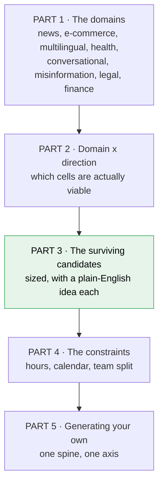
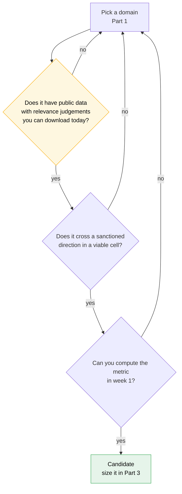
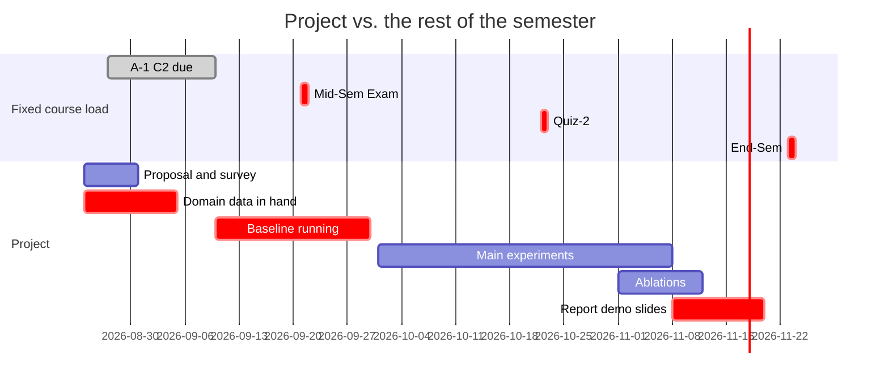
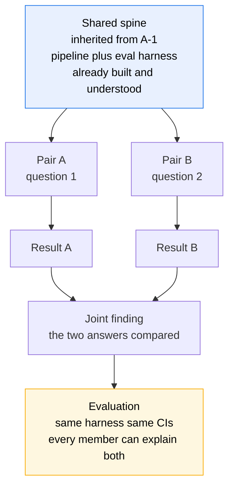
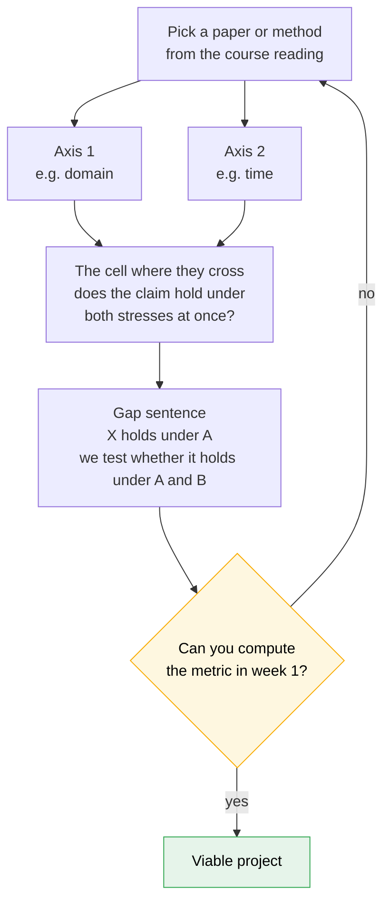

# Term project — domains, directions & expected work

Working notes for [[IRE-Term-Project]]. **Proposal + literature survey is due 2026-08-31** — four
weeks before the problem must be finalised, so the choice made here is revisable, not binding.

The file is organised the way the decision is actually made: **pick the domain first** (what kind of
documents and users you want to work on), *then* pick the project type inside it. Choosing a technique
before a domain is how teams end up with a method looking for a corpus.

> [!important] What the course is actually grading
> *"Depth and rigor of the study, not breadth"* · *"one hard, possibly open-ended question or a
> complex engineering system"* · *"explore & evaluate competing solutions in depth."*
>
> The unit of value is a **comparison that resolves a question**, not a system that exists. A narrow
> question answered with ablations and CIs beats a broad system demoed once.

## How to read this file

**Read it as:** Parts 1–2 narrow the space, Part 3 is where the actual project candidates live, and
Parts 4–5 are the reality check you apply to whatever you picked. If you only read one part, read 3.

## The five constraints that rule out most ideas

**1. It must finish by 20 Nov with a working evaluation.** Not a prototype — the deliverable is
"completed investigation with ablations, evaluation, scaling discussion." Anything whose *baseline*
isn't running by 30 Sep is too big.

**2. Free-tier GPU.** Same compute budget as A-1: Colab/Kaggle/Lightning. That rules out pre-training,
large-scale fine-tuning, and anything needing more than a few GPU-hours per experiment.

**3. Evaluation is individual.** Whatever the team builds, you must be able to explain any part of it
under questioning. Avoid a split where you own one module and understand nothing else.

**4. There are ~7 genuinely usable weeks, not 11.** The calendar says 31 Aug → 20 Nov, but A-1 C2
(10 Sep), the mid-sem (21 Sep), Quiz-2 (22 Oct), end-sem revision and one week of un-itemisable
slippage take four of them. That leaves ≈ **165 research-hours** across four people — see
[[#Part 4 · Sizing the work]] for the derivation. Every idea below is sized against that number, not
against what's intellectually appealing.

**5. AI assistants are encouraged — and they compress the plumbing, not the thinking.** They cut
loader/boilerplate cost (so domain entry lands at the *low* end of its range) but not the design,
diagnosis or viva-readiness that is actually graded. See
[[#What AI assistants change, and what they don't]].

> [!important] The domain choice is mostly a cost decision
> A-1 hands you a working pipeline over **news** (MIND English, EB-NeRD Danish) with an evaluation
> harness and bootstrap CIs by 10 Sep. Staying in news costs ~0 hours of setup. Every other domain
> costs **20–40 hours** to enter: new corpus, new loader, new relevance judgements, new sanity checks.
>
> Out of ~165 research-hours (Part 4), 30 spent on plumbing is **18% of the project** spent before a
> single experiment runs. That is sometimes worth it — a new domain can supply a question news cannot
> — but it must be a decision, not a drift.

---

# Part 1 · The domains

Six domains, each with the retrieval problem that is *native* to it — the thing that makes generic IR
underperform there. That native difficulty is where the questions come from.

> [!warning] Verify every corpus before committing
> Checked August 2026, but licences change, download links rot, and "public" sometimes means
> "public after a signed agreement". **Download the data in week 1**, before the proposal locks. A
> corpus you cannot actually obtain is the single most expensive way for this project to fail.

## 1 · Health & biomedical

**The broad idea:** people ask health questions in everyday words; the documents answering them are
written in clinical and research language. Retrieval has to cross that gap, and being wrong matters
more here than anywhere else.

| | |
|---|---|
| **Native difficulty** | **Vocabulary mismatch** — "heart attack" vs. "myocardial infarction". Lexical retrieval fails on exactly the queries users type. Also: evidence quality varies enormously, and a confidently-retrieved wrong answer is a harm, not just an error |
| **Corpora** | **NFCorpus** (nutrition queries → PubMed abstracts, small, in BEIR) · **TREC-COVID** (COVID literature, full qrels) · **BioASQ** (biomedical QA + semantic indexing) · **SciFact** (1.4k expert claims + supporting/refuting abstracts) |
| **Licence** | The BEIR-packaged versions are **cc-by-sa-4.0** and download without registration — this is the cheapest serious domain to enter |
| **Evaluation** | Strong. Real qrels, and **BioASQ runs as a CLEF 2026 lab** — Task b (QA), Task Synergy (two-week rounds from Jan 2026, expert feedback loop), plus clinical-summarisation and IE tasks |
| **Cost from A-1** | **~20 hrs.** BEIR's format is uniform and small; NFCorpus is genuinely tiny. Your retrievers port over; only the loader and the query set change |
| **The trap** | Domain expertise you don't have. You cannot judge whether a retrieved abstract actually answers a clinical question, so **do not build anything requiring you to create medical relevance labels** — use the existing qrels and study the *retrieval* behaviour |

> [!tip] Why this is the strongest non-news domain
> Vocabulary mismatch is a **measurable, well-posed** phenomenon: it predicts exactly where BM25 loses
> to dense retrieval, and it lets you slice results by how much query and document vocabulary overlap.
> That slicing is a real diagnosis, needs no medical training, and runs on a laptop.

## 2 · Finance

**The broad idea:** the answer to a financial question is usually a number buried in a 200-page filing,
often inside a table, and it's only correct for one specific company in one specific quarter.

| | |
|---|---|
| **Native difficulty** | **Numbers, tables and long documents.** The unit of retrieval isn't a passage of prose — it's a table cell in a 10-K. Retrieval must also be *precisely* scoped in time and entity: the right number for the wrong quarter is simply wrong |
| **Corpora** | **FiQA-2018** (financial opinion QA, in BEIR, cc-by-sa-4.0) · **FinanceBench** — but note the size below · SEC filings themselves are public via EDGAR |
| **Licence** | ⚠️ **FinanceBench's public subset is only 150 annotated examples**; the full 10,231-question benchmark is **licence-gated** (contact Patronus AI). 150 items is too few for a comparison with meaningful CIs |
| **Evaluation** | **Weakest of the six.** No long-running shared task with public qrels at the scale you need. You would largely be building your own evaluation |
| **Cost from A-1** | **~35–40 hrs.** PDF/table parsing is genuinely hard engineering, and it is *not* IR — it's the part that eats the schedule |
| **The trap** | You spend the project writing a table extractor and never get to a retrieval question. This is the domain where the plumbing most reliably swallows the research |

> [!warning] Attractive, and mostly a trap at this budget
> Finance sounds impressive and has obvious real-world pull, but it fails the two constraints that
> matter: **the public evaluation data is too small**, and **the parsing cost is too high**. Pick it
> only if someone on the team already has a working filings/table pipeline. Otherwise the 150-item
> ceiling means you cannot report a number with a defensible CI.

## 3 · Legal

**The broad idea:** a lawyer wants the earlier cases that support the argument they're making now. The
"query" isn't a few words — it's a whole case, and relevance means *legal* relevance, not similar
wording.

| | |
|---|---|
| **Native difficulty** | **Document-as-query, and recall matters more than precision.** Missing a controlling precedent is malpractice; one extra irrelevant case is an annoyance. That inverts the usual metric priority. Documents are also very long and citation-linked |
| **Corpora** | **COLIEE** — Task 1 case-law retrieval over **Federal Court of Canada** decisions (English), Task 3 statute retrieval over the **Japanese Civil Code** · **LeCaRDv2** (Chinese case retrieval) |
| **Licence** | COLIEE data is distributed to participants; ⚠️ **registration for 2026 has closed** (Task 4 submissions were extended to 18 Mar 2026, papers to 5 Apr 2026), so this is a **past-cycle task** — confirm what remains publicly downloadable before relying on it |
| **Evaluation** | Good *if* you get the data — real qrels and published overview-paper numbers to compare against, going back years |
| **Cost from A-1** | **~30 hrs**, plus data-access risk. English Task 1 is the only realistic entry point unless someone reads Japanese |
| **The trap** | Long documents blow up your embedding budget, and legal relevance is genuinely expert-defined — you cannot sanity-check a ranking yourself the way you can with news |

> [!note] The interesting angle if you go here
> **Recall-oriented evaluation.** Almost every method in this course is tuned for precision at the top
> of the ranking. Legal retrieval wants high recall at depth, and asking *"which of these methods
> survives being scored on recall@500 instead of nDCG@10?"* is a sharp, cheap question — a re-scoring
> exercise, not a new system.

## 4 · News & recommendation — the incumbent

**The broad idea:** you already have this one built. Given who a user is and what they've clicked,
pick which of today's articles to show them.

| | |
|---|---|
| **Native difficulty** | **Everything decays.** Documents arrive continuously, yesterday's model is stale, cold-start users are the majority, and popularity feedback loops distort the logs you learn from |
| **Corpora** | **MIND** (English, Microsoft) · **EB-NeRD** (Danish, RecSys Challenge 2024) — *already downloaded, split and indexed by A-1* |
| **Licence** | Already obtained for A-1 |
| **Evaluation** | Excellent, and already wired up: your own harness, bootstrap CIs, two Codabench leaderboards, plus published RecSys-Challenge overview numbers |
| **Cost from A-1** | **~0 hrs.** This is the entire argument for it |
| **The trap** | Novelty. "We did more experiments on the assignment dataset" needs a *sharp question* to become a project — the domain gives you no free credit |

> [!tip] The bilingual property is the hidden asset
> MIND is English, EB-NeRD is Danish. **Almost nothing in the literature reports the same design on a
> high-resource and a low-resource language with the same pipeline** — and you have exactly that, for
> free. Most of Part 3's strongest candidates exploit it.

## 5 · E-commerce & product search

**The broad idea:** someone types "cheap running shoes" into a shop. The system has to work out that
they mean a *category* of thing, not a phrase to match — and then decide whether a near-miss (a walking
shoe, a more expensive running shoe) is a useful result or a wrong one. Unlike every other domain here,
"relevant" isn't yes/no: a substitute is *partly* right, and that partial rightness is worth money.

| | |
|---|---|
| **Native difficulty** | **Relevance is graded, not binary, and the grades mean different business things.** A substitute product is a legitimate result; an irrelevant one is a lost sale. Queries are also extremely short, riddled with brand names and typos, and heavily head-tailed — a few queries are enormously frequent and the long tail is where systems fail |
| **Corpora** | **Amazon ESCI / Shopping Queries Dataset** — 130,652 queries and **2,621,738 human judgements** on a 4-way scale (**E**xact, **S**ubstitute, **C**omplement, **I**rrelevant); a reduced version has 48,300 queries / 1.1M judgements |
| **Licence** | **Apache-2.0**, distributed as **parquet** — the same format A-1's feature store already uses |
| **Evaluation** | **Excellent.** Three defined tasks (query-product ranking, ESCI classification, substitute identification) with **published baselines** — nDCG 0.83 on Task 1, macro-F1 0.23 / micro-F1 0.62 on Task 2 |
| **Languages** | **English, Spanish, Japanese** — a three-way resource contrast, wider than A-1's En/Da pair |
| **Cost from A-1** | **~15 hrs — the cheapest non-news domain on this page.** Parquet in, graded judgements given, no PDF parsing, no label creation |
| **The trap** | The 4-way scale tempts you to collapse it to binary "relevant/not" so your existing nDCG code works. **That throws away the only interesting thing about the domain** |

> [!important] The novel angle nobody reports: what does your metric do with a substitute?
> Every metric in this course assumes relevance is a single number. ESCI gives you four *semantically
> distinct* grades, and **how you map them to gains is a free design decision that nobody justifies.**
> Is a Substitute worth 0.5 of an Exact? 0.1? Does the system ranking change when you move that dial?
>
> That is a genuinely under-reported question, costs nothing but re-scoring runs, and it is exactly the
> course's "there is no one-size-fits-all" spine made concrete. **Task 2's macro-F1 of 0.23 against
> micro-F1 of 0.62** is the tell: the rare grades are being predicted badly and aggregate metrics hide it.

## 6 · Multilingual & low-resource retrieval

**The broad idea:** search engines are built and tested in English, then deployed in languages with a
hundredth of the training data. A-1 already gave you a taste of this — MIND is English, EB-NeRD is
Danish — and this domain is that comparison done properly, across languages that differ by orders of
magnitude in available resources.

| | |
|---|---|
| **Native difficulty** | **The methods themselves are language-biased.** Tokenisers fragment morphologically rich languages; pretrained encoders saw 1000× more English than Swahili; BM25's assumptions break on languages without whitespace word boundaries. A design that "works" may only work in English |
| **Corpora** | **MIRACL** — **726k human relevance judgements** over **78k queries** across **18 languages** on Wikipedia, all annotated by **native speakers** (~5 person-years of annotation) · Mr. TyDi · the multilingual BEIR variants |
| **Licence** | Available via HuggingFace with topics and qrels per language; ⚠️ confirm the per-language licence before use |
| **Evaluation** | **Strong and unusually trustworthy** — native-speaker judgements, not translations or auto-derived labels, which is rare and is the whole value |
| **Cost from A-1** | **~20 hrs.** Your multilingual encoder and retrievers already exist for EB-NeRD; you are swapping the corpus and adding languages, not rebuilding |
| **The trap** | You can't read most of the languages, so you cannot eyeball a ranking to sanity-check it. **Compensate with per-language slices and never debug by inspection** |

> [!important] This is the strongest *generalisation* domain, and it directly extends A-1
> A-1 forces you to run one design over a high-resource and a low-resource language. MIRACL turns that
> accidental two-point comparison into a **proper curve across 18 languages spanning three billion
> speakers** — so "does this technique's advantage shrink as language resources shrink?" becomes
> answerable with a trend line instead of an anecdote.
>
> Almost nothing in the literature reports the *slope* of that relationship. It needs no GPU beyond
> A-1's, no new labels, and every result carries a bootstrap CI from code you already wrote.

## 7 · Misinformation & fact-checking

**The broad idea:** a claim circulates online — "study shows X causes Y". To check it you must find the
*specific source* it's distorting, which the post never links to. Retrieval here isn't about finding
something topically similar; it's about finding the one document that settles the question, and being
wrong has consequences.

| | |
|---|---|
| **Native difficulty** | **Retrieval-for-verification, not retrieval-for-relevance.** A topically-similar paper is useless — you need the *cited* one. Evidence must also be able to *refute*, not just match, so a system that retrieves agreeable-looking text is actively harmful. Claims are short, informal and often deliberately vague; sources are formal and precise |
| **Corpora** | **CLEF CheckThat! 2026** — Task 1 *source retrieval for scientific web claims* (find the paper a social post implicitly references; **English, German, French**), Task 2 *numerical claim fact-checking* (**Arabic, English, Spanish**), Task 3 *generating fact-checking articles* · **SciFact** · FEVER / Climate-FEVER (in BEIR) |
| **Licence** | CheckThat! data is distributed to participants; ⚠️ verify access — the 9th edition ran at CLEF 2026 and **prior editions' data is the reliable route** |
| **Evaluation** | Good. Real annotations, published overview papers per edition, and **explicit refutation labels** in SciFact/FEVER |
| **Cost from A-1** | **~25 hrs.** Retrievers port; the claim-to-evidence framing and the refutation handling are the new work |
| **The trap** | Slipping from "does the evidence support this claim?" (answerable) into "is this claim true?" (not your job, and not verifiable at your budget) |

> [!important] Where the genuinely novel requirement is: retrieving *disagreement*
> Every ranker in this course is trained to retrieve documents that are *similar* to the query. Fact-
> checking needs the opposite capability — the document that **contradicts** the claim is the most
> valuable result, and dense retrievers are structurally bad at this because contradiction and
> paraphrase look nearly identical in embedding space.
>
> "Do dense retrievers systematically under-retrieve refuting evidence compared to supporting evidence,
> and does BM25 do better?" is a sharp, cheap, well-posed question. **SciFact ships supporting *and*
> refuting labels**, so you can measure it directly — and a positive finding is a real contribution.

## 8 · Conversational assistants & QA

**The broad idea:** people don't search in one shot anymore — they ask, get an answer, then say "what
about the cheaper one?". That follow-up is meaningless on its own: the system has to carry context
forward. This is the domain the course's direction 1 and direction 2 were written for.

| | |
|---|---|
| **Native difficulty** | **The query is incomplete by design.** Follow-ups rely on ellipsis ("and the cheaper one?"), coreference ("does *it* ship free?") and topic shift. The retriever receives a fragment; the *conversation* holds the need. Doing well also requires deciding what to carry forward and what to forget |
| **Corpora** | **QReCC**, **TopiOCQA**, **TREC CAsT** (conversational passage retrieval with human rewrites) · **TREC User Simulation** track framing · RecSys Challenge 2026 Music-CRS (TalkPlayData) for the recommendation flavour |
| **Licence** | QReCC/TopiOCQA/CAsT are public research datasets; ⚠️ verify current mirrors |
| **Evaluation** | **Strong, and unusually convenient** — CAsT-style datasets ship **human-written rewrites**, which give you a *ceiling* to measure against, not just a baseline |
| **Cost from A-1** | **~20 hrs.** Retriever and harness port directly; the rewriter is a new component but inference-only |
| **The trap** | The project becomes prompt-engineering an API call with no systems or measurement content |

> [!important] The oracle ceiling is what makes this domain rigorous, and most work ignores it
> Because human rewrites are provided, you can measure three points, not two: **raw conversation →
> automatic rewrite → human rewrite (the ceiling)**. That tells you *how much of the achievable gain
> your rewriter actually captured* — a far stronger claim than "rewriting helped".
>
> The under-reported refinement: **report per-phenomenon recall** — ellipsis vs. coreference vs. topic
> shift separately. Aggregate numbers hide which conversational phenomenon is actually breaking
> retrieval, and that breakdown converts a wrapper into a diagnosis.

## How much data is actually out there, by domain

> [!important] Raw volume and *usable* data are different things — and the second is what matters
> Every domain here has effectively unlimited raw text online. What a retrieval project needs is
> narrower: **documents paired with queries and relevance judgements**. A corpus of ten million
> documents with no qrels gives you nothing to measure against; 5k documents with real judgements
> gives you a project.
>
> So the two columns below are separate on purpose, and **the labelled column is the one that decides
> viability.** Finance is the worked example of why: SEC EDGAR is enormous and completely free, yet
> the domain is still the weakest option on this page.

| Domain             | Raw text available online                                                                     | **Labelled queries + qrels**                                                       | Verdict                                             |
| ------------------ | --------------------------------------------------------------------------------------------- | ---------------------------------------------------------------------------------- | --------------------------------------------------- |
| **E-commerce**     | Large — product catalogues are semi-public; ESCI ships its own                                | **Outstanding — 2.6M human judgements**, 4-way graded, 3 languages, Apache-2.0     | **Best labels-per-hour on this page**               |
| **Multilingual**   | **Vast** — Wikipedia in 300+ languages, CommonCrawl                                           | **Excellent — 726k native-speaker judgements**, 78k queries, 18 languages (MIRACL) | Deepest *trustworthy* labels                        |
| **Health**         | **Vast** — entire PubMed abstract corpus is free bulk-download (~30M+ abstracts), CORD-19     | **Good** — BioASQ (years of it), TREC-COVID, NFCorpus, SciFact                     | Big *and* labelled; a safe second domain            |
| **Conversational** | Moderate — dialogue is expensive to collect, so corpora are curated not scraped               | **Good** — QReCC, TopiOCQA, CAsT, **with human rewrites as an oracle ceiling**     | Small but exactly fit for purpose                   |
| **Misinformation** | **Vast** — social posts, claim archives, fact-check sites                                     | **Good** — CheckThat! editions, SciFact, FEVER, **with refutation labels**         | Labels encode disagreement — rare and useful        |
| **News**           | **Large but access-gated** — you have MIND + EB-NeRD; fresh news at scale needs APIs/licences | **Excellent** — impression logs *are* the labels, already split                    | Modest corpus, best labels, zero cost               |
| **Legal**          | **Large** — court opinions are public record (CourtListener, national portals)                | ⚠️ **Access risk** — COLIEE 2026 closed; verify what's downloadable                | Data exists; the *judgements* are the bottleneck    |
| **Finance**        | **Vast** — SEC EDGAR is complete, free and bulk-accessible                                    | ⚠️ **150 public items** (FinanceBench); rest licence-gated                         | **The cautionary case: huge corpus, no evaluation** |

**The pattern:** raw volume is never the constraint at this budget — you couldn't index 30M PubMed
abstracts on free-tier GPU anyway, and you don't need to. **Labels are the constraint**, and they come
almost exclusively from shared tasks and benchmark suites.

> [!important] The two domains that dominate on data
> **E-commerce (ESCI)** and **multilingual (MIRACL)** are in a different class from everything else
> here: 2.6M and 726k *human* judgements respectively, both downloadable today without registration,
> both with the labels pre-attached to the corpus. Compare that to finance's 150 public items.
>
> This matters more than it looks. **The scarce resource in this project is labelled data you didn't
> have to make**, and these two hand you more of it than you can use — which converts labelling hours
> into experiment hours.

> [!tip] Which is why challenges are the practical source of data
> Nearly every labelled collection above reaches you *through* a competition or benchmark: BEIR
> packages NFCorpus/TREC-COVID/FiQA/SciFact in one uniform format, BioASQ and CheckThat! publish years
> of cycles, TREC ships qrels going back decades. **A shared task is usually the cheapest way to
> obtain good data, not just a way to get a metric** — and a closed task is fine for this, since its
> data and scorer outlive its deadline. See [[#Anchoring on a shared task]].
>
> Practical consequence: **shop for the dataset in the task lists, not on the open web.** Scraping
> your own corpus means creating your own relevance judgements, which the budget forbids.

> [!note] You will use a subset regardless
> Whatever the domain, you will sample down to something indexable on free-tier compute — typically
> 10k–200k documents. That makes "vast" a *convenience* (you can pick a slice, and scale is a free
> experimental axis) rather than a requirement. It also means **corpus size is a variable you control**,
> which is what makes the scale axis in Part 5 cheap to run.

## The domains, compared

| Domain | Entry cost from A-1 | Eval quality | Labelled data | Native question it hands you |
|---|---|---|---|---|
| **News** | **~0 hrs** | Excellent | Yes — in hand | What decays, and who is it failing? |
| **E-commerce** | **~15 hrs** | **Excellent + baselines** | **2.6M graded** | What is a "partly relevant" result worth? |
| **Multilingual** | ~20 hrs | Strong (native speakers) | **726k, 18 langs** | Does the advantage shrink as resources shrink? |
| **Health** | ~20 hrs | Strong | Large | Vocabulary mismatch: when does lexical lose? |
| **Conversational** | ~20 hrs | Strong (oracle ceiling) | Moderate | How much of the achievable gain do we capture? |
| **Misinformation** | ~25 hrs | Good (refutation labels) | Good | Can retrievers find *disagreeing* evidence? |
| **Legal** | ~30 hrs + access risk | Good if obtained | ⚠️ registration closed | Recall at depth, not precision at top |
| **Finance** | ~35–40 hrs | **Weak** | ⚠️ **150 public items** | Numbers and tables — but you'll never reach it |

> [!important] The honest reading of this table
> **News + one second domain** is the right shape. News is free and already working; a second domain
> turns "more experiments" into a **generalisation claim**, which is what the rubric rewards.
>
> **E-commerce is now the best second domain** — cheapest entry (parquet, no parsing), the most labels
> by an order of magnitude, published baselines to compare against, *and* a native question no other
> domain here can pose. Multilingual is the best if you want to extend A-1's En/Da contrast into a real
> trend. Health remains the safe choice.
>
> Finance and legal are the two to decline, for opposite reasons: finance has a vast corpus but no
> usable public evaluation, legal has an access problem. Say so in the proposal if asked — *knowing why
> you rejected a domain is itself a graded design decision.*

---

# Part 2 · Domain × direction — which cells are viable

The course names five acceptable directions (`_syllabus.md`): conversational search with query
rewriting · long-term memory for search/recommendation agents · generative retrieval (DSI-lite) · RAG
evaluation frameworks · standing-query web monitoring. **Your project must sit in one of those cells.**

Crossing six domains with five directions gives 30 cells. Most are not viable at 165 hours.

| | 1 · Conversational | 2 · Memory | 3 · Generative retr. | 4 · RAG eval | 5 · Change detect. |
|---|---|---|---|---|---|
| **News** | ✅ strong | ✅ strong | ⚠️ compute | ✅ strong | ✅ **best cell** |
| **E-commerce** | ✅ **best cell** | ✅ strong | ⚠️ compute | ⚠️ thin — no answers to ground | ⚠️ catalogue churn |
| **Multilingual** | ⚠️ thin dialogue data | ⛔ no sessions | ⚠️ compute | ✅ strong | ⛔ static corpus |
| **Health** | ✅ strong | ⛔ no sessions | ⚠️ compute | ✅ **best cell** | ⛔ static corpus |
| **Conversational** | ✅ **best cell** | ✅ **best cell** | ⛔ | ✅ strong | ⛔ |
| **Misinformation** | ⚠️ | ⛔ | ⛔ | ✅ **best cell** | ⚠️ claim spread over time |
| **Legal** | ⛔ no dialogue data | ⛔ | ⛔ docs too long | ⚠️ grounding angle | ⛔ |
| **Finance** | ⚠️ | ⛔ | ⛔ | ⚠️ 150 items | ⛔ |

**Legend:** ✅ viable and well-supported · ⚠️ possible but has a named problem · ⛔ don't

Reading the grid: **direction 3 (generative retrieval) is compute-blocked everywhere** — it trains a
model, and free-tier GPU is the binding constraint. **Directions 1 and 4 are the most portable** across
domains. **Direction 5 needs a corpus that actually changes**, which now leaves news as its only clean
home. **Direction 2 (memory) needs multi-session users**, which only news, e-commerce and the
conversational corpora actually have.

**Read it as:** three gates, and the loop back to the start is the important arrow — a domain that
fails any gate is rejected now, in ten minutes, rather than in week five.

## Anchoring on a shared task

A-1 is not a made-up exercise — it *is* the **RecSys Challenge 2024** (EB-NeRD) plus the **MIND**
leaderboard, wrapped in a course brief. Repeat that pattern: a shared task hands you three things a
term project usually spends a month inventing.

| A shared task gives you | Why it matters here |
|---|---|
| A curated dataset with a **fixed split** | The leakage boundary is decided by the organisers, not argued about in week 3 |
| An **official metric** and scorer | Phase 1's "metric is named and computable" box ticks itself |
| Published **baselines + overview paper** | Your survey has a spine, and your gap is stated against real numbers |
| **Other teams' results** on the same split | Your number means something — the rarest property of a student project |

> [!warning] The trap: rank is not the deliverable
> The same rule as A-1 applies — *grading is never on leaderboard rank*. A shared task is scaffolding
> for a question ("does X hold when assumption A is violated?"), not the question itself.
>
> **Use the task's data and metric; supply your own question.**

### You do not need the competition to be open

Most tasks below have deadlines outside 31 Aug → 20 Nov. That's fine and it's the normal way to use
them: **run against a closed task's public data and official scorer, and compare to the published
overview paper's numbers.** You lose the leaderboard submission and keep everything that was actually
valuable. Only register live if the dates genuinely fit — a competition deadline landing mid-October
competes with your own Phase 3, and the course deadline is the one that's graded.

### Tasks worth building on, by domain

**Each row is a data source first and a metric second** — this is where the labelled collections in the
volume table above actually come from.

| Domain | Task | What data it ships | Status as of Aug 2026 | Direction |
|---|---|---|---|---|
| **News** | RecSys Challenge 2024 (EB-NeRD) | Impression logs + articles, Danish | Closed; **A-1 already builds it** | all |
| **News** | RecSys Challenge 2026 — Music-CRS | TalkPlayData: multi-turn dialogue + track ranking | Conference 28 Sep–2 Oct 2026 | 1, 2 |
| **E-commerce** | **Amazon ESCI / Shopping Queries** | **2.6M graded judgements**, 130k queries, En/Es/Ja, parquet, Apache-2.0, published baselines | **Open, no registration** — download today | 1, 2, 4 |
| **Multilingual** | **MIRACL** | **726k native-speaker judgements**, 78k queries, **18 languages** over Wikipedia | Open via HuggingFace; ⚠️ check per-language licence | 4, and any |
| **Health** | **BioASQ** at CLEF 2026 | Biomedical QA pairs + PubMed-scale corpus; **many past cycles reusable** | Synergy ran two-week rounds from Jan 2026 | 1, 4 |
| **Misinformation** | **CLEF CheckThat! 2026** | T1 scientific-claim source retrieval (En/De/Fr), T2 numerical claims (Ar/En/Es), T3 article generation | 9th edition; ⚠️ prior editions are the reliable route | 4 |
| **Conversational** | **TREC CAsT** / QReCC / TopiOCQA | Multi-turn sessions **with human rewrites** (the oracle ceiling) | Public research datasets; ⚠️ verify mirrors | 1, 2 |
| **Legal** | **COLIEE 2026** | Canadian case law (En) + Japanese Civil Code | ⚠️ **Closed** — Task 4 Mar, papers Apr 2026 | 4 |
| **Any** | **TREC 2026** — Change Detection *(new)*, RAG, AutoJudge, User Simulation, RAGTIME | **Decades of qrels**; the deepest judgement archive in IR | Applications closed May 2026; guidelines + prior qrels public | 5, 4, 1, 2 |
| **Any** | **BEIR** / MS MARCO | **18 datasets, 9 task types, one uniform format**, cc-by-sa-4.0 | Always available; no registration | 3, and any |

> [!tip] BEIR is the single highest-leverage download on this page
> It packages NFCorpus, TREC-COVID, SciFact, FiQA, SCIDOCS and thirteen more into **one schema with one
> loader**. Write that loader once and you can swap domains for near-zero marginal cost — which is
> exactly what a cross-domain generalisation claim (Candidate 5) needs, and it collapses the 20–30 hr
> domain-entry estimate for several domains at once.
>
> If you are entering any non-news domain, **start here** rather than with the original dataset
> distributions.

> [!tip] TREC Change Detection is the unlock for direction 5
> Direction 5's stated failure mode is that "meaningful change" is never operationalised, so precision
> can't be computed. TREC's 2026 framing — *a user with a daily inbox and a standing topic; rank each
> day's documents against a set of analytic questions, and rank which questions had news today* — is a
> concrete, scorable definition. Adopting it converts the weakest-evaluated direction into one with an
> official metric.
>
> Caveat: 2026 test data is participant-only until the cycle ends (~30 Nov), after your deadline.
> Build on the **track guidelines with your own corpus** — the value is the task definition.

> [!note] One line for the Phase 1 checks
> If you anchor on a shared task: **the official metric is the one you report**, and your own metrics
> are additions, not replacements. Swapping the metric silently is how a comparison to published
> numbers stops being a comparison.

---

# Part 3 · The candidates — drilled down

Five candidates, one per viable high-value cell. Each opens with **the broad idea in plain terms** —
if you can't explain the project in those two sentences to someone outside the course, it isn't ready
for a proposal either.

Each is sized against ~165 research-hours (Part 4) and marked with its 2+2 split.

> [!note] These are shapes, not assignments
> Swap the dataset or the axis freely — the point is the *shape*, which is what makes it finishable.

## Candidate 1 · Health × conversational — "does rewriting the question help when the words don't match?"

> **The broad idea, in plain terms:** when someone asks a health question in a follow-up — "what about
> the side effects?" — the retriever sees a fragment with no context, *and* the fragment uses everyday
> words while the medical literature uses technical ones. Two problems stack. We measure whether
> rewriting the question into a full, standalone one fixes either of them, and which one it fixes.

| | |
|---|---|
| **Cell** | Health × direction 1 |
| **Question** | Does query rewriting help *more* when query and document vocabularies diverge? Rewriting is evaluated on open-domain dialogue; nobody reports it against a vocabulary-mismatch gradient |
| **Pair A** | The rewriter (LLM few-shot) + retrieval over NFCorpus/TREC-COVID; raw vs. rewritten vs. oracle |
| **Pair B** | The mismatch slice: bucket queries by query–document vocabulary overlap, report per-bucket gain |
| **Data** | NFCorpus + TREC-COVID (BEIR, cc-by-sa-4.0). Conversational turns are constructed from the existing queries — **state clearly that they're synthetic** |
| **Cost** | **~150 hrs** (20 domain entry + rewriting + slicing) |
| **Risk** | Medium. The synthetic-dialogue construction is the weak joint and a reviewer will poke at it |
| **Why it's good** | The mismatch slice is a genuine diagnosis, and it explains *why* the gain appears rather than just that it does |

## Candidate 2 · Health × RAG evaluation — "do the automatic graders notice when the evidence is wrong?"

> **The broad idea, in plain terms:** we now grade RAG systems with other LLMs. If a system answers a
> health question using an abstract that's subtly wrong — right topic, wrong conclusion — does the
> automatic grader catch it? We build those wrong-on-purpose cases and find out which graders miss which.

| | |
|---|---|
| **Cell** | Health × direction 4 |
| **Question** | Where do RAGAS-style metrics and LLM-as-judge diverge from human judgement, and is the divergence *systematic* by failure type? |
| **Pair A** | RAG pipeline + several evaluators (RAGAS-style, LLM-as-judge, NLI-based) |
| **Pair B** | The adversarial set: contexts that are subtly wrong · plausible-but-irrelevant · self-contradictory · correct-but-outdated. Plus your own labels |
| **Data** | SciFact is the key asset — it ships **expert claims with explicitly refuting abstracts**, so hard negatives are given, not fabricated |
| **Anchor** | TREC **AutoJudge** / **RAG** framing |
| **Cost** | **~160 hrs**, of which **~30 is labelling** (4 people × 250 items, two sittings) |
| **Risk** | Medium. Under-labelling silently ruins the result — this is the one shape where cutting the boring part destroys the finding |
| **Why it's good** | L10–L12 cover LLM-as-judge directly; SciFact's refuting evidence means you're not inventing adversarial cases by hand; 4 annotators gives real inter-annotator agreement |

> [!warning] Only claim what your labels support
> You are not clinicians. Label **whether the answer follows from the retrieved text** (an entailment
> judgement anyone can make) — *not* whether it is medically correct. Say which you did. That
> distinction is the difference between a defensible study and an indefensible one.

> [!warning] Do not let an assistant pre-label this one
> AI cuts labelling cost in most projects. **Not here** — the human labels *are* the ground truth the
> LLM judges are being measured against. Seeding them with model output contaminates the comparison
> and quietly turns your finding into "the judge agrees with itself".
>
> Assistants are still fine for everything *around* the labels: building the annotation interface,
> computing agreement statistics, generating candidate adversarial contexts for humans to vet. The
> ~30 hrs of labelling itself is irreducibly human, and that is the point of the study.

## Candidate 3 · News × change detection — "how fast does a recommender go stale, and what does keeping it fresh cost?"

> **The broad idea, in plain terms:** train the system on one week of news and keep using it. It gets
> worse every day. We measure *how* fast, *which* part rots first — the word matching, the meaning
> matching, or the click history — and how often you'd have to rebuild it to stay within a few percent
> of fresh.

| | |
|---|---|
| **Cell** | News × direction 5 |
| **Question** | Train at *t*, evaluate at *t+1 … t+k*. Which component decays first, and how often must you re-index to hold nDCG within X%? |
| **Pair A** | The decay curves: rolling temporal splits, per-component |
| **Pair B** | The cost side: re-indexing cost vs. effectiveness retained — the freshness/cost frontier |
| **Anchor** | **TREC Change Detection** for operationalising "meaningful change" |
| **Cost** | **~140 hrs** — mostly re-running an existing pipeline over many splits: cheap, parallel, and the plumbing exists |
| **Risk** | **Low.** The decay curve exists whatever its shape — there is no outcome where you have nothing to report |
| **Why it's good** | A-1 *already forces a temporal split*, so the hard data engineering is done. It is the course's relevance-vs-cost trade-off made concrete, and news decays fast enough that a few months of impressions show a real effect |

> [!tip] My pick for this team
> Cheapest new machinery, guaranteed result, genuinely open question, splits into two halves that need
> each other, and a direct line from A-1 with no wasted work. **Add the bilingual half** (does Danish
> decay faster than English?) and it becomes hard to do better at this budget.

## Candidate 4 · E-commerce × graded relevance — "what is a 'close enough' result actually worth?"

> **The broad idea, in plain terms:** when you search a shop for running shoes, some results are exactly
> what you asked for, some are reasonable substitutes, some go with it, and some are junk. Every metric
> in this course flattens that into one relevance number, and **somebody has to decide what a substitute
> is worth** — 0.5 of an exact match? 0.1? That choice is made silently in almost every paper. We show
> it changes which system you'd conclude is best.

| | |
|---|---|
| **Cell** | E-commerce × direction 1 (with a measurement spine that touches 4) |
| **Question** | ESCI grades relevance four ways (Exact / Substitute / Complement / Irrelevant). **Does the ranking of retrieval methods depend on how those grades are mapped to gains** — and which methods are fragile to that choice? |
| **Pair A** | The gain-mapping sweep: same runs, re-scored under several defensible gain vectors; report method ranking stability |
| **Pair B** | Who the flattening hurts: per-grade retrieval rates, and the head-vs-tail query slice — plus the En/Es/Ja contrast |
| **Anchor** | **Amazon ESCI**, with its **published baselines** (nDCG 0.83 Task 1; macro-F1 0.23 vs micro-F1 0.62 Task 2) |
| **Cost** | **~135 hrs** — 15 hrs entry (parquet, no parsing, no labelling) and the rest is re-scoring runs, which is cheap and parallel |
| **Risk** | **Low.** The data is open, the labels exist, and the result exists whatever it says |
| **Why it's good** | Zero labelling cost with 2.6M judgements, a genuinely under-reported question, and **the negative result is publishable** — "method ranking is robust to gain mapping" would itself be worth reporting, because everyone assumes it without checking |

> [!important] Why this is the sharpest new candidate
> It exploits the one thing this domain has that no other domain here does: **semantically meaningful
> relevance grades at scale.** The macro/micro F1 gap in the published baselines (0.23 vs 0.62) is
> direct evidence that the rare grades are handled badly and that aggregate metrics conceal it — so
> you are starting from a documented anomaly rather than a hunch.
>
> It is also the course's spine restated exactly: *"X buys you A at the cost of B"* — here, a simpler
> metric buys comparability at the cost of hiding which system serves substitutes well.

## Candidate 5 · News + Health × RAG evaluation — "does the same grader work in two different fields?"

> **The broad idea, in plain terms:** take the automatic graders from Candidate 2 and run them on both
> news and health. If a grader looks reliable on news but fails on medical text, then "this metric
> works" was never a property of the metric — it was a property of the easy dataset.

| | |
|---|---|
| **Cell** | (News ∪ Health) × direction 4 |
| **Question** | Do evaluator–human agreement rates *transfer* across domains, or is a validated evaluator only validated for the domain it was tuned on? |
| **Pair A** | News side (A-1 corpus, free) |
| **Pair B** | Health side (SciFact/NFCorpus) |
| **Cost** | **~165 hrs — the whole budget.** Labelling doubles to two domains (~55 hrs) and **cannot be AI-assisted** for the reason in Candidate 2, so it is the binding constraint |
| **Risk** | **High.** Two domains means two of everything, and it consumes the budget with no slack; the halving test (Part 5) matters most here |
| **Why it's good** | This is the **strongest generalisation claim** on the page, and the one most likely to be a real finding: cross-domain evaluator validity is under-reported and everyone assumes it holds |

> [!warning] This is the one candidate with no slack
> At ~165 hrs it *is* the budget, and its expensive half is the one AI cannot compress. Take it only
> with a **pre-agreed cut line**: 150 items per domain instead of 250, decided in advance, not
> discovered in November. Halved, it is still a real study — which is exactly what the filter asks.

## The candidates, compared

| | Total cost | Slack vs. 165 hrs | AI compresses it? | Result guaranteed? | Novelty | Main risk |
|---|---|---|---|---|---|---|
| **1** Health × conversational | ~150 hrs | 15 hrs | Yes — loaders, rewriter scaffolding | Yes | Medium | Synthetic dialogue |
| **2** Health × RAG eval | ~160 hrs | 5 hrs | **Partly** — not the labels | Yes, if labelling happens | Medium | Under-labelling |
| **3** News × change detection | **~140 hrs** | **25 hrs** | Yes — it's all harness work | **Yes** | Medium | **Lowest** |
| **4** E-commerce × graded relevance | **~135 hrs** | **30 hrs** | Yes — entry *and* re-scoring | **Yes** | Medium–high | **Lowest** |
| **5** News+Health × RAG eval | ~165 hrs | **0 hrs** | **No** on the expensive half | Yes | **Highest** | No slack |

Every one: **inherits A-1's pipeline, trains nothing from scratch, and produces a number even if the
interesting finding doesn't materialise.** That last property is what "doable" means.

> [!important] Read the slack column, not the novelty column
> With 7 usable weeks, **slack is the property that decides whether you finish.** Candidates 3 and 4
> have 25–30 hours of it and their costs are the ones assistants cut hardest; Candidate 5 has none and
> its costs are the ones they can't touch. That is the real ranking, and it is roughly the inverse of
> the novelty ranking — the trade-off to make consciously rather than discover in November.

> [!tip] If you want one recommendation: **Candidate 4**, with Candidate 3 as the fallback
> **Candidate 4 (e-commerce × graded relevance)** now dominates on the properties that actually decide
> the outcome:
> - **Most slack** (30 hrs) and **lowest risk** — open data, no registration, no labelling
> - **Cheapest entry of any new domain** (~15 hrs; parquet in, no parsing)
> - **2.6M human judgements** you didn't have to make, plus **published baselines** to compare against
> - A question that is genuinely under-reported, where **even the negative result is worth reporting**
> - Starts from a **documented anomaly** (macro-F1 0.23 vs micro-F1 0.62), not a hunch
>
> **Candidate 3 (news × change detection)** remains the zero-risk fallback: no domain cost at all, and
> the decay curve exists whatever its shape. If the team is stretched or the ESCI download disappoints,
> fall back to it without regret.
>
> The two are also **compatible as a 2+2 split** if you'd rather one project: both re-score existing
> runs against a shared harness, so the spine is identical.

> [!note] The zero-domain-cost fallback
> If October goes badly, **Candidate 3 without its second half** — signal ablation on A-1 across MIND
> and EB-NeRD, "which signal actually carries the recommendation, and does the answer differ between
> English and Danish?" — costs ~120 hrs, cannot fail to produce a result, and still earns well. Keep
> it in your pocket. It is the honest floor of this whole page.

---

# Part 4 · Sizing the work

> [!warning] Four exceeds the course cap — settle this before 30 Aug
> `_syllabus.md` says **project teams are up to 3**. Four people on one registered project is not
> allowed as written. Two options, and it's worth asking the instructor rather than assuming:
> - **Ask for an exception**, justified by a larger scope. Get it in writing.
> - **Register as 2 + 2**: two teams, one shared pipeline, two adjacent questions. This is the safe
>   default and it's genuinely better — see [[#The 2 plus 2 structure]]. Grading is individual anyway,
>   so the registered boundary costs you nothing scientifically.
>
> Everything below sizes the work for **four people**; it splits cleanly either way.

## The budget, honestly

**A-1 is not in this budget.** It is separately graded work that finishes on 10 Sep, and its hours
belong to it. What the project inherits from A-1 is an **artifact, not a head start in hours**: a
working retrieval pipeline and an evaluation harness with bootstrap CIs, already built and understood.
That inheritance is why "entry cost from A-1" in Part 1 can be ~0 for news — the pipeline exists
*before* the clock below starts.

Start from the calendar (31 Aug → 20 Nov ≈ 11.5 weeks) and delete the weeks that are not actually
available:

| | Weeks | Why |
|---|---|---|
| Calendar span, proposal → deadline | 11.5 | |
| − A-1 C2 endgame (to 10 Sep) | −1.5 | Separately graded and it *will* take priority |
| − mid-sem week (21 Sep) | −1.0 | Revision, not just the exam day |
| − Quiz-2 week (22 Oct) | −0.5 | Lands mid-Phase-3 |
| − end-sem revision begins (~15 Nov) | −0.5 | Overlaps the report week |
| − slippage you cannot itemise but always happens | −1.0 | Illness, a dead dependency, a week that vanishes |
| **Genuinely usable** | **≈ 7 weeks** | |

At 4 people × ~9 hrs/week × 7 weeks ≈ **250 hrs raw**, then:

| | |
|---|---|
| Raw, 7 usable weeks | **250 hrs** |
| − coordination, meetings, merge friction (~15%) | −38 |
| − report, demo, presentation (Phase 4, fixed cost) | −45 |
| **Left for actual research** | **≈ 165 hrs**, i.e. ~41 hrs/person |

> [!note] Why the number didn't move
> The old table started from 8 "usable" weeks and then deducted an exam week — which double-counted
> the exams and hid the un-itemisable slippage. This version deducts the weeks honestly up front and
> lands in the same place. **165 hrs is the number; the difference is that it now survives scrutiny.**

**41 hours per person is one graduate-level module of work, not a system.** That is the number to
design against. It is enough for: one pipeline you already have, one new component, one clean
comparison, and one ablation grid. It is *not* enough for: training a model from scratch, collecting
a large human-labelled set, or building infrastructure you don't already have.

> [!important] The single most useful reframing
> With 165 hours, **you cannot afford to build and evaluate. Pick one to buy off the shelf.**
> Either the *system* is given (you take an existing implementation and study it hard), or the
> *evaluation* is given (you take a shared task's data and scorer and build against it). A project
> that builds a novel system *and* invents its own evaluation will finish neither.
>
> **Corollary for domain choice:** entering a new domain spends 20–40 of those 165 hours on plumbing.
> A second domain must buy you a *generalisation claim* to be worth it — and if it does, it's usually
> the best 20 hours you spend.

## What AI assistants change, and what they don't

Coding assistants are **encouraged** for assignments and projects (`_syllabus.md`). But the same policy
says evaluations are **closed-book**, and individual capability is verified via **vivas and exam probes
on your own submitted code**. Those two facts together determine where AI actually buys you time.

| AI compresses this a lot | AI barely touches this |
|---|---|
| Boilerplate: data loaders, config plumbing, plotting, table formatting | **Deciding what the question is** |
| Porting a working pipeline to a new corpus schema | Judging whether a result is real or a bug |
| Draft prose for the report, the survey's first pass | Designing the comparison and the ablation grid |
| Writing the bootstrap/CI and slicing code | Noticing a leakage boundary is wrong |
| Reading unfamiliar library docs, debugging stack traces | **Being able to explain it in a viva** |

**The practical effect on the numbers above:** the ~20–40 hr domain-entry cost in Part 1 is the line
item AI cuts hardest — it is mostly schema-wrangling and loader code. Budget it at the **low end of
each range** if you are using assistants well. The research hours (design, diagnosis, deciding what the
finding is) do **not** compress, because they are the part being graded.

> [!warning] The trap this creates
> AI makes it easy to produce **more system than you understand**. That is precisely the failure the
> viva is designed to catch, and it is fatal because grading is individual — four people who each
> generated a module none of them can explain is a worse position than a smaller project all four
> built. Generated code you have not read is a liability on your own submission.
>
> The defence is mechanical: **anything AI wrote, someone reads line by line and can defend.** The
> weekly pair-rotation review (below) is where that gets enforced.

> [!tip] Where assistants pay off most in this project
> Spend the saved hours on **more experimental conditions**, not more system. An extra slice, an extra
> temporal window, an extra ablation — those are cheap to run once the harness exists, and they are
> what "depth and rigor" means in the rubric. Volume of code is not.
>
> Also: log the prompts as you go. IRE grades the AI usage log as an artifact, and it is captured
> automatically — see this subject's `CLAUDE.md` and `/ai-log`.

## Where the calendar actually bites

**Read it as:** September is half-consumed by A-1 C2 and the mid-sem, so the baseline gate on 30 Sep is
tighter than it looks — and Phase 3 collides with Quiz-2. The only genuinely free stretch is
**1–20 Oct**; plan for that to be when the real work happens. Note the added first bar: **if you're
entering a new domain, the data must be downloaded and loading by ~5 Sep**, or the domain choice is
already failing.

## The 2 plus 2 structure

Four people on one codebase serialise on merges and produce one person who understands everything and
three who understand a module. Since **evaluation is individual**, that's a grading risk, not just an
engineering one.

The structure that works: **one shared spine, two questions.**

**Read it as:** the spine arrives already built — it's A-1's pipeline, which everyone has worked in, so
no project hours go into it — and the two pairs then vary *one thing each* against it, so the two
results are directly comparable instead of being two unrelated projects stapled together.

**Rules that keep this from degenerating:**
- The spine is a **dependency from day one, not a work item.** It came from A-1; whoever changes it
  re-runs both pairs' baselines. Any *extension* it needs is scoped and done before 30 Sep.
- The two questions must share **the same metric and the same split**, or you have two projects.
- **If you use two domains, the domain loader is part of the spine**, not one pair's private code.
  Otherwise the two halves quietly stop being comparable.
- **Rotate a review weekly**: each pair explains its week to the other, *including anything an
  assistant generated.* Twenty minutes, and it is the only reliable defence against the
  individual-evaluation risk — and the cheapest way to catch code nobody on the team can defend.
- Everyone writes the section of the report covering what they built.

---

# Part 5 · Generating your own ideas

Part 3's candidates are instances. This is how to produce your own, which is more valuable — and the
proposal is graded on *the gap sentence*, so idea-generation is literally the graded skill.

## The generator: one spine, one variation axis

Every doable project here has the form:

> **Take the A-1 pipeline. Vary exactly one thing. Measure what happens.**

Pick one axis, hold everything else fixed:

| Axis | Vary it how | The question it creates |
|---|---|---|
| **Domain** | News → e-commerce / health | Was the design news-specific, or does it transfer? |
| **Time** | Train at *t*, test at *t+k* | Does effectiveness decay, and which component first? |
| **Language** | MIND (En) vs. EB-NeRD (Da) | Does the design transfer, or was it English-specific? |
| **Scale** | 10k → 50k → 200k docs | Where does the crossover between methods happen? |
| **Signal** | Remove one input | Which signal actually carries the result? |
| **User** | Cold-start vs. heavy users | Who is the system actually failing? |
| **Adversary** | Corrupt the input deliberately | What breaks it, and does the metric notice? |
| **Cost** | Fix a latency or memory budget | Which method wins *per unit cost* rather than absolutely? |
| **Judge** | Human vs. automatic metric | Does the metric measure what we think? |

**Two axes at once is a 4-person project** — one per pair — provided they share a metric and split.
Three axes is next semester.

> [!important] Domain is the newly-added axis, and it's the cheapest strong one
> Crossing **domain × anything** produces a generalisation claim, which is the class of finding the
> rubric rewards most and the literature under-reports most. Every candidate in Part 3 is a
> domain-crossing or time-crossing pair for exactly this reason.

## Combining: the 2×2 that generates most good projects

**Read it as:** good project ideas are not invented, they are found at the intersection of a known
method and two stresses nobody has applied to it together — and the loop back to the start is the
important arrow, because an idea whose metric you can't compute in week 1 is not yet an idea.

## Five prompts that reliably produce candidates

Run these against any paper from the course reading or any A-1 design decision:

1. **"Under what condition would this stop working?"** — then test that condition. This is the single
   highest-yield question, and its answer is always a gap sentence.
2. **"What did they hold fixed that could vary?"** — read the experimental setup, not the abstract.
   Every fixed choice is a candidate axis. **The domain is almost always one of them.**
3. **"What would this cost at 100×?"** — scaling analysis is an explicit deliverable, so a project
   built around cost has one section written for free.
4. **"Who does this fail for?"** — slice by user segment, language, document age, query length.
   Aggregate numbers hide the finding.
5. **"Does the metric agree with a human?"** — usually unasked, and usually the most interesting.

## Filtering: kill an idea in 10 minutes, not 3 weeks

Score any candidate honestly. **Any single "no" kills it** — do not negotiate with this list.

- [ ] **The data is downloaded**, not "publicly available". You have the files.
- [ ] **The baseline runs in week 1.** Not "could be made to run" — you have run something adjacent.
- [ ] **The metric is computable today**, with code you already have or can install.
- [ ] **The domain costs ≤40 hrs to enter**, and you've named what that buys.
- [ ] **It fits in ~165 hrs with slack left**, counting only ~7 usable weeks — not the 11 on the calendar.
- [ ] **You know which costs AI compresses and which it doesn't.** If the expensive half is human
      judgement (labelling, adjudication), assistants don't help and the estimate stands.
- [ ] **Every member can defend every line submitted**, including whatever an assistant generated.
- [ ] **It survives halving.** If you cut scope 50% in October, is there still a project? If not, it's
      already too big — you have no slack and October is when slack is needed.
- [ ] **The negative result is publishable.** If "it didn't help" leaves you with nothing to report,
      the comparison isn't designed right.
- [ ] **No new data collection**, beyond a few hundred labels you've explicitly budgeted.
- [ ] **No training from scratch.** Fine-tuning a small model is the ceiling on free-tier GPU.
- [ ] **It splits into two halves** that share a metric and can run in parallel.
- [ ] **Every member can state the question** in one sentence, unprompted.

> [!tip] The halving test is the one people skip
> Take your idea, delete half the experiments, and ask whether the remainder is still a coherent
> investigation. If yes, you have a real project with slack. If no, you have a plan that only works if
> nothing goes wrong — and something always goes wrong in the week before the report is due.

## A worked example of the method

> **Start:** A-1's semantic retriever uses a multilingual encoder because EB-NeRD is Danish.
> **Prompt 2** (*what did they hold fixed?*): the encoder is fixed across both datasets — and the
> *domain* is fixed at news.
> **Prompt 1** (*when would it stop working?*): when the two languages have different amounts of
> pre-training data — Danish is far smaller than English.
> **Axis pair:** language × time. Danish embeddings may also decay faster as vocabulary drifts.
> **Gap sentence:** *"Multilingual encoders are evaluated on static benchmarks; we test whether their
> effectiveness decays at different rates across a high-resource and a low-resource language."*
> **Filter:** data in hand (A-1), baseline runs, metric computable (nDCG@10 + CIs), halves cleanly
> (one pair per language), negative result reportable ("decay rates are indistinguishable" is a
> finding).
> **Verdict:** viable — and it is Candidate 3 with a sharper question.

That took five minutes and produced something better than picking from a list. **Do this for six
candidates in one sitting before the 31 Aug proposal**, then take the two that survive filtering.

---

# What the work actually looks like

## Phase 1 · Proposal + survey — by **31 Aug**
- 15–25 papers, clustered by approach rather than listed
- **The gap stated as one sentence:** "X has been shown for A, but not under condition B."
- Your question, your datasets, your evaluation metric — the metric especially, because it constrains everything after
- **The domain named, with its entry cost and what you rejected** — this is a graded design decision
- A baseline you can run in week one

> [!warning] The gap is what's graded here
> "We will build X" is not a proposal. "Prior work does X under assumption A; we test whether it holds
> when A is violated" is. The survey exists to justify the question, not to demonstrate reading.

## Phase 2 · Pipeline + baseline — by **30 Sep**
- Data loading, baseline method, evaluation harness — all running end to end
- **A number on the board**, however bad
- Problem finalised: scope frozen, and it should be *smaller* than the proposal

If the baseline isn't running by 30 Sep, the project is too big. Cut scope then, not in November.

## Phase 3 · Main experiments — Oct → mid-Nov
- The comparison your question demands, with bootstrap CIs (same machinery as A-1)
- **Ablations:** which component actually causes the effect
- Failure analysis: where it breaks and why — this reliably earns more than another point of accuracy

## Phase 4 · Report + demo + presentation — by **20 Nov**
- Report: question → prior work → method → results → ablations → scaling → limits
- Demo: it runs
- Presentation: **you can each answer questions on any part** — evaluation is individual

## Failure modes

| Symptom | Cause | Fix |
|---|---|---|
| Viva: can't explain your own module | Generated code nobody read | Weekly pair review; read what the assistant wrote |
| Plan assumed 11 weeks, 7 existed | Calendar span mistaken for usable time | Size against ~165 hrs from the start |
| Oct: still writing a data loader | New domain entered without costing it | Cost the domain in Phase 1; fall back to news |
| Nov: system works, nothing to report | No comparison designed in | Fix the comparison in the proposal |
| Baseline still broken in Oct | Scope too large | Cut at the 30 Sep gate |
| Metric can't be computed | Success never operationalised | Define it in Phase 1 |
| Two domains, non-comparable results | Loader wasn't part of the shared spine | Freeze the loader with the spine on 30 Sep |
| One member can't explain a module | Siloed split | Rotate reviews; evaluation is individual |
| Results with no CIs | Harness not reused | Reuse A-1's bootstrap directly |

## Sanity checks before submitting the proposal
- [ ] The domain is named, its data is downloaded, and its entry cost is written down
- [ ] The gap is one sentence, and it's falsifiable
- [ ] The evaluation metric is named and computable
- [ ] The baseline is something you can run within a week
- [ ] Compute fits free-tier GPU, with a number attached
- [ ] Scope is small enough that halving it would still be a project
- [ ] Every team member can state the question unprompted

---
[[IRE-Term-Project|← tracking note]] · [[_syllabus|IRE course plan]] · [[Dashboard]]
