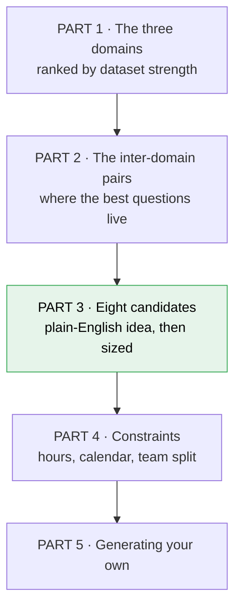
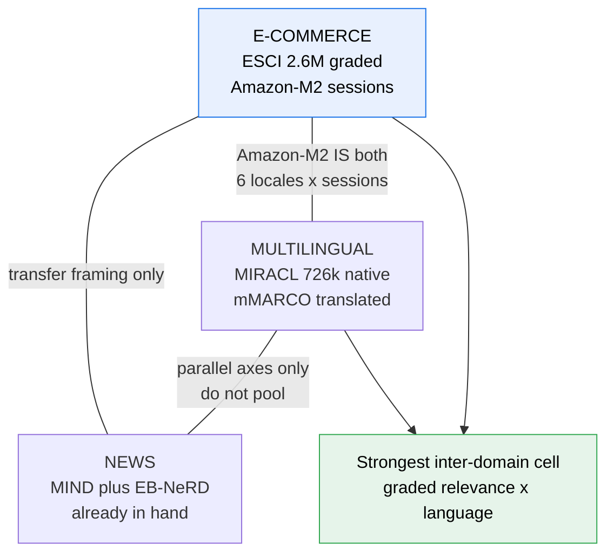
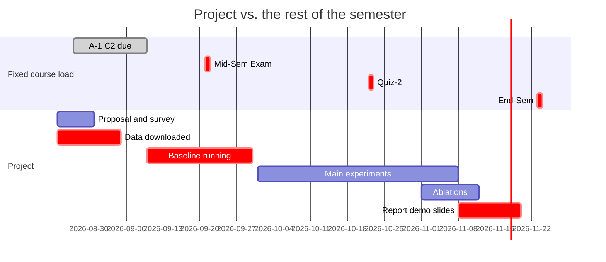
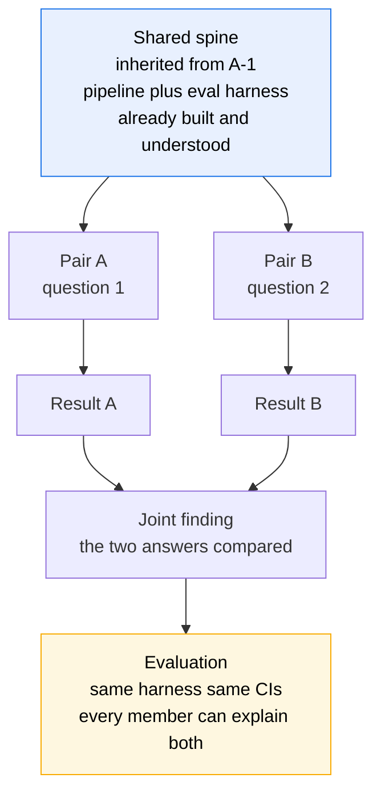

# Term project — three domains, their datasets, and candidate projects

Working notes for [[IRE-Term-Project]]. **Proposal + literature survey is due 2026-08-31.**

The search space is now deliberately closed to **three domains — e-commerce, multilingual, news — plus
the inter-domain pairs between them.** Everything else (health, finance, legal, misinformation,
education, construction, scholarly, code) has been considered and dropped. This file is organised
**strongest datasets first**, because at this budget the data decides the project.

> [!important] What the course is actually grading
> *"Depth and rigor of the study, not breadth"* · *"one hard, possibly open-ended question or a
> complex engineering system"* · *"explore & evaluate competing solutions in depth."*
>
> The unit of value is a **comparison that resolves a question**, not a system that exists.

## How to read this file

**Read it as:** Parts 1–2 establish what data you actually have; Part 3 is where the projects are; Parts
4–5 are the reality check. If you read one part, read 3.

## The five constraints that rule out most ideas

**1. It must finish by 20 Nov with a working evaluation.** Anything whose *baseline* isn't running by
30 Sep is too big.

**2. Free-tier GPU.** Colab/Kaggle/Lightning. No pre-training, no large-scale fine-tuning.

**3. Evaluation is individual.** You must be able to explain any part of the system under questioning.

**4. There are ~7 genuinely usable weeks, not 11.** A-1 C2 (10 Sep), the mid-sem (21 Sep), Quiz-2
(22 Oct), end-sem revision and one week of slippage take four. That leaves ≈ **165 research-hours**
across four people — see [[#Part 4 · Sizing the work]].

**5. AI assistants are encouraged — and they compress plumbing, not thinking.** They cut loader and
boilerplate cost but not design, diagnosis or viva-readiness. See
[[#What AI assistants change, and what they don't]].

---

# Part 1 · The three domains, ranked by dataset strength

Ranked by the only measure that matters at this budget: **how much labelled, downloadable, usable data
you get per hour spent getting it.**

> [!warning] Verify every download in week 1
> Checked August 2026. Licences change and links rot. **A corpus you cannot actually obtain is the most
> expensive way for this project to fail.**

## Rank 1 · E-commerce — the strongest datasets available to you

**The broad idea:** someone types three words into a shop — "cheap running shoes" — and the system must
work out they mean a *category*, then decide whether a near-miss is a useful result or a wrong one.
Unlike news or Wikipedia search, **"relevant" here is not yes/no**: a substitute product is *partly*
right, a complement is right in a different way, and those distinctions are worth money. It is the only
one of the three domains where the label itself carries several meanings.

### Why its data is the strongest

| Dataset | What you get |
|---|---|
| **Amazon ESCI** (Shopping Queries) | **130,652 queries · 2,621,738 human judgements** on a 4-way scale (**E**xact / **S**ubstitute / **C**omplement / **I**rrelevant). Reduced version: 48,300 queries / 1.1M judgements. **English, Spanish, Japanese.** **Apache-2.0**, **parquet** |
| **Amazon-M2** (KDD Cup 2023) | **Millions of anonymised shopping sessions across six locales** — English, German, Japanese, French, Italian, Spanish. Three tasks: next-product recommendation, **next-product recommendation with domain shifts**, next-product title generation. On GitHub + Kaggle |
| **XMarket** | Cross-market metadata for **1M+ items**, ~**52M multilingual reviews**, all **18 Amazon marketplaces** |
| **MARC** (Multilingual Amazon Reviews) | 200k train / 5k dev / 5k test **per language** × 6 (En, Ja, De, Fr, Es, Zh) |

**Published baselines to compare against:** ESCI Task 1 nDCG **0.83**; Task 2 macro-F1 **0.23** /
micro-F1 **0.62**. Amazon-M2 has full KDD Cup 2023 leaderboards and participant papers.

| | |
|---|---|
| **Native difficulty** | **Graded relevance with semantically distinct grades**, very short queries full of brands and typos, and a brutal head-tail distribution where the tail is where systems fail |
| **Licence** | ESCI **Apache-2.0** — cleanest on this page. ⚠️ Verify Amazon-M2 / XMarket individually |
| **Entry cost from A-1** | **~15 hrs.** Parquet in (same format as A-1's feature store), judgements given, no parsing, no labelling |
| **Syllabus fit** | **M3** (ranking, CTR/CVR), **M5** (metrics), **M6–M8** — which **names e-commerce explicitly** |
| **The trap** | Collapsing the 4-way scale to binary so your existing nDCG code works. **That discards the only thing this domain uniquely offers** |

### Three ways to see this domain

**Aspect A — graded relevance as a measurement problem.** How you map E/S/C/I to gains is a free design
decision nobody justifies. Does method ranking survive moving that dial?

**Aspect B — sessions and intent drift.** Amazon-M2 gives session sequences, so what the user *means*
evolves within a session — structurally identical to A-1's click history.

**Aspect C — head vs. tail.** A few queries are enormously frequent; the long tail is where retrieval
breaks, and aggregate nDCG hides it entirely.

> [!important] The strongest single fact about this domain
> **2.6M human judgements, Apache-2.0, parquet, no registration, published baselines.** No other domain
> here — and none of the six dropped ones — comes close on labels-per-hour. **If dataset strength is the
> deciding criterion, this is the answer.**

## Rank 2 · Multilingual — the deepest *trustworthy* labels

> [!important] This is **not** translation
> **MIRACL is 18 *separate monolingual* setups.** Swahili queries search a Swahili corpus, judged by
> Swahili native speakers. Nothing is translated.
> - **Multilingual retrieval** (this domain): query and documents in the **same** language, repeated
>   across *n* languages. The question is whether your *method* holds up.
> - **Cross-lingual retrieval** (a different task): query in one language, documents in another — *that*
>   involves translation or shared embedding spaces.
>
> **mMARCO is the translated one** (13 languages, machine-translated MS MARCO), and the *contrast*
> between it and MIRACL is itself a research question — see [[#Candidate 3 · Multilingual — "are native judgements and translated ones interchangeable?"]].

**The broad idea:** essentially every retrieval technique you will learn was invented, tuned and
benchmarked in English, then deployed to languages with a hundredth of the resources. The uncomfortable
question is whether the *technique* was ever the thing that worked, or whether English's data abundance
was doing the work. A-1 put you one step in — MIND is English, EB-NeRD is Danish — but **two points
cannot show a trend.** This domain is that comparison done properly: same design, same metric, 18
languages, and you watch the advantage decay as resources fall away.

The mechanism is concrete, not hand-wavy:

| What breaks | Why |
|---|---|
| **Tokenisation** | Subword vocabularies are fitted mostly on English. Morphologically rich languages (Finnish, Telugu, Swahili) shatter into more subwords per word — a noisier, longer sequence for the same meaning |
| **BM25's assumptions** | It assumes whitespace-delimited words. **Chinese, Japanese and Thai have no whitespace word boundaries**, so term statistics mean something different before you start |
| **Encoder pretraining** | A "multilingual" encoder saw orders of magnitude more English than Swahili. The embedding space is not equally good everywhere, and the name hides that |
| **Judgement availability** | Most languages have no qrels at all — which is exactly why MIRACL's native-speaker annotation is the valuable part |

### The datasets

| Dataset | What you get |
|---|---|
| **MIRACL** | **726k manual relevance judgements · 78k queries · 18 languages** over Wikipedia, **all by native speakers** (~5 person-years of annotation). Average **5.9M passages per language**. Topics + qrels per language on HuggingFace |
| **Languages** | ar, bn, en, es, fa, fi, fr, hi, id, ja, ko, ru, sw, te, th, zh + 2 surprise languages. **Low-resource set: Telugu, Swahili, Yoruba, Bengali, Hindi, Thai, Indonesian** |
| **mMARCO** | **13 languages, machine-translated** MS MARCO passage ranking. Known result: mT5 finetuned on mMARCO beats English-only *even for languages absent from it*, and **translation quality correlates with retrieval effectiveness** |
| **Mr. TyDi** | Multilingual retrieval; the standard zero-shot companion to mMARCO |
| **NoMIRACL** | MIRACL variant built for **relevance-assessment / hallucination** studies |
| **IndicIRSuite** | **11 Indian languages** — see the Indian-language section below |
| **IndicRAGSuite** | 13 Indian languages in-benchmark (AI4Bharat) — see below |

| | |
|---|---|
| **Native difficulty** | The methods themselves are language-biased, per the table above |
| **Licence** | HuggingFace distribution; ⚠️ confirm per-language terms |
| **Entry cost from A-1** | **~20 hrs.** Your multilingual encoder already exists for EB-NeRD; you swap the corpus and add languages |
| **Syllabus fit** | **M2** (text processing / tokenisation — where its story lives), **M3**, **M4** |
| **The trap** | You can't read most of these languages. **Never debug by inspection** — compensate with per-language slices. *Exception:* Indian languages you actually read — see below |

> [!important] Why this domain's labels are the most trustworthy here
> Native-speaker judgements, not translations and not auto-derived proxies. That is rare, expensive, and
> it means a per-language result is genuinely comparable *across* languages — which is the entire basis
> for measuring a **slope** rather than telling an anecdote.

### Indian languages — what's actually available

Worth its own section, because the coverage is uneven in a way that matters.

**In MIRACL (native-speaker judgements):** **Hindi**, **Bengali**, **Telugu** — and that's it.
**Malayalam, Tamil, Kannada, Marathi and Gujarati are absent.** So if you want *native* judgements, you
have exactly three Indian languages, all Indo-Aryan except Telugu.

**In Indian-specific benchmarks (translated / synthetic judgements):**

| Resource | Languages | How the labels were made |
|---|---|---|
| **IndicIRSuite / INDIC-MARCO** | **11** — Assamese, Bengali, Gujarati, Hindi, Kannada, **Malayalam**, Marathi, Oriya, Punjabi, **Tamil**, **Telugu** (Indo-Aryan **and Dravidian**) | ⚠️ **Machine translation** of MS MARCO. Ships **Indic-ColBERT**, 11 monolingual retrieval models. On GitHub |
| **IndicRAGSuite** (AI4Bharat) | **13** in the benchmark, 19 in training data | ⚠️ Benchmark queries are **human-translated** (1,000 MS MARCO-dev queries); training tuples are **LLM-generated** from Wikipedia. On HuggingFace (`ai4bharat/indicragsuite`) |
| **Hindi-BEIR** | Hindi only | Large-scale Hindi retrieval benchmark; integrated into **MTEB** |
| **FIRE** | Various Indian languages | The long-running Indian IR evaluation forum — older but real shared-task history |

**IndicIRSuite's reported gains:** +47.47% MRR@10 averaged over 10 of the 11 languages (excluding
Oriya), +12.26% nDCG@10 vs. MIRACL Bengali/Hindi baselines, +20% MRR@100 vs. Mr. TyDi Bengali.

> [!warning] The catch that decides how you can use these
> **Indian-language retrieval data is overwhelmingly translated or LLM-generated, not natively judged.**
> INDIC-MARCO is machine-translated MS MARCO; IndicRAGSuite's training data is LLM-generated. Only
> Hindi, Bengali and Telugu have MIRACL's native-speaker judgements.
>
> That is a **limitation to state, not a reason to avoid them** — but it changes what you may conclude.
> A result on machine-translated Malayalam tells you about your method *on translated text*, which is not
> quite the same claim.

> [!important] This turns out to *strengthen* Candidate 3, not weaken it
> Candidate 3 asks whether **native-judged and translated benchmarks agree.** Indian languages are the
> ideal test bed for exactly that question, because for **Telugu, Hindi and Bengali you have both**:
> MIRACL's native judgements *and* INDIC-MARCO's machine-translated ones, on the same languages.
>
> So you can measure the native-vs-translated gap **directly on three languages**, then ask whether the
> gap predicted from those three holds for **Malayalam and Tamil**, where only translated data exists.
> That's a genuinely useful finding for anyone working on Indian-language IR — and it's a question you're
> unusually well placed to ask.

> [!tip] The one advantage you have that most teams don't
> **You can read some of these languages.** The stated trap of this domain is that you can't sanity-check
> a ranking by inspection — but for Hindi/Telugu/Malayalam/Tamil, depending on the team, you *can*.
>
> That is worth real hours: it lets you catch tokenisation bugs and nonsense translations that a
> non-speaker would silently report as a finding. **If someone on the team reads Malayalam or Telugu,
> say so in the proposal** — it justifies the language choice on methodological grounds, not preference.

## Rank 3 · News — weakest raw scale, but it's already yours and it's multi-source

**The broad idea:** you already have this built. Given who a user is and what they've clicked, pick which
of today's articles to show them. What makes it *fresh* is not the task — it's that **six public
news-recommendation datasets exist across five languages, with deliberately incompatible schemas**, and
almost nobody runs one design across more than two of them.

### The datasets

| Dataset | What you get |
|---|---|
| **MIND** (English) | 1M users · 161,013 articles · **24.2M clicks**. ⚠️ **Only user-ID, article-ID, event-time — and front-page events only.** Aggregator-sourced |
| **EB-NeRD** (Danish) | **37M impression logs · 251M interactions** + news metadata. Publisher-sourced. Richer: read-time, location, subscription status, article-page events |
| **Adressa** (Norwegian) | 3.08M users · 48,486 articles · **27.2M clicks**. Publisher-sourced, rich features |
| **plista** (German) · **NPR** (Portuguese) · **IDEA** (English) | Further impression-log datasets |
| ⚠️ **Unavailable** | Globo, Yahoo! Webscope (withdrawn); MSN / Google / Yahoo News (proprietary) |

| | |
|---|---|
| **Native difficulty** | **Everything decays**, cold-start users dominate, and **the logs are biased by the recommender that produced them** |
| **Licence** | MIND + EB-NeRD **already obtained for A-1**; verify the others |
| **Entry cost from A-1** | **~0 hrs** for the two in hand · **~10–15 hrs per additional source** |
| **Syllabus fit** | **Best of the three** — M3, M4, M5, and **M6–M8 names news recommendation explicitly.** It is also A-1's own domain |
| **The trap** | Novelty. "More experiments on the assignment dataset" needs a sharp question |

### Four ways to see this domain

**Aspect A — temporal decay.** How fast does effectiveness rot, which component first, how often must you
re-index?

**Aspect B — cold-start.** Most users have almost no history, but aggregate metrics are dominated by heavy
users, so the real failure mode is invisible in the headline number.

**Aspect C — cross-source schema heterogeneity.** The fresh one, and it has a published gap — below.

**Aspect D — feedback loops and popularity bias.** Training logs were produced by a previous recommender.
How much of "relevance" is really exposure?

> [!important] The one place a published paper states your gap for you
> A 2025 survey of news-recommendation research found that models trained on public datasets **struggle
> with differing schemas and metadata**, and — remarkably — that they **could not identify any paper
> incorporating declared user interests**, despite that being standard in commercial products.
>
> The datasets differ in ways that matter: **MIND has only user-ID / article-ID / event-time and
> front-page events**; Adressa and EB-NeRD add read-time, location, subscription status and article-page
> interactions. MIND is aggregator-sourced; the other two come straight from publishers.
>
> So *"how much of reported effectiveness depends on features only some datasets have?"* is answerable by
> ablating down to the common schema — and **you don't have to argue that the gap exists.**

> [!tip] The Danish↔Norwegian pair is a clean natural experiment
> Adressa is Norwegian, EB-NeRD is Danish — **closely related languages, different publishers, similar
> market size.** That isolates *publisher/platform* effects from *language* effects, which MIND↔EB-NeRD
> cannot do, because English-vs-Danish confounds language with resource level.

## The three domains, compared

| | **E-commerce** | **Multilingual** | **News** |
|---|---|---|---|
| **Judgements** | **2.6M human, 4-way graded** | **726k human, native-speaker** | Implicit (clicks) |
| **Queries** | 130,652 | 78,000 | n/a — impressions |
| **Corpus scale** | 1M+ items (XMarket) | **5.9M passages/language** | 161k–250k articles |
| **Languages** | En, Es, Ja (+6 in Amazon-M2) | **18** | En, Da, No, De, Pt |
| **Licence clarity** | ✅ **Apache-2.0** | ⚠️ Verify per language | ✅ Two in hand |
| **In hand already?** | No | No | ✅ **Yes** |
| **Entry cost** | ~15 hrs | ~20 hrs | **~0 hrs** |
| **Sessions / behaviour?** | ✅ **Amazon-M2** | ✗ | ✅ **Yes** |
| **Graded relevance?** | ✅ **only one here** | ✗ | ✗ |
| **Published baselines** | ✅ ESCI + KDD Cup | ✅ Per-language | ✅ RecSys / Codabench |
| **Challenge lineage** | KDD Cup 2022 + 2023 | MIRACL / MTEB ongoing | RecSys, TREC, SemEval |
| **Syllabus fit** | M3, M5, **M6–M8 named** | M2, M3, M4 | **M3–M8, named** |
| **Debug by reading?** | ✅ | ✗ **No** | ✅ |

> [!important] The honest ranking
> **On dataset strength alone: e-commerce > multilingual > news.** ESCI's 2.6M graded judgements under
> Apache-2.0 are the best labelled resource reachable from here, and Amazon-M2 adds millions of
> multilingual sessions on top.
>
> **On total project cost: news > e-commerce > multilingual**, because news is already loaded and indexed.
>
> **These are not really competing.** The best candidates in Part 3 pair a domain you already have with
> one whose data is stronger — which is what turns "more experiments" into a generalisation claim.

---

# Part 2 · The inter-domain pairs — where the best questions live

Three domains give three pairs. **Combinability is a technical property, not a matter of ambition**, so
each pair is judged on four conditions, all required:

1. **Schema compatibility** — can both map into one representation without inventing fields?
2. **Label compatibility** — do the judgements *mean* the same thing? Graded relevance and implicit
   clicks are different signals; averaging them is meaningless.
3. **Licence compatibility** — the stricter licence governs the combination.
4. **A shared metric** — if you cannot compute one number over both, you have two projects.

> [!warning] "We ran on two datasets" is not a multi-source project
> Running the same code twice and reporting two tables is not a cross-source finding. The finding must be
> *about* the difference — transfer, degradation, feature dependence. **If your conclusions section could
> be split in half with nothing lost, you didn't do a cross-source study.**

## The feasibility matrix

| Pair | Schema | Labels | Licence | Shared metric | Verdict |
|---|---|---|---|---|---|
| **News ↔ News** (MIND + EB-NeRD) | ✅ A-1 did it | ✅ Both impressions | ✅ | ✅ | ✅ **Your existing baseline** |
| **News ↔ News** (+ Adressa) | ⚠️ Adressa richer — **ablate to MIND's fields** | ✅ All impressions | Verify | ✅ | ✅ **Best pure multi-source** |
| **E-comm ↔ E-comm** (ESCI + Amazon-M2) | ⚠️ Queries vs. sessions | ⚠️ Graded vs. implicit | ✅ | ⚠️ Per-task | ✅ **Good — same catalogue, two signal types** |
| **E-comm × Multilingual** | ✅ **Amazon-M2 is natively both** | ✅ Within M2 | ✅ | ✅ | ✅ **Best inter-domain — one dataset spans it** |
| **Multilingual ↔ Multilingual** (MIRACL + mMARCO) | ✅ Both passage ranking | ✅ **Native vs. translated** | Verify | ✅ | ✅ **Sharpest contrast on this page** |
| **E-comm × News** | ✗ Products vs. articles | ⚠️ Graded vs. clicks | ✅ | ⚠️ Re-derived | ⚠️ **"Does it transfer?" framing only** |
| **News × Multilingual** | ⚠️ Rec vs. ad-hoc retrieval | ✗ Behavioural vs. qrels | ⚠️ | ✗ pooled | ⚠️ **Parallel axes only, never pooled** |

**The pattern:** pairs combine cleanly **within** a family and badly **across** them. Cross-domain work
must be framed as *"does the finding transfer?"* — parallel experiments with a shared method, comparing
*differences* — not as one pooled dataset.

**Read it as:** the e-commerce↔multilingual edge is special because **one dataset (Amazon-M2) already
spans both**, so you get the inter-domain question without paying two entry costs or arguing about
whether the sources are comparable.

## Where each sanctioned direction lives now

The course names five acceptable directions; your project must sit in one.

| | 1 · Conversational | 2 · Memory | 3 · Generative retr. | 4 · RAG eval | 5 · Change detect. |
|---|---|---|---|---|---|
| **E-commerce** | ✅ session → query rewriting | ✅ **Amazon-M2 sessions** | ⚠️ compute | ⚠️ no answers to ground | ⚠️ catalogue churn |
| **Multilingual** | ⚠️ thin dialogue data | ⛔ no sessions | ⚠️ compute | ✅ **NoMIRACL supports it** | ⛔ static corpus |
| **News** | ✅ strong | ✅ strong | ⚠️ compute | ✅ strong | ✅ **best cell** |

**Legend:** ✅ viable · ⚠️ has a named problem · ⛔ don't

**Direction 3 (generative retrieval) is compute-blocked everywhere** — it trains a model, and free-tier
GPU is binding. **Direction 5 needs a corpus that changes**, leaving news as its clean home.
**Direction 2 needs sessions**, which news and Amazon-M2 both have.

## The challenge families in these domains

| Family | In these three domains | Status |
|---|---|---|
| **RecSys Challenge** | **2024 = EB-NeRD = A-1** | Closed; you already build it |
| **KDD Cup** | **2022 = Amazon ESCI** · **2023 = Amazon-M2** | Closed; data + leaderboards + participant papers public |
| **TREC** | Change Detection, RAG, AutoJudge, User Simulation | Applications closed May 2026; **decades of qrels reusable** |
| **SemEval** | **2025 Task 7** — claim retrieval, **mono- + crosslingual tracks**, on **Codabench** | Past cycle; data + overview public |
| **MTEB / BEIR** | Embedding + retrieval leaderboards, MIRACL included | Always open, no registration |

> [!tip] Both e-commerce datasets are ex-KDD-Cup, which is why they're so well-equipped
> ESCI was **KDD Cup 2022**; Amazon-M2 was **KDD Cup 2023**. That's why both ship fixed splits, official
> metrics, published baselines *and* participant papers. **Use their data and metric; supply your own
> question** — rank is never what's graded.

---

# Part 3 · Eight candidates

Each opens with **the broad idea in plain terms** — if you can't explain it in two sentences to someone
outside the course, it isn't ready for a proposal. Each is sized against ~165 research-hours and marked
with its 2+2 split.

## The front-runners, in plain language

Before the tables: the strongest problems written the way you'd **say them out loud** — to a teammate, to a
lecturer, to someone who has never taken this course. No jargon, no metrics.

> [!tip] Use these verbatim in the proposal's opening paragraph and in the presentation
> The rest of Part 3 is engineering detail. **This is the version that has to survive being said aloud in
> a viva** — if you can't tell it like this, you don't have the question yet.

### News: how fast does it go stale?

You train a news recommender on one week of clicks, then keep using it. It gets worse every day, because
new articles keep arriving and people's interests move.

You measure exactly how fast it degrades. You find out which part rots first — the word matching, the
meaning matching, or the click history. Then you work out how often you'd have to rebuild it to keep it
good enough.

The result is a trade-off curve: rebuild more often, spend more compute, get better results. **That curve
is the answer.**

**Why it's good:** this is exactly what the course says IR is — paying a cost to get relevance. It needs no
new data at all, and you can explain it to anyone in one sentence.

*Detail:* [[#Candidate 6 · News — "how fast does a recommender go stale, and what does freshness cost?"]]

### E-commerce: does it work in another language?

Amazon has shopping data from six countries in six languages, all in one dataset with the same format.

You build one recommender and run it on all six. Then you ask whether it works equally well everywhere, or
whether it only looked good because it was built and tested on English data.

Then you push harder: train it on the big languages, test it on the small ones, and see how badly it falls
over.

**Why it's good:** every company expanding into a new country faces this exact problem. And because all six
languages sit in one dataset with one format, **nobody can argue your comparison is unfair.**

*Detail:* [[#Candidate 2 · E-commerce × multilingual — "does the same design work in six languages?"]]

### E-commerce: what is a "close enough" result worth?

Search a shop for running shoes. Some results are exactly what you asked for. Some are substitutes — a
different brand of running shoe. Some are complements — socks. Some are junk.

Amazon's data labels all four of those separately. But every scoring method squashes them into a single
number, which means **somebody quietly decided how much a substitute is worth** — half of an exact match?
A tenth? Nobody ever justifies that choice.

You take the same set of systems, score them several times with different values for a substitute, and
check whether the "best" system changes depending on that choice.

**Why it's good:** it's a real argument that happens inside companies, and the published scores already hint
something is wrong here. Even if the answer is "nothing changes," that's worth reporting — **everyone
assumes it without checking.**

*Detail:* [[#Candidate 1 · E-commerce — "what is a 'close enough' result actually worth?"]]

### Multilingual: does the trick still work in a smaller language?

Search techniques get invented in English, tested in English, and then written up as if they work
everywhere. But English has more text on the internet than almost any other language, so the technique
might be borrowing that abundance rather than being genuinely good.

There is a dataset — MIRACL — with the same search task in 18 languages, ranging from English and Chinese
down to Swahili and Telugu, all judged by people who actually speak them.

So you run the same method on all 18 and **plot how much it helps against how much data each language
has.** If the line slopes downward, the technique was partly living off English's abundance. If it stays
flat, the technique is genuinely good.

You can then ask *why* it slopes. Two suspects: the language simply has less training data, or the language
is built differently — Telugu, Tamil and Malayalam glue endings onto words, and Chinese, Japanese and Thai
don't put spaces between words at all, which breaks the word-counting that older methods rely on.

**Why it's good:** almost nobody reports that slope, only the average. It runs on data you download once,
needs no new labels, and "the slope is flat" is just as publishable as "the slope is steep". If anyone on
the team reads Telugu, Hindi or Malayalam, you can also **check the results by eye** — which most teams
working on these languages genuinely cannot do.

*Detail:* [[#Candidate 4 · Multilingual — "does the advantage shrink as the language gets smaller?"]]

### One line each

- **Staleness:** yesterday's model is worse today — how much worse, and when should we rebuild?
- **Languages (e-commerce):** it works in English; does it work in Japanese?
- **Substitutes:** a substitute product is half-right — who decided half?
- **Resource slope:** the trick works in English; does it still work in Swahili?

> [!important] Why the staleness and substitute problems pair well
> Take them together as the 2+2 and they share one question: **"what is our metric hiding?"** Staleness
> hides the cost of not rebuilding; substitutes hide the value of a near-miss. That shared spine is what
> makes two halves into one project instead of two.

> [!note] Where the resource-slope problem fits
> It is the **most intuitive of the multilingual options** and the result is guaranteed — but it scores
> **weakest on syllabus fit** of the four here: strong on M2 (tokenisation) and M3–M4, but it misses M5–M8,
> and multilingual IR is not one of the applications named in M6–M8 (ads, e-commerce, news).
>
> Best used **paired with the six-locales problem** — both share the "does it hold as resources shrink?"
> axis and one loader pattern, so they make a coherent 2+2 with e-commerce supplying the syllabus anchor.

## Candidate 1 · E-commerce — "what is a 'close enough' result actually worth?"

> **The broad idea:** search a shop for running shoes and some results are exactly right, some are
> reasonable substitutes, some are accessories, some are junk. Every metric in this course flattens that
> into one relevance number, so **somebody has to decide what a substitute is worth** — half an exact
> match? A tenth? That choice is made silently in almost every paper. We show it changes which system
> you would conclude is best.

| | |
|---|---|
| **Domain** | E-commerce · direction 1 (measurement spine touching 4) |
| **Question** | Does the **ranking of retrieval methods depend on how E/S/C/I grades map to gains**, and which methods are fragile to that choice? |
| **Pair A** | Gain-mapping sweep: same runs re-scored under several defensible gain vectors; report ranking stability |
| **Pair B** | Who the flattening hurts: per-grade retrieval rates, head-vs-tail slice, plus the En/Es/Ja contrast |
| **Data** | **ESCI** — 2.6M judgements, Apache-2.0, parquet |
| **Cost** | **~135 hrs** (15 entry + re-scoring, which is cheap and parallel) |
| **Risk** | **Low.** Data is open, labels exist, the result exists whatever it says |
| **Why it's good** | Zero labelling; a **documented anomaly** to start from (macro-F1 **0.23** vs micro-F1 **0.62** — rare grades handled badly, hidden by aggregates); and **the negative result is publishable** |

## Candidate 2 · E-commerce × multilingual — "does the same design work in six languages?"

> **The broad idea:** Amazon-M2 contains shopping sessions from six countries in six languages, all in
> one dataset with one schema. So you can run **exactly the same recommender** on each and ask whether its
> advantage is real or an artefact of the language it was tuned on — with no cross-dataset excuses,
> because it's the same catalogue, same format, same metric.

| | |
|---|---|
| **Domain** | E-commerce × multilingual · direction 2 (sessions) |
| **Question** | Does a session-based recommender's advantage hold across six locales, and does it **degrade with locale data volume**? |
| **Pair A** | Per-locale effectiveness curves plotted against locale data volume |
| **Pair B** | The **domain-shift task**: train on high-resource locales, test on low-resource ones |
| **Data** | **Amazon-M2** — millions of sessions, 6 locales (En, De, Ja, Fr, It, Es), KDD Cup 2023 baselines |
| **Cost** | **~140 hrs** (~20 entry; sessions closely resemble A-1's click histories) |
| **Risk** | Low–medium. Scale means you sample — state the sampling explicitly |
| **Why it's good** | **The inter-domain question with none of the usual confounds** — one dataset, one schema, one metric. A-1's session machinery ports almost directly, and **the domain-shift task is given, not invented** |

> [!important] Why this is the best-designed candidate here
> Every cross-domain study has to defend "are these really comparable?". **Amazon-M2 makes that question
> disappear** — same platform, same schema, six languages by construction. You get a generalisation claim
> without having to win a generalisation argument.

## Candidate 3 · Multilingual — "are native judgements and translated ones interchangeable?"

> **The broad idea:** MIRACL paid native speakers to judge relevance in 18 languages — about five
> person-years of work. mMARCO just machine-translated an English dataset into 13 languages. Everyone
> uses both as if they measure the same thing. **Do they?** If a method looks good on translated data and
> bad on native data, a lot of published multilingual results mean less than they appear to.

| | |
|---|---|
| **Domain** | Multilingual · direction 4 (evaluation validity) |
| **Question** | Do method rankings agree between **native-annotated (MIRACL)** and **machine-translated (mMARCO)** benchmarks for the same languages — and does disagreement grow as translation quality drops? |
| **Pair A** | Run the same retrievers on both, per overlapping language; measure rank correlation |
| **Pair B** | The tokenisation/resource story: per-language subword fragmentation vs. the size of the gap |
| **Data** | **MIRACL** (726k native judgements, 18 langs) + **mMARCO** (13 langs, translated). The overlapping languages are the study set |
| **The Indian-language variant** | **Telugu, Hindi and Bengali have both** MIRACL's native judgements *and* INDIC-MARCO's machine-translated ones. Measure the gap on those three, then ask whether it predicts behaviour on **Malayalam and Tamil**, where only translated data exists |
| **Anchor** | mMARCO's own finding that **translation quality correlates with retrieval effectiveness** — you are testing whether that contaminates *evaluation*, not just training |
| **Cost** | **~150 hrs** (~20 entry each, but one loader pattern serves both) |
| **Risk** | Medium — depends on sufficient language overlap. **Verify in week 1** |
| **Why it's good** | It questions the **validity of a widely-used benchmark**, which is a higher class of finding than improving a number. No GPU beyond A-1's, no new labels — and the Indian-language variant is a result the Indic-IR community would actually want |

## Candidate 4 · Multilingual — "does the advantage shrink as the language gets smaller?"

> **The broad idea:** techniques are invented in English and reported as general. MIRACL has 18 languages
> ranging from English and Chinese down to Swahili and Telugu. Run one design across all of them and
> **plot the advantage against how much data the language has.** If the line slopes down, the technique
> was partly borrowing English's resources — and nobody reports that slope.

| | |
|---|---|
| **Domain** | Multilingual · direction 4 |
| **Question** | Does the dense-over-lexical advantage **shrink monotonically with language resource level**, and which component (tokenisation, encoder, term statistics) explains most of the decay? |
| **Pair A** | The slope: BM25 vs. dense per language, plotted against resource proxies |
| **Pair B** | Attribution: tokenisation fragmentation rates, with the **no-whitespace languages** (zh/ja/th) as a natural break |
| **The Indian-language angle** | **Dravidian vs. Indo-Aryan is a second natural break.** Telugu/Tamil/Malayalam are agglutinative with heavy morphology; Hindi/Bengali/Marathi are not. IndicIRSuite spans both families, so *"is the decay about data volume or about morphology?"* becomes separable — two confounded explanations pulled apart |
| **Data** | **MIRACL** — 18 languages, native judgements, ~5.9M passages/language · **IndicIRSuite** to extend to 11 Indian languages (⚠️ translated labels) |
| **Cost** | **~145 hrs** — one loader, then many cheap parallel runs |
| **Risk** | **Low.** The curve exists whatever its shape |
| **Why it's good** | Directly extends A-1's accidental En/Da two-point comparison into a real trend across languages spanning three billion speakers, with bootstrap CIs from code you already wrote |

## Candidate 5 · News — "does the model work, or does the dataset?"

> **The broad idea:** every news-recommendation paper reports on one dataset, but the datasets aren't
> equivalent. MIND only knows *who clicked what, when*; Adressa and EB-NeRD also know how long people
> read, where they were, whether they subscribe. So a good number **might mean a good design, or might
> just mean richer data.** We run one design at three feature levels across three datasets and separate
> the two.

| | |
|---|---|
| **Domain** | News · direction 5 with a generalisation spine |
| **Question** | How much of reported effectiveness depends on **features only some datasets have**, and does method ranking change when you ablate to the common schema? |
| **Pair A** | Feature-ablation axis: MIND-common fields only vs. full rich schema |
| **Pair B** | Language/publisher axis: **Danish↔Norwegian** (related languages, different publishers) vs. **English** |
| **Data** | **MIND + EB-NeRD in hand**; **Adressa** at ~10–15 hrs |
| **Anchor** | The 2025 survey that **names schema heterogeneity as the unsolved problem** and found no papers using declared user interests |
| **Cost** | **~145 hrs** — one new loader; the rest re-runs an existing pipeline |
| **Risk** | **Low.** If Adressa fails to load you fall back to A-1's own two-source setup |
| **Why it's good** | **The gap is stated in the literature, not inferred by you** — which is the hardest part of Phase 1 |

## Candidate 6 · News — "how fast does a recommender go stale, and what does freshness cost?"

> **The broad idea:** train on one week of news and keep using it; it gets worse every day. We measure how
> fast, **which part rots first** — word matching, meaning matching, or click history — and how often
> you'd have to rebuild to stay within a few percent of fresh.

| | |
|---|---|
| **Domain** | News · direction 5 |
| **Question** | Train at *t*, evaluate at *t+1 … t+k*. Which component decays first, and how often must you re-index to hold nDCG within X%? |
| **Pair A** | Decay curves: rolling temporal splits, per component |
| **Pair B** | Cost side: re-indexing cost vs. effectiveness retained — the freshness/cost frontier |
| **Anchor** | **TREC Change Detection** for operationalising "meaningful change" |
| **Cost** | **~140 hrs**, mostly re-running an existing pipeline — cheap and parallel |
| **Risk** | **Lowest on this page.** The decay curve exists whatever its shape |
| **Why it's good** | A-1 *already forces a temporal split*, so the hard data engineering is done. It's the course's relevance-vs-cost trade-off made concrete, and it needs **zero new data** |

## Candidate 7 · E-commerce ↔ news transfer — "is 'stale' the same problem in two industries?"

> **The broad idea:** news goes stale in hours; product catalogues change over weeks. Both are "the world
> moved and my index didn't" problems, but nobody checks whether the *same* fix works for both. We take
> one decay-and-refresh design, run it in both, and compare the shapes of the curves.

| | |
|---|---|
| **Domain** | News × e-commerce · direction 5 |
| **Question** | Does the temporal-decay/refresh finding **transfer** between a fast-churn domain (news) and a slow-churn one (products), and does the optimal re-index interval scale with churn rate? |
| **Pair A** | News side (in hand, zero entry cost) |
| **Pair B** | E-commerce side (ESCI / Amazon-M2) |
| **Cost** | **~155 hrs** |
| **Risk** | **Medium–high.** ⚠️ Labels don't pool — this must be framed as *parallel* experiments comparing curve shapes, never one merged number |
| **Why it's good** | A genuine generalisation claim about *mechanism* rather than numbers — but read the warning first |

> [!warning] The candidate most likely to become two projects stapled together
> Per Part 2, News × E-commerce is a ⚠️ pair: schemas and labels don't align. It works **only** as "does
> the finding transfer?", and it needs a shared *derived* metric (e.g. % effectiveness retained at horizon
> *h*) agreed **before** you start. **If you can't define that metric in week 1, take Candidate 6 instead.**

## Candidate 8 · The safety net — "which signal actually carries the recommendation?"

> **The broad idea:** A-1 combines word matching, meaning matching and click history. Which one is
> actually doing the work — and is the answer different in English than in Danish? No new data, no new
> components, guaranteed result.

| | |
|---|---|
| **Domain** | News · ablation study |
| **Question** | Which signal carries the result, and does the ranking of signal importance hold across MIND (En) and EB-NeRD (Da)? |
| **Pair A** | Signal ablation, per user-segment slice |
| **Pair B** | Cross-lingual: where the English-trained encoder breaks on Danish |
| **Cost** | **~120 hrs** — the pipeline exists; this is experiments and analysis |
| **Risk** | **Cannot fail to produce a result** |
| **Why it's good** | Zero build cost, zero new data, and A-1's bootstrap CIs are exactly the machinery needed. **Keep this in your pocket** — if October goes badly, this still earns well |

## The candidates, compared

| | Domain(s) | Cost | Slack | Data strength | Result guaranteed? | Novelty | Risk |
|---|---|---|---|---|---|---|---|
| **1** Graded relevance | E-comm | ~135 | 30 | **Best (2.6M)** | ✅ | Med–high | **Low** |
| **2** Six locales | E-comm × ML | ~140 | 25 | **Best (M2)** | ✅ | **High** | Low–med |
| **3** Native vs. translated | ML | ~150 | 15 | Strong | ✅ | **Highest** | Medium |
| **4** Resource slope | ML | ~145 | 20 | Strong | ✅ | High | **Low** |
| **5** Cross-source schema | News | ~145 | 20 | Modest, **in hand** | ✅ | Med–high | **Low** |
| **6** Temporal decay | News | ~140 | 25 | **In hand** | ✅ | Medium | **Lowest** |
| **7** E-comm ↔ news transfer | Both | ~155 | 10 | Mixed | ⚠️ | High | **Med–high** |
| **8** Signal ablation | News | ~120 | 45 | **In hand** | ✅✅ | Low | **None** |

> [!important] The recommendation, by what you're optimising for
> - **Strongest datasets:** **Candidate 2** — Amazon-M2's millions of sessions across 6 locales, one
>   schema, KDD Cup baselines, and the inter-domain question with no comparability argument to win
> - **Closest to the syllabus + most intuitive:** **Candidate 6** — its question *is* the course thesis
> - **Sharpest single argument:** **Candidate 1** — starts from a documented anomaly
> - **Most novel finding:** **Candidate 3** — questioning a widely-used benchmark's validity
> - **If the team is stretched:** **Candidate 8**, always
>
> See [[#Scored four ways: real-world weight, intuitiveness, syllabus fit, and the three "inters"]] for the
> full scoring. **Short version: 6, 2 and 1 win on real-world weight, intuitiveness and syllabus fit
> simultaneously; my proposal would be 6 + 1 as a 2+2**, which covers both named applications (news and
> e-commerce) and lands the philosophy's cost half squarely.

## Scored four ways: real-world weight, intuitiveness, syllabus fit, and the three "inters"

The comparison above ranks on cost and risk. These are the *other* axes — and they reorder things.

### Angle 1 · Real-world weight

**The test:** would a working engineer recognise this as a problem they actually have?

| | Real-world reading | Weight |
|---|---|---|
| **1** Graded relevance | "Our metric says model A wins but merchandisers say B feels better." **This is a real, recurring industry argument** about what relevance means commercially | **Very high** |
| **2** Six locales | "We built it for the US site; does it work when we launch in Japan?" **Every multinational faces this exact question** | **Very high** |
| **6** Temporal decay | "How often do we retrain, and what does it cost us not to?" **A budget conversation held in every ML team** | **Very high** |
| **5** Cross-source schema | "We swapped vendors and our numbers moved." Real, but felt by *researchers* more than by product teams | Medium–high |
| **3** Native vs. translated | "Can we trust our Hindi benchmark?" Real for Indian-market teams and Indic-NLP groups specifically | Medium–high |
| **4** Resource slope | Matters to model builders and to anyone deploying beyond English; less to a single-market team | Medium |
| **7** Churn transfer | Genuinely interesting; less often a decision someone must make | Medium |
| **8** Signal ablation | "Which feature earns its keep?" Real, but routine — it's a sprint task, not a project | Low–medium |

### Angle 2 · Intuitiveness — can you explain it in one breath?

This matters more than it sounds: **you must defend it in a viva, and your audience must grasp it in a
presentation.** A question needing three sentences of setup is a question you'll struggle to defend.

| | The one-breath version | Verdict |
|---|---|---|
| **6** Temporal decay | *"Yesterday's model is worse today. How much worse, and how often should we rebuild?"* | ✅ **Clearest on the page** |
| **2** Six locales | *"Works in English. Does it work in Japanese?"* | ✅ **Equally clear** |
| **1** Graded relevance | *"A substitute product is half-right. Who decided half?"* | ✅ Clear, one beat of thought |
| **8** Signal ablation | *"Which of the three signals is doing the work?"* | ✅ Clear but unexciting |
| **4** Resource slope | *"Does the trick still work in a language with less data?"* | ✅ Clear |
| **5** Cross-source schema | *"Is the model good, or was the dataset richer?"* | ⚠️ Needs the schema-difference setup first |
| **3** Native vs. translated | *"Two benchmarks, one translated. Do they agree?"* | ⚠️ Needs the provenance distinction explained |
| **7** Churn transfer | *"Is going stale the same problem for news and for products?"* | ⚠️ Needs both domains set up |

### Angle 3 · Syllabus proximity

The course philosophy is explicit: **"IR is disciplined management of a relevance-vs-cost trade-off under
a latency budget — not a single algorithm."** And **M6–M8 names ads, e-commerce and news** as its
applications. Scored against that:

| | Modules exercised | Hits the *cost* half of the philosophy? | Named in M6–M8? |
|---|---|---|---|
| **6** Temporal decay | M3, M4, **M5**, M6–M8 | ✅ **It IS the trade-off** — freshness vs. re-index cost | ✅ news |
| **1** Graded relevance | M3, **M5**, M6–M8 | ⚠️ Partly — metric design, not cost | ✅ e-commerce |
| **2** Six locales | M3, M4, M6–M8 | ⚠️ Indirect (data volume as cost) | ✅ e-commerce |
| **5** Cross-source schema | M3, M4, M5, M6–M8 | ⚠️ Partly | ✅ news |
| **7** Churn transfer | M3, M4, M5, M6–M8 | ✅ Yes, in two domains | ✅ both |
| **8** Signal ablation | M3, M4, M5 | ✗ | ✅ news |
| **4** Resource slope | **M2**, M3, M4 | ✗ | ✗ |
| **3** Native vs. translated | **M2**, M4, **M5** | ✗ | ✗ |

> [!important] The syllabus verdict is unambiguous
> **Candidate 6 is the only one whose central question *is* the course's stated thesis.** "How much
> freshness do you buy per unit of re-indexing cost" is literally a relevance-vs-cost trade-off under a
> budget. Nothing else on this page maps that directly.
>
> The two multilingual candidates (3, 4) are the *weakest* on syllabus fit — strong M2 content, but they
> miss M5–M8 and neither is a named application. Interesting work, further from what's taught.

### Angle 4 · The three "inters"

**Inter-competition** — does it connect two different shared tasks?

| Combination | What it gives you | Feasible? |
|---|---|---|
| **KDD Cup 2022 (ESCI) + KDD Cup 2023 (Amazon-M2)** | Same company, same catalogue, **two different signal types** — graded query-product labels *and* session sequences. Both have leaderboards and participant papers | ✅ **Best inter-competition pair** |
| **RecSys 2024 (EB-NeRD) + KDD Cup 2023** | Two recommendation competitions, two industries; both session/impression-shaped | ⚠️ Comparable in *shape*, not in labels |
| **RecSys 2024 + TREC Change Detection** | Your data + TREC's operational definition of "meaningful change" | ✅ **Cleanest borrow** — take the task definition, not the data |
| **MIRACL/MTEB + SemEval-2025 T7** | Multilingual retrieval + crosslingual claim retrieval | ⚠️ Different tasks; parallel only |

**Inter-data** — two datasets, one question:

| Pairing | Verdict |
|---|---|
| **ESCI + Amazon-M2** | ✅ Same catalogue family; graded labels + sessions is a genuine two-signal study |
| **MIND + EB-NeRD + Adressa** | ✅ Best pure multi-source; the schema ablation is the finding |
| **MIRACL + INDIC-MARCO** (Te/Hi/Bn overlap) | ✅ **Sharpest** — native vs. translated labels on the *same* languages |
| **MIRACL + mMARCO** | ✅ Same idea, wider language set |
| **ESCI + MIND** | ⚠️ Transfer framing only — labels don't pool |

**Inter-domain** — see Part 2. Only **e-commerce × multilingual** (via Amazon-M2) is clean; the other two
pairs are parallel-axes-only.

### Putting the four angles together

| | Real-world | Intuitive | Syllabus | Inters available | Data strength | Risk |
|---|---|---|---|---|---|---|
| **6** Temporal decay | **Very high** | ✅ **Best** | ✅ **Best — it *is* the thesis** | TREC borrow | In hand | **Lowest** |
| **2** Six locales | **Very high** | ✅ **Best** | ✅ Named app | ✅ Inter-domain + inter-competition | **Best** | Low–med |
| **1** Graded relevance | **Very high** | ✅ Clear | ✅ Named app | ✅ Inter-competition | **Best** | Low |
| **5** Cross-source | Med–high | ⚠️ | ✅ Named app | ✅ Inter-data | In hand | Low |
| **7** Churn transfer | Medium | ⚠️ | ✅ Both apps | ✅ Inter-domain | Mixed | Med–high |
| **3** Native vs. translated | Med–high | ⚠️ | ✗ Weakest | ✅ **Sharpest inter-data** | Strong | Medium |
| **4** Resource slope | Medium | ✅ | ✗ Weak | Inter-data | Strong | Low |
| **8** Signal ablation | Low–med | ✅ | Partial | — | In hand | **None** |

> [!important] The answer to "most interesting for the real world, intuitive, and closest to syllabus"
> **Three candidates win on all three criteria simultaneously — 6, 2 and 1 — and they differ in what they
> cost you.**
>
> **🥇 Candidate 6 (news temporal decay) if you weight syllabus proximity highest.** Its question *is* the
> course thesis — freshness bought per unit of re-index cost, under a budget. It's the most intuitive
> sentence on the page, a real budget conversation in every ML team, needs **zero new data**, and has the
> lowest risk. Its weakness: the least novel, and it leans on data you already have rather than the
> strongest data available.
>
> **🥈 Candidate 2 (six locales) if you weight real-world reach and data strength.** "Works in English,
> does it work in Japanese?" is a question every multinational actually asks, it's equally intuitive, and
> it's the **only candidate that is simultaneously inter-domain and inter-competition** on the strongest
> dataset here. Slightly further from the *cost* half of the philosophy.
>
> **🥉 Candidate 1 (graded relevance) if you want the sharpest argument.** "A substitute is half-right —
> who decided half?" is a real industry disagreement, e-commerce is a named application, and it starts
> from a documented anomaly. Narrower in scope than the other two.
>
> **The combination I'd actually propose: Candidate 6 + Candidate 1 as a 2+2.** One pair on the
> freshness/cost frontier in news, one pair on graded-relevance metric design in e-commerce — joined by
> the shared question *"what does our metric hide?"*. That covers M3–M8, hits **both** named applications
> (news *and* e-commerce), lands the philosophy's cost half squarely, and both halves have guaranteed
> results with independent fallbacks.

> [!tip] The 2+2 pairings that actually work
> - **2 + 4** — both multilingual-flavoured; share the resource-level axis and one loader pattern
> - **5 + 6** — both news, same datasets, same harness (schema transfer + temporal decay)
> - **1 + 2** — both e-commerce, same catalogue family (graded relevance + locale transfer)
>
> Avoid pairing across the ⚠️ edges in Part 2 — you'd be maintaining two incompatible harnesses.

---

# Part 4 · Sizing the work

> [!warning] Four exceeds the course cap — settle this before 30 Aug
> `_syllabus.md` caps project teams at **3**. Either get a written exception, or **register as 2 + 2**
> (two teams, one shared spine, two adjacent questions) — the safe default, and genuinely better. See
> [[#The 2 plus 2 structure]]. Grading is individual either way.

## The budget, honestly

**A-1 is not in this budget.** It is separately graded work finishing 10 Sep, and its hours belong to it.
What the project inherits is an **artifact, not a head start in hours**: a working pipeline and an
evaluation harness with bootstrap CIs, already built and understood.

Start from the calendar and delete the weeks that aren't available:

| | Weeks | Why |
|---|---|---|
| Calendar span, proposal → deadline | 11.5 | |
| − A-1 C2 endgame (to 10 Sep) | −1.5 | Separately graded; it *will* take priority |
| − mid-sem week (21 Sep) | −1.0 | Revision, not just the exam day |
| − Quiz-2 week (22 Oct) | −0.5 | Lands mid-Phase-3 |
| − end-sem revision begins (~15 Nov) | −0.5 | Overlaps report week |
| − slippage you cannot itemise | −1.0 | Illness, a dead dependency, a week that vanishes |
| **Genuinely usable** | **≈ 7 weeks** | |

| | |
|---|---|
| Raw, 7 usable weeks (4 × 9 hrs) | **250 hrs** |
| − coordination, meetings, merge friction (~15%) | −38 |
| − report, demo, presentation (fixed) | −45 |
| **Left for actual research** | **≈ 165 hrs**, ~41 hrs/person |

**41 hours per person is one graduate-level module of work, not a system.** Enough for: one pipeline you
already have, one new component, one clean comparison, one ablation grid. Not enough for: training from
scratch, collecting a large labelled set, or building infrastructure you don't have.

> [!important] The single most useful reframing
> With 165 hours, **you cannot afford to build and evaluate. Pick one to buy off the shelf.** All eight
> candidates buy the *evaluation* off the shelf — ESCI, Amazon-M2, MIRACL, mMARCO and the news datasets
> all ship judgements and metrics. **That is why they are the candidates.**

## What AI assistants change, and what they don't

Coding assistants are **encouraged** (`_syllabus.md`), but evaluations are **closed-book** and individual
capability is verified via **vivas and exam probes on your own submitted code**.

| AI compresses this a lot | AI barely touches this |
|---|---|
| Boilerplate: loaders, config, plotting, tables | **Deciding what the question is** |
| Porting a pipeline to a new corpus schema | Judging whether a result is real or a bug |
| Draft prose for the report and survey | Designing the comparison and ablation grid |
| Bootstrap/CI and slicing code | Noticing a leakage boundary is wrong |
| Unfamiliar library docs, stack traces | **Being able to explain it in a viva** |

**Effect on the numbers:** the 15–20 hr entry costs are what AI cuts hardest — mostly schema-wrangling.
Budget at the **low end**. Research hours don't compress, because they are what's graded.

> [!warning] The trap this creates
> AI makes it easy to produce **more system than you understand** — precisely what the viva catches, and
> fatal because grading is individual. **Anything AI wrote, someone reads line by line and can defend.**

> [!tip] Where assistants pay off most
> Spend saved hours on **more experimental conditions, not more system.** An extra locale, an extra
> language, an extra gain-mapping — cheap once the harness exists, and that *is* "depth and rigor".
> Also: log your prompts as you go — IRE grades the AI usage log. See `/ai-log`.

## Where the calendar bites

**Read it as:** September is half-consumed by A-1 C2 and the mid-sem, so the 30 Sep baseline gate is
tighter than it looks, and Phase 3 collides with Quiz-2. The only free stretch is **1–20 Oct**. Note the
second bar: **the data must be downloaded and loading by ~5 Sep**, or the domain choice is already failing.

## The 2 plus 2 structure

Four people on one codebase serialise on merges and produce one person who understands everything and
three who understand a module. Since **evaluation is individual**, that's a grading risk.

The structure that works: **one shared spine, two questions.**

**Read it as:** the spine arrives already built — it's A-1's pipeline — so no project hours go into it,
and the two pairs vary *one thing each* against it, keeping the results directly comparable.

**Rules that keep this from degenerating:**
- The spine is a **dependency from day one, not a work item.** Whoever changes it re-runs both baselines.
- The two questions must share **the same metric and split**, or you have two projects.
- **The dataset loader is part of the spine**, not one pair's private code.
- **Rotate a review weekly**, including anything an assistant generated. Twenty minutes, and it's the only
  reliable defence against the individual-evaluation risk.
- Everyone writes the report section covering what they built.

---

# Part 5 · Generating your own ideas

## The generator: one spine, one variation axis

> **Take the A-1 pipeline. Vary exactly one thing. Measure what happens.**

| Axis | Vary it how | The question it creates |
|---|---|---|
| **Language** | MIRACL's 18 · Amazon-M2's 6 locales · MIND/EB-NeRD/Adressa | Does the advantage shrink as resources shrink? |
| **Label granularity** | ESCI's E/S/C/I vs. binary | What is a partly-relevant result worth? |
| **Annotation provenance** | MIRACL native vs. mMARCO translated | Do the benchmarks even agree? |
| **Schema richness** | MIND-common fields vs. EB-NeRD/Adressa rich | Is it the model, or the features? |
| **Time** | Train at *t*, test at *t+k* | What decays, and which component first? |
| **Domain** | News ↔ e-commerce | Does the mechanism transfer? |
| **Scale** | 10k → 50k → 200k docs | Where's the crossover between methods? |
| **User** | Cold-start vs. heavy | Who is the system failing? |
| **Cost** | Fix a latency/memory budget | Which method wins *per unit cost*? |

**Two axes at once is a 4-person project** — one per pair — provided they share a metric and split.

## Five prompts that reliably produce candidates

1. **"Under what condition would this stop working?"** — then test that condition. Highest-yield question
   there is; its answer is always a gap sentence.
2. **"What did they hold fixed that could vary?"** — read the experimental setup, not the abstract.
   **Language, label granularity and annotation provenance are almost always fixed.**
3. **"What would this cost at 100×?"** — scaling analysis is an explicit deliverable.
4. **"Who does this fail for?"** — slice by locale, language, query frequency, history length.
5. **"Does the metric agree with a human?"** — or with *another benchmark*, which is Candidate 3.

## Filtering: kill an idea in 10 minutes, not 3 weeks

**Any single "no" kills it.**

- [ ] **The data is downloaded**, not "publicly available". You have the files.
- [ ] **The baseline runs in week 1.**
- [ ] **The metric is computable today.**
- [ ] **Entry cost ≤20 hrs**, and you've named what it buys.
- [ ] **You know which costs AI compresses and which it doesn't.**
- [ ] **Every member can defend every line submitted**, including generated code.
- [ ] **It fits ~165 hrs with slack left**, counting 7 usable weeks not 11.
- [ ] **It survives halving.**
- [ ] **The negative result is publishable.**
- [ ] **No new data collection**; no training from scratch.
- [ ] **It splits into two halves** sharing a metric.
- [ ] **If it crosses domains, the shared metric is defined in advance.**

> [!tip] The halving test is the one people skip
> Delete half the experiments and ask whether the remainder is still a coherent investigation. If yes, you
> have slack. If no, you have a plan that only works if nothing goes wrong.

## A worked example

> **Start:** A-1's semantic retriever uses a multilingual encoder because EB-NeRD is Danish.
> **Prompt 2** (*what was held fixed?*): the encoder is fixed across both datasets, and **only two
> languages are tested**.
> **Prompt 1** (*when would it stop working?*): when a language has far less pretraining data.
> **Axis:** language, extended from 2 points to 18 (MIRACL) or 6 locales (Amazon-M2).
> **Gap sentence:** *"Multilingual encoders are evaluated on static benchmarks; we test whether their
> advantage over lexical retrieval decays monotonically with language resource level."*
> **Filter:** data downloadable, metric computable (nDCG + CIs), halves cleanly (split the language set),
> negative result reportable ("no slope" is a finding).
> **Verdict:** viable — it is Candidate 4.

---

# What the work looks like

## Phase 1 · Proposal + survey — by **31 Aug**
- 15–25 papers, clustered by approach rather than listed
- **The gap as one sentence:** "X has been shown for A, but not under condition B"
- Question, datasets, metric — the metric especially, because it constrains everything after
- **The dataset named, downloaded, with entry cost stated**
- A baseline you can run in week one

> [!warning] The gap is what's graded
> "We will build X" is not a proposal. "Prior work does X under assumption A; we test whether it holds
> when A is violated" is.

## Phase 2 · Pipeline + baseline — by **30 Sep**
- Data loading, baseline, harness — running end to end
- **A number on the board**, however bad
- Scope frozen, and *smaller* than the proposal

## Phase 3 · Main experiments — Oct → mid-Nov
- The comparison your question demands, with bootstrap CIs
- **Ablations:** which component causes the effect
- Failure analysis — reliably earns more than another point of accuracy

## Phase 4 · Report + demo + presentation — by **20 Nov**
- Report: question → prior work → method → results → ablations → scaling → limits
- Demo: it runs
- Presentation: **each member answers on any part**

## Failure modes

| Symptom | Cause | Fix |
|---|---|---|
| Viva: can't explain your own module | Generated code nobody read | Weekly pair review |
| Plan assumed 11 weeks, 7 existed | Calendar span ≠ usable time | Size against 165 hrs |
| Oct: still writing a loader | Entry cost not budgeted | Download by 5 Sep, or fall back to news |
| Two domains, non-comparable results | Shared metric never defined | Define it in week 1, or don't cross domains |
| Nov: system works, nothing to report | No comparison designed in | Fix the comparison in the proposal |
| Metric can't be computed | Success never operationalised | Define it in Phase 1 |
| Results with no CIs | Harness not reused | Reuse A-1's bootstrap directly |

## Sanity checks before submitting the proposal
- [ ] The dataset is downloaded and loads
- [ ] The gap is one sentence, and it's falsifiable
- [ ] The metric is named and computable
- [ ] Compute fits free-tier GPU, with a number attached
- [ ] Halving it would still be a project
- [ ] Every team member can state the question unprompted

---

# Appendix · Team name candidates

Grouped by what the name is *doing*, because that's the actual choice — whether the name should describe
the work, signal that you're an IR team, or just be short and land cleanly in a presentation title.

## If the name should nod at the actual work

Both halves of the recommended project are about **what a metric conceals**: the staleness half hides the
cost of not rebuilding, the substitute half hides the value of a near-miss. Names that carry that:

**Hidden Variables** — what the metric isn't telling you. Reads as a statistics term, which fits a project
whose findings are all about things aggregate numbers hide. The strongest of this group if you want the
name to mean something to an examiner.

**The Missing Half** — a substitute product is half-right, and a stale model is half-useful. It names both
halves of the project at once, and the "half" is literal rather than decorative.

**Confidence Interval** — you are the team that always reports one. The course requires bootstrap CIs on
every number, and this quietly says you took that seriously. Slightly dry, but it earns respect from
anyone who knows the requirement.

**Second Decimal** — where the honest findings live. The joke is that the interesting differences in
retrieval are rarely in the first decimal place, and pretending otherwise is how people overclaim.

## If you want the retrieval in-joke

**Top-K** — reads as "the best", and is also literally what your pipeline returns at the candidate
generation stage. The double meaning is the whole appeal: outsiders hear a boast, anyone in the course
hears the pipeline stage.

**nDCG@Us** — a pun on nDCG@10. Funny to the twenty people who get it, opaque to everyone else. Good for
a slide footer, risky as the registered name.

**Recall Bias** — plays on recall (the metric) and recall bias (the cognitive one). Works because your
project is partly about measurement error, so the pun has a point rather than just being a pun.

**Off By One Rank** — the classic off-by-one error, moved into ranking. Self-deprecating, which is
charming, but it does advertise a bug as your identity.

## If you want something short and clean

**Stale & Substitute** — names both problems exactly, and sounds like a law firm. The best "says what we
do" option: someone reading the project list learns your two research questions from the team name alone.

**Team Drift** — staleness in one word. Short, works verbally, and "drift" is the correct technical term
for what you're measuring.

**The Ablators** — you are the people who remove a component and measure what breaks. Accurate, since
ablation is the core method in both halves, and it has a slightly menacing ring.

## The shortlist

| | Name | Why it wins | Why it might not |
|---|---|---|---|
| **Pick** | **Top-K** | Short, memorable, works in a presentation title, and it's the one term sitting at the centre of both halves — you generate candidates, then argue about how to score them | The pun is mild; it doesn't tell anyone what you found |
| **Runner-up** | **Stale & Substitute** | Names both research questions exactly. The wit is about your *findings* rather than the machinery | Longer, and locks the name to this specific pair of questions |
| **If you want gravity** | **Hidden Variables** | Sounds like a real research group and describes the through-line of the whole project | Less playful; a little generic outside context |

**Recommendation: Top-K**, with **Stale & Substitute** if you'd rather the name describe the work than the
pipeline. Both survive being said out loud in a viva, which is the actual test.

---
[[IRE-Term-Project|← tracking note]] · [[_syllabus|IRE course plan]] · [[Dashboard]]
