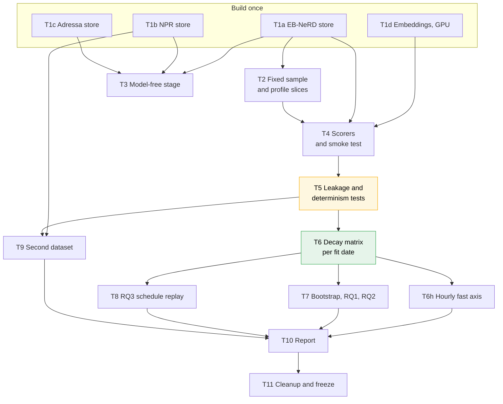
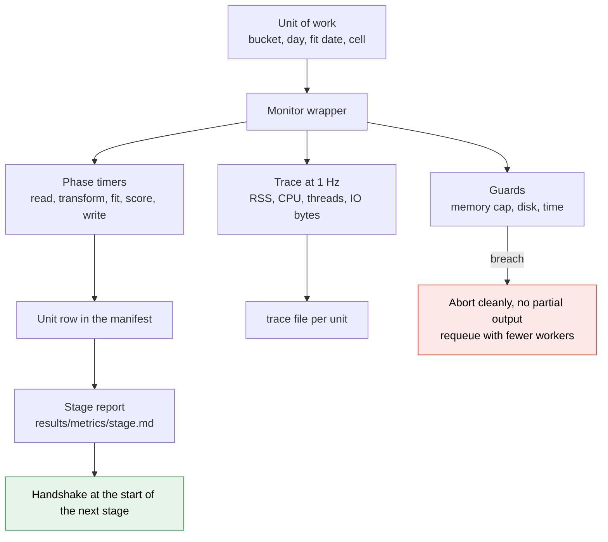
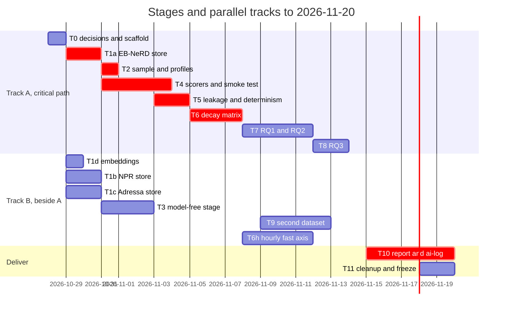

# Stage-by-stage plan

The execution plan for the temporal-degradation study: what each stage reads and writes, how it runs in
parallel **without changing its result**, how much memory it needs, and how we know it is correct. It builds on
[[Subjects/IRE/Projects/IRE-Term-Project/docs/planning/tasks-explained|tasks-explained]] (what and why),
[[Subjects/IRE/Projects/IRE-Term-Project/docs/planning/architecture|architecture]] (the design record) and
[[dataset-stats]] (measured sizes). Stage ids T0–T10 are the same as the task ids there.

> [!success] Build status, 2026-10-29 evening (T0 to T4 built; measured, not estimated)
> | Stage | State | Evidence (details in [[log]] P34 to P41) |
> |---|---|---|
> | T0 | **done** | `code/monitor.py`, 10 tests passing; memory guard fired once for real (log P35) |
> | T1a | **done** | EB-NeRD store: 113,408,571 clicks, 791,582 users, 785 MB; 07:00 curve reproduced exactly |
> | T1b | **done** | NPR store: 17,622,725 clicks (1,402,576 impression clicks), 118 days, 201 MB |
> | T1c | **done** | Adressa store: 35,236,385 clicks, 3,614,911 users, 81,018 articles, 90 days, 350 MB |
> | T1d | **done** | embeddings for all three datasets on the GPU, 4,830 to 11,510 articles per second, re-encode cosine above 0.99999 |
> | T2 | **done** | 20,000 clicks a day for 11 to 24 May; the sample files are byte-identical with 1, 3 and 7 workers |
> | T3 | **done** | `code/modelfree.py` reproduces the P30 table on all three datasets from the stores |
> | T4 | **done, one smoke cell** | five scorers and a shuffle; fit and score seconds and memory measured; the hybrid and the top-K fallback are **not built** |
> | T5 onward | not started | |
>
> Measured at the T4 smoke cell (fit 16 May, day 18 May): recency fit 0.15 s, popularity 0.46 s, meaning 0.09 s, word 1.9 s,
> **click history 18.6 s with a peak of 7.1 GB** (not the 1.5 GB estimated), score time 0.2 to 4 s per 20,000 clicks. A fit
> state of 7.1 GB allows **2 worker processes** in the 16 GB pool, so T6 runs 2 fit dates at a time.

> [!important] Status — T0 to T4 built (see above); everything after is planning
> **Every time, size and memory figure below is an estimate** unless it says *measured*; T4 replaces the estimates
> with measurements and sets the worker counts. Apart from the model-free curves in [[log]] P28, P30 and P32 (which use
> no scorer), no result exists, so none is claimed. Re-checked against the decisions of 2026-10-29 (D21, D22, D23): see
> [[cross-check]] F15–F26.

> [!important] How this file relates to the others
> [[current-plan]] is the **master** for what and when; this file is the master for **how**: parallelism,
> memory and the gates. [[cross-check]] compares the two, item by item. The older planning documents
> (`tasks-explained`, `architecture`, `summary`, `log`) are in `docs/planning/`.

> [!success] B1 decided 2026-10-29: option D ([[current-plan]] section 4)
> Fit and score on **one click corpus**: the validation users' history clicks, 4–25 May. Fit dates 10–23 May, evaluation
> days 11–24 May, about 105 cells. The **sample unit is a click** (20,000 a day), the **candidate source is the
> 48-hour publish-time pool**, the metrics are MRR and recall over about 400 candidates. Option A (the train users'
> impression slates, 18–25 May) is a cross-check and option B a robustness run. Rows marked *(D)* below were rewritten for
> this; cell counts are estimates until T4 measures fit times.

## 1. The shape of the pipeline, and where parallelism is safe

**Read it as:** the four stores are independent and can be built at the same time; T3 can run beside T4; and T6
does not start until the leakage and determinism tests in T5 pass. The decay matrix is the single point
everything after it depends on.

## 2. Cross-cutting rules (apply to every stage)

### 2.1 The determinism contract

A parallel run must give **byte-identical outputs** to a serial run. These rules make that true by
construction, and T5 tests it.

| Rule | Why it protects correctness |
|---|---|
| **The unit of parallel work is independent and writes its own file.** Units are: a user-hash bucket, a day, a fit date, or one (fit date, day) cell. No two units write the same path. | No locks, no ordering, no lost writes. |
| **Randomness is keyed, not sequential.** A sample or bootstrap draw uses a counter-based generator seeded from stable keys, e.g. `SeedSequence([seed, day])` or a hash of `(user, article, time, seed)` for a click. Never a generator shared across workers and never Python's built-in `hash()`. | The draw for a unit is the same whichever worker or order runs it. |
| **No floating-point sum is split across workers.** Each metric for a click is computed inside one worker, in a fixed order. Parallel work is across groups of clicks, never inside one reduction. | Float addition is not associative; splitting a sum changes the last digits. |
| **One thread per worker for numeric libraries** (`OMP_NUM_THREADS=1`, `OPENBLAS_NUM_THREADS=1`, `MKL_NUM_THREADS=1`), and parallelism across processes. | Multi-threaded BLAS can change summation order with the thread count, and threads times processes would oversubscribe 32 cores. |
| **Sort before you write and before you hash.** Output rows are sorted by explicit keys; vocabularies are built from sorted tokens; no iteration over a `set` or `dict` decides an output. | Removes dependence on hash randomisation and arrival order. |
| **Outputs are written to a temporary name and renamed**, and a manifest line is appended only after the unit is complete. A restart skips manifest days and deletes partial files. | A crashed run cannot leave half a result that looks complete (the pattern the Adressa converter already uses). |
| **Inputs are read-only and shared by memory map.** Embeddings and stores are opened with `mmap`, never copied per worker. | No worker can change an input, and memory is not multiplied by the worker count. |
| **Every stage ends with a count and a checksum in its manifest.** Row counts reconcile with the profiled figures in [[dataset-stats]]. | Catches silent truncation. |

### 2.2 The resource budget

| Resource | Available (measured 2026-10-27) | Rule |
|---|---|---|
| CPU | 32 cores | Worker processes: at most half the cores unless a stage says otherwise; the rest stay free for I/O and the desktop. |
| RAM | 31 GB total, about 21 GB available when checked | The worker pool uses **at most 16 GB in total**, leaving at least 4 GB headroom. Workers = `min(cores/2, floor(16 GB / peak per worker))`, with the peak measured in T4. |
| GPU | one RTX 4060 laptop GPU (8 GB) | Used only for the one-off embedding step (T1d). **Checked 2026-10-29:** torch 2.5.1 (CUDA 12.1) sees the card, 7.8 GB free of 8.2 GB. torch is installed in the user site (`~/.local`), **not** in the A1 `.venv`, so a script that needs it cannot run in isolated mode (`-I`); T1d reads only the article tables, not untrusted data, and runs without `-I` from a clean directory. |
| Disk | 23 GB free after the EB-NeRD copy | See the disk budget in section 4. Never extract the Adressa tarball (154 GB). |

### 2.3 Memory habits used everywhere

- **Read only the columns and rows needed**: parquet projection and a predicate on day or bucket; lazy polars
  scans, collected per unit. `history.parquet` alone is 1.2 GB compressed and holds about 238 M clicks once
  exploded (1,579,672 rows at a mean of 151 per row; fewer after removing users who appear in both train and
  validation history), so it is never exploded in one piece.
- **Small dtypes**: `int32` ids, `int32` epoch seconds, `float32` scores and embeddings. Strings only where text
  is needed.
- **Partition by the unit of work**, so each worker holds one partition: 16 user-hash buckets, per-day files.
- **Bounded chunks** for anything that multiplies (pairs of candidates and profile items): a chunk size
  parameter, e.g. 2,000 impressions at a time, so the peak does not grow with the sample.
- **Cap and say so**: reader profiles use the most recent *M* clicks (a parameter, default 50, same for every fit
  date and scorer) so very heavy readers cannot blow up memory or dominate a score. The cap is a design
  decision recorded in the log, not a hidden detail.
- **Free early**: delete a day's arrays before reading the next; one result shard per unit instead of holding
  the matrix.

### 2.4 The metrics ledger — what is measured, at which point

Every stage writes its measurements to `results/metrics/<stage>.parquet` (one row per unit) next to its manifest, so
a number in the report can be traced to a file. Nothing here is a result yet; every threshold is a default to be
confirmed in T4. **No online serving system is built**: the "serving" rows are *offline proxies* (cost and state size
measured per scored click), and the report says so.

**A. Inputs (data quality; T1, T2, T3).** Written once per store as `reports/input_<dataset>.json`.

| Metric | Why | Fails the run when |
|---|---|---|
| rows, users, articles, clicks per day and per source | reconcile with [[dataset-stats]] | a total differs from the profiled figure |
| null rate per column; publish-time coverage (EB-NeRD 98.98 %, Adressa measured, NPR 100 %) | clicks without a publish time cannot be placed in the pool | coverage falls below the profiled value by more than 0.5 points |
| clicks published after the click (EB-NeRD 0.03 %, Adressa 1.28 %, NPR 0 %) | impossible ages | counted and reported; the run stops if above 5 % |
| article age at click: quantiles, share within 24 and 48 h | sets the pool window | median moves more than 20 % from [[dataset-stats]] |
| pool size per click (min, median, max) | a tiny pool inflates MRR | median below 50 candidates |
| share of sampled clicks excluded (article older than the window, or no publish time) | selection bias of the protocol | reported always; above 10 % needs a log entry |
| reader profile length (median, share empty, share capped at *M*) | regime B depends on it | reported always |
| embedding shape, NaN count, unit norm | a bad encode would look like a weak scorer | any NaN, or norm off by more than 1e-3 |
| id-map coverage (every click's user and article are in the map) | silent drops | any miss |
| duplicate `(user, article, time)` rows | double counting | reported; above the profiled rate fails |

**B. Process (every unit; written to the manifest).** rows in and out, fit seconds, score seconds, peak resident
memory, worker count, input and output checksums, config hash, code hash (hash of the source files, since no git
is required), seed. A unit whose peak memory exceeds the budget of section 2.2 is logged and re-run with fewer workers.

**C. Outputs: quality, with intervals (T6, T6h, T7, T9).** Every value is `x [lo, hi]` with *n* and the dataset.

| Metric | Level |
|---|---|
| MRR and recall@10 (primary); AUC and nDCG@5 (secondary) | per scorer, regime, fit date, evaluation day |
| **decay** Δ(r, d) = M(d−1, d) − M(r, d), paired bootstrap | per scorer and regime; against days or hours since the fit |
| **share scorable** (candidates and clicks the scorer can score at all) | per scorer: click history and popularity cannot score an unseen article, so this is the mechanism |
| two-seed noise margin of the scorers that have a seed | T4, used to read a flat curve |
| sensitivity: pool window 24, 48, 72 h; sample *N*; profile cap *M*; seed | T7, reported as a table, not hidden |

**D. Fresh versus decayed: an exact accounting (T6, T7).** Fresh and decayed are not left to a plot. For a cell
(*r*, *d*) every sampled click belongs to exactly one stratum, **defined by the fit date *r* of the frozen model**:

| Stratum | Article published | What it means |
|---|---|---|
| S0 *seen* | at or before the end of day *r* | the frozen model could have learned it |
| S1 *missed* | after *r* and up to the end of day *d* − 1 | the frozen model never saw it; the daily-rebuilt control did |
| S2 *new today* | on day *d* | neither model saw it |

The per-click ranks are stored with the stratum (and an article-age bucket of 0–1, 1–6, 6–24, 24–48 h). Then, as an
exact identity (the clicks are the same for both models): the mean metric of a model is
M = Σₖ sₖ · Mₖ with sₖ the stratum's share of the clicks, so
**Δ(r, d) = Σₖ sₖ (M_control,ₖ − M_frozen,ₖ)** with no remainder. Each stratum's term is reported with its interval, so a
decay curve reads as "S1 explains x of the gap, S0 explains y". T5 tests that the strata partition the clicks and
that the terms add up to Δ exactly (within `float32` rounding, stated).

**E. Serving proxies (T4, T6h, T8).** Measured offline, per scorer:

| Metric | Meaning for a deployment |
|---|---|
| fit seconds and peak memory of one fit | the price of one rebuild |
| score milliseconds per click (one thread) and candidates per click | per-request latency proxy |
| state size on disk and in memory | what a serving node must hold |
| share unscorable at serve time as a function of hours since the fit | how often a request falls back (cold-start rate) |
| quality against hours (T6h) or days (T6) since the fit, as a **staleness-at-serve** curve, and the same for a rebuild every *k* | the fresh-versus-decayed trade-off a site would face |
| incremental update (T6h): seconds per hourly update against a full refit, and whether it reproduces the refit exactly | the cheap alternative to rebuilding |

**F. Robustness metrics (T5, T7).** Hash equality across worker counts and orders; mutation tests detected; planted
decay recovered (see T5); the bootstrap interval width against *n* on a spot check.

### 2.5 Monitoring — inside a stage and between stages

One small module, `code/monitor.py` (to be built in T0, used from T1a; **not written yet**), wraps every unit of work.
It uses `psutil` (present in the A1 environment, version 5.9.8, checked 2026-10-29) and `resource` from the standard
library; GPU memory comes from `nvidia-smi` in T1d only. Its own cost is measured in T5 and must stay under 2 % of a
unit's time (a default; if it does not, the sampling interval is raised).

**Read it as:** every unit reports what it did and what it cost; a guard that is breached stops the unit without leaving a
result; and the next stage refuses to start unless the previous stage's report and hashes check out.

**Intra-stage (within a unit and across the workers of a stage).**

| Measured | How | Why | Guard (defaults) |
|---|---|---|---|
| time per phase: read, transform, fit, score, write | phase timers in the wrapper | shows which phase dominates and where a parallel unit waits | a unit over 3 times the stage median is logged as a straggler |
| resident memory (RSS) over time, and its peak | `psutil` sample every second, plus `ru_maxrss` at the end | sets the worker count (T4) and finds leaks | **abort** above the per-worker cap = 16 GB / workers; warn at 85 % of it |
| CPU use and thread count | `psutil` | one thread per worker is a rule (section 2.1); more means a library ignored it | warn when threads per worker exceed 1 for numeric work |
| bytes read and written, rows per second | `psutil` I/O counters, row counts | finds an I/O-bound stage, so more workers would not help | reported |
| worker idle share (time waiting for work) | stage level, from unit start and end times | uneven units (days of different size) waste workers | above 30 % is logged, and unit sizes are reconsidered |
| system memory available and **swap growth** | `/proc/meminfo` every 5 seconds | a run that starts swapping is slow and unfair to timings. The machine has a 30 GB swap partition with about 2 GB already used, so the rule is *growth during the run*, not zero | **abort** if swap grows by more than 1 GB; warn at 4 GB available |
| free disk | `shutil.disk_usage` before each unit | the converter's 6 GB guard, applied everywhere | **abort** below 6 GB free |
| GPU memory and utilisation (T1d) | `nvidia-smi` | one 8 GB GPU shared with the desktop | warn at 90 % |
| numeric health | NaN and infinity count in each output shard | a bad scorer must not write a believable file | **abort** on any |

**Inter-stage (between stages, the handoff).**

| Measured | How | Why | Guard |
|---|---|---|---|
| **handshake** | each stage's manifest records the hashes of the upstream manifests it read; the next stage recomputes them at its start | a downstream result built on an upstream that later changed would look valid | mismatch: the stage refuses to run and marks its own results **stale** |
| row-count and schema reconciliation | the upstream's output counts and schema hash against what the downstream reads | silent truncation, a changed column | any difference stops the run |
| stage wall time against the plan | actual start and end against the gantt of [[current-plan]], and against the estimate for the stage | the schedule has no slack | above 1.5 times the estimate: a log entry and a decision to cut or continue |
| peak RAM, total CPU seconds and bytes written per stage | summed from unit rows | the totals that go into the cost story of RQ3 and the disk budget of section 4 | a stage over its disk estimate by more than 50 % is logged |
| cumulative disk after each stage | `disk_usage` | the 23 GB free is the real limit | below 8 GB free stops new builds until cleanup |
| config and code hash of the stage | hash of the config file and of the source files | tells which run produced a result when no git is used | two stages with different configs on the same data stop at the handshake |
| manifest completeness | every unit of the stage's plan has a manifest line | a missing unit is a missing cell | incomplete: the next stage does not start |

**Where it is written.** Per unit: a row in `manifest.jsonl` and a trace file `results/metrics/trace/<stage>_<unit>.parquet`
(one row per second; small). Per stage: `results/metrics/<stage>.md`, generated, with the table above filled in and the
breaches listed. T10 collects them into one table in the report (time, peak memory and disk per stage, planned against
actual). Thresholds are defaults; T4 replaces them with measured values.

## 3. The stages

Each stage lists: **In**, **Out**, **Method**, **Parallel** (the unit, and why it cannot change the result),
**Memory**, **Correct when** (the gates), and **Done when**.

### T0 — Decisions and scaffold

| | |
|---|---|
| In | the open decisions in [[Subjects/IRE/Projects/IRE-Term-Project/log|log]]; your answers |
| Out | `code/` (the converter and its tests are already there), the `results/`, `figures/` and `report/` folders, and **`code/monitor.py` with its tests** (section 2.5) |
| Method | record the memory and worker policy of section 2; no git repo or committed hypotheses are required (log D13, D23) |
| Parallel / memory | none |
| Correct when | the folders exist and the policy is written down; the monitor's tests pass: a unit that allocates past its cap is aborted and leaves no output, a stale upstream is refused at the handshake, a swap-growth or low-disk reading stops a unit |
| Done when | decisions logged |

### T1 — Compact, leakage-checked stores (four independent builds)

**T1a — EB-NeRD store.** *(raw data copied into `data/ebnerd/large/`, verified by checksum on 2026-10-27)*

| | |
|---|---|
| In | `data/ebnerd/large/`: `articles.parquet`, `{train,validation}/behaviors.parquet`, `{train,validation}/history.parquet` |
| Out | `data/ebnerd/store/` with `articles/`, `clicks_by_day/` (partitioned by click date), `clicks_by_user/` (16 user-hash buckets, sorted by user then time), `slates/` (per day), `manifest.json` |
| Method | 1. **articles:** drop the 1993 outlier; `text` = title plus subtitle; keep `published_time`. 2. **clicks:** explode `article_id_fixed` with `impression_time_fixed` per user (history) and `article_ids_clicked` with `impression_time` (behaviours); **de-duplicate** on exact `(user, article, time)` only. Measured on the two days where both sources exist (18 and 25 May), only 0.4–0.7 % of `(user, article)` pairs appear in both and 0.1 % of matched pairs lie within 60 seconds, so the two sources are **different events, not duplicates**; the overlap is reported, not merged. **Click-source report (gate for B1):** clicks and users per day by source (history, impression) go to the manifest. 3. **slates** (used only by the option-A cross-check, not by the main run): `impression_id, user, time, candidates, clicked`, one file per day. 4. **Slate-order check** (cross-check only): is the clicked item's position in the slate informative? If yes, slate order is banned as a tie-break (decision D11). 5. **Day definition and time zone:** the click-forward corpus uses the **calendar date of the stored timestamps**, set by one config value; the dataset's 07:00 boundary applies to slates only. Whether EB-NeRD's stored times are UTC or Danish local time is **not established** (log P32), so the check is made here and the answer recorded in the manifest. |
| Parallel | **Unit: one of 16 user-hash buckets**, where `bucket = splitmix64(user_id) mod 16` (own hash, version-independent). Users never span buckets, so explode and de-duplicate inside a bucket give the same rows as one global pass. Per-day outputs are then written by day (unit: day). Workers: 8. |
| Memory | one bucket at a time: about 15 M exploded clicks (238 M / 16) at 12 bytes is about 180 MB, under 1 GB with overhead, so 8 workers stay under 8 GB (estimate). |
| Correct when | (a) clicks rows equal history rows plus behaviour clicks minus measured duplicates, with every term reported; (b) every impression's clicked ids are in its candidates (or the mismatch is counted); (c) **totals** match [[dataset-stats]] (24,630,275 impressions; 24,783,679 clicks), and the calendar-date daily table is re-derived from the store and matches; (c2) the **model-free hourly curve** of [[log]] P28 is reproduced from the store (EB-NeRD 07:00 fit: 19.5, 59.7, 77.2, 90.8 % at 1, 2, 3, 6 h); (d) a 1-worker run and an 8-worker run give identical checksums per output file; (e) no click earlier than 2023-04-27 or later than 2023-06-01 |
| Input report | `reports/input_ebnerd.json`: the input metrics of section 2.4 A, per source and per day |
| Done when | all gates pass and the manifest records counts and checksums; the **fit-corpus choice (option D, with A and B as alternatives) is a single config value** |

**T1b — NPR store.**

| | |
|---|---|
| In | `data/npr/raw/behaviors/behaviors_00..04.parquet`, `articles_wobody_wourl.parquet` |
| Out | `data/npr/store/` in the same three tables, plus `algo` (the recommender policy) and `positions` on slates |
| Method | map string ids to `int32` by sorted order of the full id set (deterministic); local day = UTC minus 3 hours; drop outage days (under 3,000 impressions); history clicks come from the timestamped history lists |
| Parallel | **Unit: one behaviours file** (5 files; users may span files, so the user-level step, de-duplicating and ordering, is done once afterwards on the concatenated small result: 1.4 M rows) |
| Memory | under 2 GB (the whole dataset is 855 MB extracted) |
| Correct when | 1,402,576 impressions; 116 days with data; one click per impression; every clicked item present in `articles` |

**T1c — Adressa store.** *(raw already converted and verified: `data/adressa/parquet/`)*

| | |
|---|---|
| In | the 90 per-day parquet sets |
| Out | `data/adressa/store/`: `clicks_by_day/` (article events only, integer ids), `articles/` (about 81 k rows: one row per article id, its latest `publishtime`, title, keywords, category, author), `pool_index/` |
| Method | keep events with `id` present; map user and article ids to `int32` by sorted order; take the article attributes once per article; parse `publishtime` (ISO 8601, UTC) to epoch seconds; clicks before publish time (1.3 %) are flagged, not dropped |
| Parallel | **Unit: one day** for the click files; the id maps come from one cheap global pass over `userId` and `id` only (two columns), so they do not depend on worker order |
| Memory | one day at a time, about 0.3 GB. The id pass reads two columns of 113.6 M rows as dictionary-encoded strings (estimate under 3 GB); done once, single process |
| Correct when | 35,244,078 article clicks; 4,805,071 users in the map; 81,018 articles (plus the null id removed); per-day counts equal the table in [[dataset-stats]] |

**T1d — Embeddings.**

| | |
|---|---|
| In | the article tables from T1a, T1b, T1c; the multilingual MiniLM that A1 used (`src/retrieval/encode.py`) |
| Out | `data/<dataset>/store/emb_minilm.npy` (`float32`, rows in article-table order) and an `ids.npy`; EB-NeRD is about 125,541 × 384 × 4 B = 193 MB |
| Method | encode `text` in batches on the GPU if torch sees it, else on the CPU. **Compare against A1's cache** (`minilm_125541_…npy`) on a sample of rows: cosine above 0.999 shows the id order matches; this is the check that resolves the open question in the log |
| Parallel | GPU batches in a fixed order; the batch size changes only speed. Encoding is a **one-time build step**: after it the file is data, with a recorded checksum, so GPU non-determinism cannot leak into the experiment |
| Memory | VRAM under 8 GB at batch size 128; RAM under 2 GB |
| Correct when | shape equals the article count; no NaN; unit-norm check; the A1 cross-check passes |

### T2 — The fixed sample and the profile slices *(D)*

| | |
|---|---|
| In | the validation users' history clicks (`clicks_by_user`, 4–25 May) with article publish times |
| Out | `data/ebnerd/store/sample/`: `clicks_d=<day>.parquet` (**20,000 clicks per evaluation day**, each with user, article, time), `profiles_d=<day>.parquet` (for each sampled user, their clicks before the day's end, time-sorted, last 300 at most) |
| Method | **Selection by key, not by random stream:** `splitmix64(hash(user, article, time) xor seed)` for every click of the day, keep the 20,000 smallest: order-independent, exactly 20,000, the same under any worker count. A regime-B profile uses only clicks **strictly before** the sampled click and never the click itself, by a time mask on the slice. The candidate pool (articles published at or before *t* and within the last 48 h) is derived from publish times at scoring time and is not stored |
| Parallel | **Unit: one day** (14 evaluation days, 11–24 May); workers: 7 |
| Memory | one day is about 9–13 M clicks; project to `user, article, time` first, take the 20,000 by key, and only then fetch profiles. Profile slice about 20,000 users × up to 300 clicks (estimate under 100 MB per day) |
| Correct when | exactly 20,000 clicks per day, no duplicates; the **evaluation cohort and days are an explicit config**; the same clicks when run twice and with 1 or 7 workers; the file is written once and never regenerated (hash in the manifest); clicks whose article is older than the pool window, or has no publish time (about 1 %), are counted and reported, not silently dropped |
| Done when | all 14 days written; hash recorded |

### T3 — The model-free stage (RQ0)

| | |
|---|---|
| In | clicks and articles of all three datasets (the T1a, T1b and T1c stores) |
| Out | `results/rq0/` tables: age-at-click distribution; for each fit date *r* and day *d*, the share of clicks on articles published after *r*; the **hourly curve per dataset and per fit hour** with intervals over fit days (first computed as one-off scripts: [[log]] P28, P30, P32) |
| Method | counts over the full click tables (not the sample), with a bootstrap over days or users for intervals |
| Parallel | **Unit: one evaluation day**; the bootstrap uses keyed seeds per day |
| Memory | a day of clicks, under 200 MB |
| Correct when | the age quantiles reproduce [[dataset-stats]] (EB-NeRD median 3.0 h); the curves reproduce [[log]] P30 (hours to 50 % of 2, 7 and 13 h for EB-NeRD, Adressa, NPR at a 07:00 fit) |
| Runs beside | T4 |

### T4 — The scorers and the smoke test

| | |
|---|---|
| In | the T1 stores, T1d embeddings, T2 sample |
| Out | `code/` scorers behind the interface in [[Subjects/IRE/Projects/IRE-Term-Project/docs/planning/architecture|architecture]]; a measured table of **fit seconds, score seconds and peak memory per scorer** — the numbers that set the worker count |
| Method and parallel structure | see below |
| Candidates and metrics *(D)* | for a click at *t* the candidates are the articles published at or before *t* and within the last 48 h (about 340–465, measured); the primary metrics are **MRR and recall@10** of the clicked article, with paired bootstrap intervals; AUC and nDCG@5 are secondary. The pool window (24, 48, 72 h) is a sensitivity parameter |
| Monitoring baseline | from the monitor's traces: RSS peak and time per phase per scorer, which phase dominates, the I/O-bound or CPU-bound verdict, the worker count and the thresholds of section 2.5 that replace the defaults |
| Serving proxies | per scorer: fit seconds, peak memory, score milliseconds per click on one thread, state size, share scorable (section 2.4 E); recorded in `results/metrics/t4.parquet` |
| Hybrid and ties | unscorable candidates tie at the bottom in a seeded shuffle keyed by the click (D11); the hybrid standardises scores per click, not per slate |
| Correct when | each scorer alone beats a seeded shuffle on a smoke day, with a paired interval; the recency gap is exactly 0 (the recency check); a top-*K* variant of the co-click table, if used, is compared with the full table on a sample and the difference is reported |
| Done when | the table of seconds and memory is in the log, and the grid size (section 5) is confirmed or cut |

**How each scorer is fitted and scored, with its memory plan**

| Scorer | Fit (per fit date *r*) | Score | Memory | Parallel-safety note |
|---|---|---|---|---|
| **Recency** | nothing | `−(t − published)` | none | the harness self-check |
| **Popularity** | click counts per article in the 7-day window | the count | one array over articles | pure counting |
| **Word matching** | document frequency per word and average length over articles published by *r*; **vocabulary from sorted tokens** | BM25 of the candidate against the profile's words, with the frozen weights; scored in chunks of clicks | a sparse term-frequency matrix of all articles (CSR, `float32`); the profile matrix and the candidate rows are built per chunk of 2,000 clicks | each click is scored alone, so chunks run in any order |
| **Meaning matching** | nothing | cosine of the candidate embedding to the mean of the profile's embeddings | `mmap` of the 193 MB embedding file, shared by all workers | pure gathers and dot products per click |
| **Click history** | sparse user × item matrix from the window (about 25 M clicks, estimate), then item-to-item co-click cosine, with heavy readers damped; computed in **blocks of item columns** so only one block is dense at a time | sum of similarities between the candidate and the profile's items; an unseen candidate is unscorable | the item-item matrix over about 5–15 k active articles is at most about 1 GB as `float32` (estimate); if the measurement says more, keep only the top-*K* neighbours per item and report the effect | the fit is one process; fit dates are separate units |
| **Hybrid** | weights tuned on the last day of the window by an inner split: the components are refitted on the first six days and the weights tuned on day *r* with profiles before *r* | weighted sum of per-click standardised scores | the component fits are done twice per *r* | tuning is per fit date, so fit dates stay independent |

### T5 — Leakage and determinism tests (the gate before T6)

| Test | How it works | Must |
|---|---|---|
| **Boundary mutations** | move the fit boundary one day later; add the sampled click itself to a regime-B profile; let hybrid weights see day *d*; **let the candidate pool include articles published after the click time** | each **fail** the leakage test, i.e. the harness detects them |
| **Recency gap** | recency scored in every cell | gap exactly 0 |
| **Serial equals parallel** | run a small grid with 1 worker and with 8 workers, hash every result shard | identical hashes |
| **Order independence** | run the cells of the same grid in a shuffled order | identical hashes |
| **Resume** | kill a run midway, restart | identical to an uninterrupted run |
| **Sample stability** | rebuild the ids and compare with the stored hash | identical |
| **Hourly-gap check** | clicks per hour over the whole corpus; any hour with a count far below its neighbours (one such hour, about 01:00, shows in the 18-hour bucket of the measured curve, ten times lower than its neighbours) is explained before T6h | explained or excluded, in the log |
| **Time-zone and day check** | a click at 23:59 and one at 00:00 fall on the right calendar days; NPR local-day edges (UTC minus 3 h); the EB-NeRD time-zone answer from T1a is used | pass |
| **Pool check** | every candidate pool contains only articles published at or before the click and within the window; the clicked article is in its pool, or counted as excluded | pass |
| **Planted decay** | a small synthetic corpus generated with a *known* turnover rate (articles replaced at a set rate, readers who click new articles with a set probability); run the pipeline end to end | the measured unseen share and the click-history decay match the planted values within the intervals, and a planted zero-turnover corpus gives zero decay for every scorer |
| **Monitor** | run a deliberately memory-hungry unit, a slow unit and a unit with a NaN; change an upstream file after a downstream stage ran; run a stage with and without the monitor | the hungry unit is aborted and requeued with no partial file; the straggler is logged; the NaN stops the unit; the downstream is marked stale; the monitor adds under 2 % to the unit time |
| **Strata identity** | the strata S0, S1, S2 partition the clicks of every cell; the stratum terms sum to Δ | exact, within the stated rounding |
| **Input gates** | the thresholds of section 2.4 A on every store | pass, or the stage stops with the failing metric named |
| **Volume equality** *(D)* | the windows of a fit-date family differ in click count by less than a stated factor | pass, or the run fails |

**Done when:** all pass and the results are in the log. A failing determinism test blocks T6; it is never skipped.

### T6 — The decay matrix (EB-NeRD)

| | |
|---|---|
| In | stores, sample, scorers |
| Out | `results/decay_matrix/r=<fit date>/d=<day>/part.parquet`: per-click values (the rank of the clicked article in its pool, from which MRR, recall@10, AUC and nDCG@5 follow), keyed by `(r, d, scorer, regime)` and carrying the **stratum (S0, S1, S2), the article-age bucket, the pool size and a scorable flag**; `manifest.jsonl` with rows, seconds and peak memory per cell |
| Method | for each fit date *r* of 10–23 May *(D)*: build the 7-day window, fit all scorers once (state held in memory), then score the sample of every day *d* > *r* (to 24 May) in regime A and regime B. About 105 cells, staleness up to 14 days (*estimate*) |
| Parallel | **Unit: one fit date** (14 units, each fits once and scores its days in order). Workers = `min(16, floor(16 GB / measured peak))`. Each unit writes only its own shards. The daily-rebuilt control is the cell (*d* − 1, *d*), which belongs to the unit *r* = *d* − 1 |
| Memory | one fit state (at most about 1.5 GB for the click-history table, estimate) plus one day's sample and profile slice (about 0.3 GB) per worker; with 6 workers about 12 GB (estimate; measured in T4) |
| Correct when | the recency gap is 0 in every cell; every cell of the fit-date family is present (about 105 under option D); the same fit date gives identical shards on rerun; per-click ranks stay between 1 and the pool size, and MRR and recall between 0 and 1 |
| Done when | the manifest is complete and the checksums are recorded |

### T7 — Bootstrap and the RQ1 and RQ2 analysis

| | |
|---|---|
| In | the matrix shards |
| Out | `results/rq1_rq2/` tables and `figures/` plots: decay against days since the fit, per scorer and regime, with paired intervals; the diagnostics |
| Method | **paired bootstrap by counts:** for each evaluation day, draw one matrix of resample counts (1,000 × 20,000 clicks, from `SeedSequence([seed, day])`) shared by **every** scorer and fit date of that day, and compute all resampled means as one matrix product with the per-click metric columns. Sharing the draw is what makes differences paired |
| Parallel | **Unit: one evaluation day.** The product is single-threaded per worker, so summation order is fixed. 14 workers possible |
| Memory | the count matrix is 1,000 × 20,000 in `float32`, about 80 MB, and the metric columns for one day are 20,000 × (cells in that day), under 1 GB |
| Correct when | rerunning with 1 and 14 workers gives identical intervals; a paired difference of a scorer with itself is exactly 0 with a zero-width interval; intervals shrink as *n* grows on a spot check |
| Fresh versus decayed | the stratum decomposition of section 2.4 D for every decay curve; share scorable per scorer; the sensitivity table (pool window, *N*, *M*, seed) |
| Reporting | every number as `metric = x [lo, hi]` with *n* and the dataset |

### T8 — RQ3: replay the rebuild schedules

| | |
|---|---|
| In | the matrix, measured fit seconds |
| Out | `results/rq3/`: for each interval *k* in 1, 2, 3, 5, 7, 14 days, the mean metric, the cost (rebuild count, fit seconds, peak memory) and the staleness-at-serve distribution (days since the last rebuild, averaged over days) |
| Method | for each day *d*, pick the cell (the latest rebuild at or before *d*, *d*): a lookup into the matrix, no refitting |
| Parallel / memory | trivial; one pass over per-day summaries |
| Correct when | *k* = 1 equals the daily-rebuilt control exactly; the bootstrap rules of T7 apply |

### T9 — The second dataset (NPR; Adressa optional)

| | |
|---|---|
| In | the NPR store (T1b) and the same scorer code |
| Out | `results/npr/`: the same matrix and plots under the same click-forward protocol, reported per `algo` of the click's impression and pooled over days into windows |
| Method | the T6 driver with day windows of 7 days pooled; the `top-state` mix held fixed in headline curves; a position scorer added as a reference. About 10,000 clicks a day, so **all clicks are used, not 20,000**; 82 % of readers are one-time, so regime-B profiles are mostly empty and that is reported; the pool window is larger (NPR publishes about 750 articles a day) and is a sensitivity parameter (24, 48, 72, 168 h). The hourly fit-hour dependence is weak on NPR (log P32), so a daily grid is enough there |
| Parallel | unit as in T6; NPR is small enough that all fit dates run at once |
| Memory | far lower than EB-NeRD (about 10 k impressions a day, sparse histories) |
| Correct when | the T5 tests pass on NPR's day edges; per-`algo` cells carry their *n* |
| **Adressa variant** | the **same harness**: Adressa has article clicks and publish times, so the pool protocol applies as is (the window is a design choice, with the same sensitivity run). 90 days allow fit dates 8 Jan to 28 Mar. First to be cut after T6h's extras |

### T6h — The hourly fast axis (core, gated on measured fit time)

*Why it is here:* on EB-NeRD the median click is on an article 1.4 hours old (97.7 % within 48 hours), and the
model-free curve shows the unseen-click share climbing from 19.5 % one hour after a fit to 77 % at 3 hours, 91 % at
6 hours and about 96 % by 12–24 hours (*measured*, [[current-plan]] section 8). A daily grid sees only the
saturated end of that curve.

| | |
|---|---|
| In | stores, **its own sample drawn by the T2 key rule per (day, hour) bucket**, scorers, the T5-passed driver. The T2 sample of 20,000 clicks a day is only about 830 an hour, too few for the 1–3 hour offsets; the default here is **5,000 clicks per (day, hour) bucket** (*estimate*, set in T4 from the score time) |
| Out | `results/decay_hourly/r=<fit time>/h=<hours since fit>/part.parquet` per-click ranks with the same strata (S0, S1, S2, defined by the fit **time**), age bucket, pool size and scorable flag as T6, and a manifest |
| Method | the T6 driver with **hourly boundaries**: fit at chosen fit times (every *k*-th hour of a block of days, **spread over the whole day** because the fit hour changes the curve, log P32; *k* set from the T4 fit time, starting at 3), evaluate at 1–24 hours since the fit (48 optional), both regimes, the same 7-day sliding window ending at the fit hour; the control is the model fitted one hour before the evaluation hour; the pool window is a parameter (24 h and 48 h). Fit times are **00, 03, … 21 h** (8 a day, the grid of log P32) on a block of 5 days (for example 17–21 May, config; *estimate*), so about 5 × 8 × 24 = 960 cells |
| Parallel | **Unit: one fit time**, as in T6. Consecutive fit hours share 167 of their 168 window hours, so an **incremental co-click update** (add the new hour's counts, remove the oldest hour's) is a later optimisation; it is allowed only if it reproduces the full refit **exactly** (counts are integers) in a test |
| Memory | as T6; the update variant holds one extra hour of counts |
| Correct when | the recency gap is 0 in every cell; for the fit time at 00:00 the mean over offsets 1–24 agrees **within the intervals** with the daily grid's cell (*r*, *r* + 1) (a consistency check between the two grids; the samples differ); the hour-of-day pattern is handled by the control (the hourly-rebuilt model sees the same hour); the unexplained data gap near 01:00 is understood first (see T1a) |
| Gate | one click-history fit under a few minutes, measured in T4; if slower, raise *k*, then shorten the block, before dropping any regime |
| Done when | the manifest is complete and the checksums are recorded |

### T10 — Report and the AI log

Design note and report written from the log and the manifests; `ai-log.md` curated with `/ai-log`; figures from
`results/` only; every question RQ0–RQ3 answered with what was run, including the failures.

### T11 — Cleanup and freeze

| | |
|---|---|
| In | the finished stages |
| Out | a tidy project: no temporary or partial files; `results/` frozen with a manifest hash; scripts that produced reported numbers inside `code/`; a disk report; the one-off analysis scripts of [[log]] P28, P30 and P32 (now only in the session scratchpad) copied into `code/` |
| Method | 1. **Partial files:** list and remove every `*.tmp` and unfinished unit file that has no manifest line (the resume rule makes them safe to delete). 2. **Reproduce:** rerun one small grid from the stores in a clean process and compare hashes with `results/`. 3. **Freeze:** write `results/FROZEN.sha256` (hash of every result file) and set the files read-only. 4. **Where is data:** list every file over 100 MB under the project and confirm that none exists in `~`, `/tmp` or another folder outside the project (the vault rule). 5. **Disk report:** size per folder, and a **list of deletable intermediates** (the stores that can be rebuilt, the raw zips, the Adressa tarball) **for you to approve**; nothing is deleted without that. 6. **Scripts:** every number in the report maps to a script and a manifest line |
| Parallel / memory | none |
| Correct when | the reproduction hashes match; the freeze file verifies; no stray large files; the report's numbers each have a source |
| Never | delete the Adressa tarball or any raw data on my own initiative; edit a result file after the freeze |
| Done when | the disk report and the deletable list are in the log, and you have decided what to delete |

## 4. Disk budget (estimates)

| Item | Size | Status |
|---|---|---|
| EB-NeRD raw copy (`data/ebnerd/large/`) | 3.4 GB | **present, checksum-verified** |
| NPR raw and zip | 0.86 GB + 0.69 GB | present |
| Adressa parquet | 3.11 GB | present, verified |
| Adressa tarball | 17.2 GB | present; **you will delete it later** (after T1c is verified); I will not |
| EB-NeRD store (two click layouts, slates, articles) | about 2–3 GB | estimate |
| Adressa store | under 1 GB | estimate |
| Embeddings (three datasets) | about 0.4 GB | estimate |
| Sample and profile slices (14 days) | under 1.5 GB | estimate |
| Decay matrix (about 25 M per-click ranks: 105 cells × 20,000 × 6 scorers × 2 regimes, plus the hourly grid) | 0.3–1.5 GB | estimate |
| **New data from the plan** | about 6–9 GB | fits in the 23 GB free; the tarball is the reserve |

The EB-NeRD **test set** (1.8 GB, 13.5 M impressions, no click labels) was **not** copied: no ranking metric can
be computed on it. It stays in the A1 folder, read-only, if it is ever needed.

## 5. The schedule, with what runs in parallel

**Read it as:** the stores and embeddings run side by side on day one; T3 runs beside the scorers; and T5 sits
between the scorers and the matrix. **Experiments stop on 2026-11-15**; T6h's extras are the first thing cut, then Adressa, then T9, then
the 10 May fit date.

**Cost control for the grid (about 105 cells, about 6 scorers, 2 regimes, plus T6h).** The smoke test in T4 fixes the real
time. If the grid is too slow, cut in this order, never touching the daily-rebuilt control: lower the sample from 20,000,
drop the 10 May fit date, use every second fit date.

## 6. Failure containment

| Failure | What stops it from reaching a result |
|---|---|
| Worker killed (out of memory) | the manifest skips completed units; the run is restarted with fewer workers; a worker count that was too high is logged |
| Two workers disagree on a shared quantity | none exists to disagree on: inputs are read-only and outputs are per unit |
| A silent difference between serial and parallel | the 1-versus-8-worker hash test in T5 |
| A leak that produces a smooth believable curve | the mutation tests in T5; the recency gap is exactly 0 |
| Disk full | the disk check before each unit (as in the converter); the budget in section 4 |
| A worker leaks or balloons in memory | the RSS guard aborts the unit with no output; it is requeued with fewer workers and the event is in the stage report |
| A downstream stage runs on changed upstream data | the handshake of section 2.5 |
| The run swaps and the timings become meaningless | the swap-growth guard; timings from a run with a breach are marked and not used for the worker count |
| Bad input slips in unnoticed | the input gates of section 2.4 A stop the stage and name the metric |
| The pipeline invents a decay, or hides one | the planted-decay test in T5 (known turnover, and zero turnover) |
| A decomposition that does not add up | the strata identity test in T5 |
| Results change after the report is written | `results/FROZEN.sha256` in T11 |
| Result files edited by hand | `results/` is generated only; a manifest hash is checked at the start of T7 |

## 7. Decisions and questions

| | State (2026-10-29) |
|---|---|
| Team | **3 people, one pipeline** (Noel, Sidhardha, Emil). Who owns which stage is **not decided**; the parallel tracks in section 5 are the natural split |
| Click-history method | **decided: co-click cosine** |
| Hourly fast axis | **decided 2026-10-29: core (T6h)** (D22) |
| Hypotheses | **removed** (D23): not a project requirement |
| Git repo | **deferred by the team**; no deadline |
| Adressa tarball | you will delete it yourself later; I will not |
| B1 | **decided 2026-10-29: option D** (D21), see [[current-plan]] section 4 |
| Instructor notice (D14) | open, low stakes |
| Profile cap *M* = 50 and sample N = 20,000 clicks a day (T6h: 5,000 per day-hour bucket) | my defaults; both change the numbers and are recorded in the log once fixed |

---
[[IRE-Term-Project|← tracking note]] · [[Subjects/IRE/Projects/IRE-Term-Project/docs/planning/tasks-explained|tasks-explained]] · [[Subjects/IRE/Projects/IRE-Term-Project/docs/planning/architecture|architecture]] · [[current-plan]] · [[cross-check]] · [[dataset-stats]] · [[datasets]] · [[Subjects/IRE/_syllabus|IRE course plan]]
