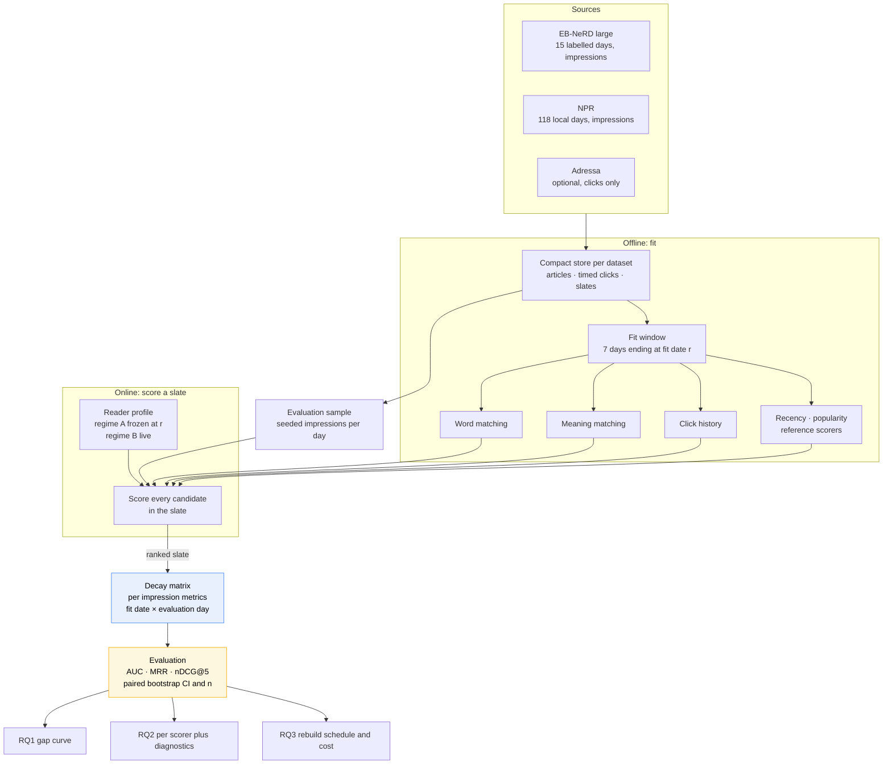

# Term project — architecture

> [!warning] Superseded in part by option D (2026-10-29)
> This design record was written around **impression slates**. The main run now follows option D (click-forward evaluation with a
> 48-hour publish-time pool, [[current-plan]] section 4); the slate protocol is the cross-check. The diagrams and sections below
> that say "slate" still describe the cross-check; **[[stage-plan]] is the authority** where they differ. The numbers in Part E are updated.

**What the system is and what we decided**, for [[IRE-Term-Project]]. The question and the ideas are in
[[Subjects/IRE/Projects/IRE-Term-Project/docs/planning/tasks-explained|tasks-explained]]; the datasets in [[datasets]]; the dated record of decisions and findings in [[log]].
This file is the one that becomes the design note, so it is written to survive being submitted.

> [!warning] Nothing here has been run
> Written 2026-10-26 **before any code and before any result**. Numbers marked *measured* come from the
> profiling in [[datasets]]; numbers marked *estimate* are planning figures; there are no experimental results
> yet, and none may be added to this file until they have been produced.

> [!important] The decision that shapes the design
> **One table, built once: the decay matrix** — the metric for every (fit date, evaluation day) pair, on the
> same sampled impressions throughout. Every research question is a different way of reading it. This buys
> paired comparisons and zero re-running per question, at the cost of fitting every scorer on many dates up
> front.

---

# Part A · The shape

## The pipeline



**Read it as:** fitting is offline and happens once per fit date; scoring is online and happens per slate;
evaluation attaches to the matrix, not to any single run. The offline/online split matters here because the
whole study is about what happens in the gap between them.

## Fit versus score — the vocabulary

| Term | Meaning in this project |
|---|---|
| **Fit date $r$** | Last day of data a scorer was trained on. Fitting uses events with time up to the end of day $r$. |
| **Fit window** | The 7 days ending at $r$. Sliding, not expanding (see Part G). |
| **Evaluation day $d$** | A day with labelled slates, $d>r$. |
| **Staleness $s$** | $d-r$ in days. |
| **Regime A / B** | Reader profiles frozen at $r$ / updated live up to each impression. |
| **Control** | The scorer fitted at $d-1$ and scored on $d$ with live profiles. |

---

# Part B · Data

## Where things live

```
Projects/IRE-Term-Project/
  IRE-Term-Project.md        tracking note
  docs/plan/  current-plan.md (master, what and when)  stage-plan.md (how)  cross-check.md
  ai-log.md
  docs/
    planning/   summary.md  tasks-explained.md  architecture.md  log.md
    reference/  datasets.md  dataset-stats.md
    proposal/   project_proposal_temporal_degradation.md  ..._v1_submitted.md
    ideation/   project-ideas.md  shortlist.md
  data/
    npr/        raw/ + npr.zip                     (present, 855 MB extracted)
    adressa/    parquet/ (verified, 3.11 GB)       (the tarball three_month.tar.gz sits in data/)
    ebnerd/     large/ (copied, checksum-verified) store/ to build in T1; the A1 originals stay read-only
    stats/      per-day CSVs
  code/         scripts and tests
  results/      decay_matrix/  tables/             generated, never hand-edited
  figures/      real result plots only             (never explanation sketches)
  md_figures/   sketches for these docs, if any
  report/       design note and final report
```

**Vault rule applied:** datasets and derived stores stay inside this folder, out of the code repo and out of
the submission zip. EB-NeRD's raw files remain in `Assignments/Assignment-1-Lexical-Semantic-Retrieval/data/`
and are read-only; the `large` set was **copied** into `data/ebnerd/large/` on 2026-10-27 (checksums identical) and T1 reads that copy.

## One schema for all datasets

A dataset adapter's only job is to produce three tables. Everything downstream sees only these.

| Table | Columns | Notes |
|---|---|---|
| **articles** | `article_id`, `published_time`, `title`, `text`, `topics` | `text` = title plus subtitle (as A1's `retrieval_text`, `src/data/schema.py:44`); body kept but unused by default |
| **clicks** | `user_id`, `article_id`, `time` | every timed click: history lists **and** the clicks inside impressions, de-duplicated |
| **slates** | `impression_id`, `user_id`, `time`, `candidates`, `clicked`, `algo`, `positions` | `algo` and `positions` are NPR-only (null elsewhere) |

## The three adapters

| | EB-NeRD large | NPR | Adressa |
|---|---|---|---|
| Labelled days | 18 May 07:00 → 1 Jun 07:00 = **14 full days** (*measured*) | 118 local days (UTC−3, inferred) | 90 days |
| Day boundary | **07:00**, the dataset's own | local midnight | calendar |
| Clicks before the labelled window | yes: history to 27 Apr (*measured*) | none: history starts at 3 Jan | n/a |
| Slate | `article_ids_inview`, median 9, p90 23, 99.4 % have one click (*measured*) | about 10 items, exactly one click | **none — built** (see below) |
| Text | Danish title, subtitle, body | Portuguese title, topics | Norwegian title, keywords, entities |
| Special handling | one 1993 publish outlier; first and last days partial | outage days under 3 000 impressions dropped; `algo` stratified | candidate pool from publish time only |

**Adressa candidate pool (only if Adressa is used):** at time $t$, every article with $\text{publishTime}\le t$
that was published within the last 48 hours — defined from publish time alone, never from later clicks, which
would leak the future. The window is a design choice that moves the numbers, so a sensitivity run is part of
using it. Full list scored, not sampled negatives.

**Adressa storage plan (D17).** The tarball expands to 154 GB (90 members, 1.1–2.9 GB each) against 29 GB of free
disk, so it is **never extracted**. A one-off converter streams the archive with `tarfile` in stream mode, one day
at a time, and writes **one parquet file per day with every field and every event** to `data/adressa/parquet/`
(nested `profile` and list fields stored as JSON text). A 600 000-event probe compressed to 2.7 % of the raw JSON,
so the 90 days were expected to take about 4 GB; the run **measured 3.11 GB, 113.6 M events** (log P23). The small analysis stores (integer user and article ids, a deduplicated article table of about
48 k rows) are then built from the parquet files, not from the tarball, so the 17 GB archive is read once, about
10 minutes, and stays untouched.

**Hourly fast axis (D22, proposed core, EB-NeRD).** Same fit and score code, with fit times on hourly boundaries and
evaluation at 1–24 hours since the fit; scale set by the measured click-history fit time (T4). Details and gate in
[[stage-plan]] T6h; the reason is the measured unseen-click curve in [[current-plan]] section 8.

---

# Part C · Components

## Interfaces

All scorers share one shape, deliberately **not** A1's `Retriever`
(`src/retrieval/base.py:36`), which retrieves top-$k$ from a whole corpus. Here a fixed slate is ranked.

| Piece | Responsibility | In → out |
|---|---|---|
| **`FitWindow`** | The events a scorer may see for fit date $r$ | dataset, $r$, length → articles known at $r$, clicks up to end of $r$ |
| **`Scorer.fit`** | Learn whatever is frozen; record seconds | `FitWindow` → state, `fit_seconds` |
| **`Scorer.score`** | Score a slate | reader context, candidates, time → `{article_id: score}`; an unscorable candidate is *absent* |
| **`ReaderContext`** | A reader's clicks, by regime | user, time, regime, $r$ → ordered clicks (A: $\le r$; B: before the impression) |
| **`Sampler`** | The fixed impression ids per day | dataset, seed, $N$ → ids, saved |
| **`Matrix`** | Per-impression metrics keyed `(r, d, scorer, regime)` | scorer outputs → parquet |
| **`Schedule`** | Replays "rebuild every $k$ days" from the matrix | $k$, matrix → $\bar M(k)$, cost |

**Why not reuse `Retriever`:** it assumes a corpus index and returns a top-$k$ list. Scoring a slate of
articles **published after the fit date** is the whole point here, and an index built at $r$ cannot contain
them. Reuse stops at metrics, bootstrap, tokeniser, encoder and the leakage tests (Part F).

## The scorers

Each states what it gives up. All are "frozen" in a specific, different way — that difference is the study.

| Scorer | What is fitted at $r$ | Score of candidate $c$ for reader $u$ | Buys / costs | Unscorable when |
|---|---|---|---|---|
| **Word matching** | per-word document frequency, average length over articles published by $r$ | BM25 of $c$'s text against the concatenated texts of $u$'s clicks, using **frozen** weights | Cheap, interpretable, exact on shared words; **blind to a word not in the frozen vocabulary** | $u$ has no clicks |
| **Meaning matching** | nothing: encoder is fixed (A1's `minilm` key, `src/retrieval/encode.py`) | cosine of $c$'s embedding to the mean embedding of $u$'s clicks | Never needs an unseen article "learned"; **only the profile can go stale**, so it isolates reader drift; XLM-R was measured unusable on Danish (A1 F37) | $u$ has no clicks |
| **Click history** | item-to-item co-click cosine over readers' clicks in the window, damped for very heavy readers | sum of similarity between $c$ and each of $u$'s clicks | Captures taste text cannot; **a candidate with no co-click row scores nothing** — the coverage mechanism under test | $c$ unseen in window, or $u$ has no clicks |
| **Recency** (reference) | none | $-(t_{\text{impression}}-\text{published})$ | Needs no training; strong in news (A1 F16/F21). **Doubles as a harness self-check: its gap must be exactly 0** | never |
| **Popularity** (reference) | clicks per article in window | the count | Cheap baseline; zero for an unseen article | $c$ unseen |
| **Position** (NPR only) | none | $-$ feed position | Shows how much position alone explains | never |
| **Hybrid** | weights, tuned on the last day of the window with an inner split | weighted sum of per-slate standardised scores | One recommender to quote; **weights themselves go stale**, which is measured | per-component |

**Unscorable candidates** all tie at the bottom, ordered by a **seeded shuffle**, and the share is logged. A1
orders ties by slate order (`rank_slate`, `src/eval/metrics.py:55`) and says why; here that is unsafe, because the
slate order may encode the site's own ranking. T1 checks whether the clicked item's index in the slate is
informative; if it is, slate order must never be used as a fallback.

**Two details that decide whether the lexical result is believable:**

- The BM25 *index* from A1 cannot be reused: scoring an article that was not indexed at $r$ needs the
  formula applied directly with frozen statistics. A word absent at $r$ contributes zero; the alternative
  (assign it the highest weight) is a sensitivity run, because it changes which way lexical decay points.
- The frozen quantity for meaning matching is the *profile*, not the encoder. If the encoder is later
  fine-tuned, the study changes meaning; that is out of scope.

---

# Part D · The protocol

## The leakage boundary — stated before the pipeline is written

> [!important] Boundary
> For fit date $r$ and an impression at time $t$ on evaluation day $d>r$:
> 1. A **scorer's fitted state** is built only from events with time **≤ end of day $r$**, and from articles with
>    `published_time` ≤ end of day $r$.
> 2. A **reader profile** in regime A is the reader's clicks with time ≤ end of day $r$. In regime B it is the
>    reader's clicks with time **strictly before** $t$, and **never the impression's own click**.
> 3. The **candidates** of the slate are scored using only those two things plus the candidate's own text and
>    publish time (which are properties of the candidate, not of the future).
> 4. **Hybrid weights** for $r$ use an inner split inside the window; they never see day $d$.
> 5. The **sample ids** are fixed once and never re-drawn after seeing a result.

Mutation tests (T5) must **fail** when the boundary is moved: shift the fit cut-off by a day and the unseen
article share must change; include the impression's own click in its profile and AUC must jump. A test that
cannot be made to fail is not testing anything. Pattern reuse: `src/data/split.py:226` (`check_no_leakage`),
`:188` (`truncate_history`).

## Evaluation

| Choice | Setting | Why |
|---|---|---|
| Primary metrics | **MRR and recall@10** per click (option D); AUC and nDCG@5 secondary | the clicked article is ranked in a pool of about 400 candidates; the slate-based AUC and MRR remain for the option-A cross-check |
| Secondary | nDCG@5; warm/cold reader slices | cold readers (no profile) are themselves a staleness signal |
| Sample | $N=20{,}000$ impressions per evaluation day, seeded (*A1's default after F34*); fewer on NPR — use all, pooled into windows | an 800-impression harness reported a score outside its own CI |
| CI | bootstrap on per-click (cross-check: per-impression) values; **paired** on differences, `src/eval/bootstrap.py:33`, `:115` | same impressions in every cell |
| Reporting | `metric = x [lo, hi]`, with $n$ and the dataset, always | course requirement |
| NPR | stratify by `algo`; headline curves hold the mix fixed | the mix drifts and looks like decay |

## Reading the matrix

- **RQ1:** fix $r$; $\Delta(r,d)$ against $s=d-r$, per scorer and regime, with paired CIs.
- **RQ2:** the same curves side by side, normalised as % of control; plus the four diagnostics in
  the diagnostics table in [[Subjects/IRE/Projects/IRE-Term-Project/docs/planning/tasks-explained|tasks-explained]]; plus the A − B split.
- **RQ3:** for each $k\in\{1,2,3,5,7,14\}$ pick the right row per day; average; pair with measured fit seconds
  per scorer (rebuilding word weights and rebuilding a co-click table cost very different amounts).
- **Model-free (RQ0):** the article-age curve and the unseen-click share; no scorer involved.

---

# Part E · Size, cost, and what is estimated

| Quantity | Value | Basis |
|---|---|---|
| EB-NeRD evaluation days | 14 full days | *measured* |
| Fit dates | 10 → 23 May, 14 dates | plan, option D (2026-10-29) |
| (fit date, day) cells | **105 (option D)** | $14+13+\dots+1$: fit dates 10–23 May, days 11–24 May |
| Scorer × regime sets | about 6 scorers × 2 regimes | plan |
| Per-click values stored | about 25 M | *estimate*: 105 cells × 20 000 clicks × 6 scorers × 2 regimes |
| Stored size | a few hundred MB as float32 parquet | *estimate* |
| Click-history fits | 14 (daily grid) plus the hourly grid | one per fit date or fit time |
| Time to fit and score | **not known** | measure on the T4 smoke test before committing the grid |

**If the smoke test is too slow:** lower $N$ first, then drop the 10 May fit date, then use every second fit
date. Do not drop the daily-rebuilt control.

---

# Part F · Reuse from A1

Copy, do not import across work items; the A1 repo is separate and graded separately. Reference by path so
the lineage is traceable.

| Need | A1 source | Use |
|---|---|---|
| AUC, MRR, nDCG, recall | `src/eval/metrics.py:34, 71, 94, 107` | per-impression metrics |
| Ranking a fixed slate | `src/eval/metrics.py:55` (`rank_slate`) | take the explicit-tie-break idea; change the fallback (Part C) |
| Bootstrap and paired difference | `src/eval/bootstrap.py:33, 63, 115` | CIs everywhere |
| Leakage checks | `src/data/split.py:188, 226` | pattern for the mutation tests |
| Tokenising | `src/retrieval/tokenise.py` | word-matching text |
| Encoder and cache | `src/retrieval/encode.py` (`encode_cached` keys on the ordered id list) | reuse the 125 541-article embedding cache **only if the id order matches**; otherwise recompute |
| Unified article schema | `src/data/schema.py` | `retrieval_text` convention |

**Not reused:** the BM25 index and `Retriever` interface (Part C), the A1 split (it is a single temporal
split; this study needs a sliding family).

---

# Part G · Alternatives rejected

| Alternative | Why not | What it would have bought |
|---|---|---|
| **Adressa as primary** (the submitted proposal) | article text is on-request, no impression lists, download unfinished | 10 weeks of horizon |
| **One train/test split** | gives one number, not a curve; cannot attribute | simplicity |
| **Expanding window** | confuses "stale" with "less data than the rebuilt model" | more training data |
| **One end-to-end neural model** | the three signals cannot be isolated, so RQ2 cannot be answered | likely higher raw accuracy |
| **Score the whole corpus, not the slate** | EB-NeRD labels only shown candidates; unshown ones have no judgement | a recall-style metric |
| **Equal hybrid weights** | would make the hybrid weak and its decay uninformative | no inner split |
| **LongEval-style retrieval persistence** | would replace the submitted proposal; loses the click-history signal | a ready benchmark |
| **Per-day CIs only** | single NPR days are too thin | no pooling decisions |
| **Position as a fallback ordering** | may leak the site's own ranking | determinism without a shuffle |

---

# Part H · Failure modes and checks

| Symptom | Likely cause | Check |
|---|---|---|
| Recency gap is not 0 | day or time-zone mismatch, or sample changes between cells | recency check (gap must be exactly 0); fail the run |
| Smooth, believable decay that moves with the fit cut-off | leakage in the window | mutation tests |
| Every scorer decays identically | the sample, not the scorer | compare to the control; look at the cold-reader share |
| NPR decay that follows `algo` | policy mix drift | stratify; fix the mix |
| Metric well above the control | profile includes the impression's own click | rule 2 of the boundary |
| Embeddings misaligned | cache keyed on a different id order | check shape and a few nearest neighbours by eye |
| Duplicates inflate co-clicks | history and behaviors both list a click | de-duplicate on (user, article, time) in T1 |
| Disk fills | extracting Adressa unchecked | check `df` first; stream the archive |

---

# Part I · Schedule against 2026-11-20

The schedule is kept in one place, [[current-plan]] section 5, with the same dates drawn as a gantt chart in
[[stage-plan]] section 5. It is not repeated here, so the three cannot drift apart.

**Read it as:** the critical path is T1 → T4 → T6 → T10. Treat **15 Nov as the experiment cut-off**: the report
week overlaps end-sem revision. The cut order is in [[Subjects/IRE/Projects/IRE-Term-Project/docs/planning/tasks-explained#The tasks|the task list]].

---

# Part J · Planned code layout

Nothing here exists yet; it is created in T0 after the decisions in [[Subjects/IRE/Projects/IRE-Term-Project/docs/planning/tasks-explained|tasks-explained]] are confirmed.

| Path under `code/` | Holds |
|---|---|
| `src/decay/data/` | the three adapters and the store writer |
| `src/decay/scorers/` | the scorers behind one interface |
| `src/decay/matrix/` | fit-date loop, sampler, matrix writer |
| `src/decay/diagnostics/` | the four diagnostics and the model-free stage |
| `src/decay/schedule/` | the rebuild-interval replay |
| `src/decay/eval/` | metrics, bootstrap (copied from A1) |
| `configs/` | one file per run: dataset, window, $N$, seed |
| `tests/` | boundary and mutation tests; harness self-check |

---
[[IRE-Term-Project|← tracking note]] · [[Subjects/IRE/Projects/IRE-Term-Project/docs/planning/tasks-explained|tasks-explained]] · [[log]] · [[datasets]] · [[project_proposal_temporal_degradation|proposal (revised)]] · [[Subjects/IRE/_syllabus|IRE course plan]]
