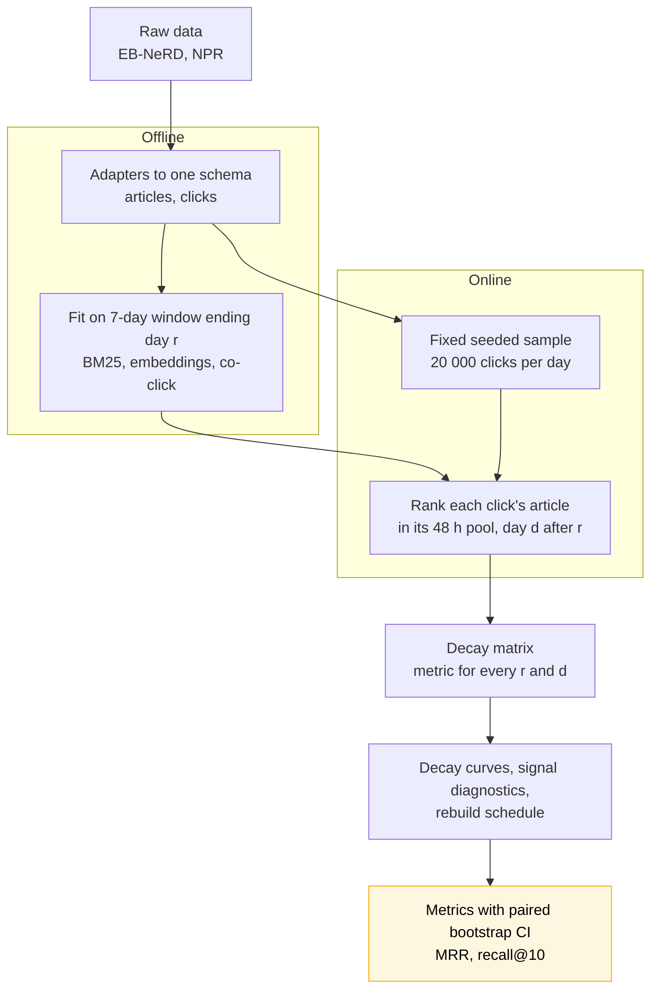
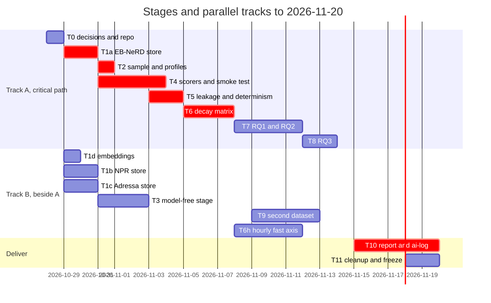

# Revised summary — temporal degradation of a news recommender

One-page entry point, revised 2026-10-26. It replaces nothing: the submitted proposal is archived in
[[project_proposal_temporal_degradation_v1_submitted]] (a reconstruction, not byte-exact — diff it against
your submitted copy) and the working proposal is [[project_proposal_temporal_degradation]]. Detail lives in
[[Subjects/IRE/Projects/IRE-Term-Project/docs/planning/tasks-explained|tasks-explained]] (concepts and tasks),
[[Subjects/IRE/Projects/IRE-Term-Project/docs/planning/architecture|architecture]] (design record), [[datasets]] and [[log]]
(decisions and findings).

> [!important] Status
> **Planning only. No code has been written and no experiment has been run**, so this document holds no
> results. Expectations below are targets, not findings. Deadline **2026-11-20**
> (25 % of the course grade); today is 2026-10-26.

## 1. The project in one paragraph

A news recommender is built from past clicks and articles. News is replaced within hours, so a model built
on day *r* meets articles on day *d* that did not exist when it was built. We measure **how much worse a
frozen model gets as days pass, which of three signals goes stale first, and how often it pays to rebuild**.
The three signals are word matching (BM25), meaning matching (frozen multilingual MiniLM embeddings) and
click history (item-item co-click cosine). Reference scorers: recency, popularity, and feed position (NPR
only).

| | |
|---|---|
| **RQ0** (model-free) | How fast do articles age? Share of clicks on articles published after the fit date. |
| **RQ1** | How fast does quality fall with days since the fit? |
| **RQ2** | Which signal falls first, and why? |
| **RQ3** | What rebuild interval balances quality against the cost of rebuilding? |

## 2. Design and algorithm

**Read it as:** one fit per fit date, scored on every later day over the same sampled clicks; all three
research questions are read off the single resulting table.

### The algorithm, explained from the ground up

**In one sentence:** we measure how much a recommender gets worse the longer it goes without being rebuilt, and which of its parts gets worse first.

**1. The plain picture.** A recommender learns from last week's clicks. Tomorrow's news is different, so it gets a little worse each day. We want to know how much worse, and when rebuilding it is worth the effort.

**2. How we measure it.** We take a model built on day *r* and let it rank the articles shown on later days. We also score a model rebuilt every day on the same impressions. The difference between the two is the **decay**.

- *Why the daily model:* it cancels weekday effects. A weekend dip hits both models equally, so it does not read as decay.
- *Why the same impressions:* every comparison is paired, which gives tighter confidence intervals.

**3. The three signals, and why they age differently.**

| Signal | What it knows | Why it may go stale |
|---|---|---|
| Word matching (BM25) | Which words readers' past articles used | New stories use new words |
| Meaning matching (frozen MiniLM) | What articles are about | Least affected; only the topic mix shifts |
| Click history (co-click) | Which articles were clicked together | A brand-new article has no co-clicks, so it cannot be scored |

**4. Two versions of "frozen".** In **regime A** the whole system, including each reader's profile, is frozen on day *r*. In **regime B** only the learned parts are frozen and profiles keep updating. Without both, the click-history answer would be decided by how we define "frozen".

**5. One table answers all three questions.** The **decay matrix** holds the decay for every fit day and every later day. From it we read how quickly quality falls (RQ1), which signal falls first (RQ2) and how often to rebuild (RQ3).

**6. Safeguards.** Only past data is used for each fit. Tests must fail when the future is deliberately leaked. The recency scorer has nothing to freeze, so its decay must come out exactly 0, which checks the harness. Candidates a scorer cannot score tie at the bottom in a seeded shuffle, not in slate order, because slate order may encode the site's own ranking.

**7. The precise version.**

- **Decay** = M(d−1, d) − M(r, d): the gap to a model rebuilt the previous day. The daily-rebuilt control
  cancels weekday and difficulty effects.
- **Two regimes.** A: everything frozen at *r*, including reader profiles. B: only learned parts frozen,
  profiles live. Without both, RQ2 is decided by construction.
- **Fit window** is a 7-day sliding window (an expanding one conflates staleness with data volume).
- **Leakage boundary.** State fitted on events up to the end of day *r*. Regime B profiles use clicks
  strictly before the impression. Tests that move the boundary must fail.
- **Unscorable candidates** tie at the bottom in a seeded shuffle (not slate order, which may carry the site's own ranking).
- **Metrics (option D):** MRR and recall@10 of the clicked article in its pool of about 400 candidates; AUC and nDCG@5
  secondary. Always with n and a paired bootstrap CI.
- **Recency check:** the recency scorer's decay gap must be exactly 0, since it has nothing to freeze.

## 3. Datasets

Full detail and sources in [[datasets]]. *Measured* = read from local files on 2026-10-26.

| | EB-NeRD large | NPR (Globo) | Adressa |
|---|---|---|---|
| Role | **Primary** | **Second (recommended)** | Optional replication |
| Language | Danish | Portuguese | Norwegian |
| Span | 15 labelled days, 2023-05-18 → 06-01 | 118 local days, 2023-01-03 → 05-01 (116 have data) | 10 weeks, 1 Jan → 31 Mar 2017, Norwegian local days (first UTC timestamp is 23:00 on 31 Dec) |
| Impression lists | Yes (median 9 items, 1 click) | Yes (about 10 items, exactly 1 click) | **No** — clicks only |
| Article text | Title and body | Title and topics, **no body** | Title, keywords, entities; **no body** (on request) |
| Publish time | Yes | Yes | Yes (`publishtime`, ISO 8601 UTC) |
| User history | Timestamped, 27 Apr onward | Timestamped, median 6 items | Event stream |
| Scale | 1.4–2.0 M impressions per day | 1.40 M impressions in total | **113.6 M events, 4 805 071 users, 81 019 article ids** (measured; documentation says 27.2 M, 3.08 M, 48 486) |
| Main risk | Only 15 days | 87 % from the non-personalised `top-state` list; 82 % of users appear once; modest per-day volume | No impression lists, so the candidate pool is built; large |
| Status | On disk (A1 work folder), copy to `data/` | Downloaded and profiled, `data/npr/` | Converted to parquet, 3.11 GB, verified, `data/adressa/parquet/` |

Measured NPR facts that shape the design: the median clicked article is 0.58 days (13.8 h) old at click; 41 % of
clicks are on feed position 1; about 10 outage days must be dropped. Decay is reported **per `algo`**, and
days are pooled into windows because a single day is too small for a tight CI.

**Rejected:** Netflix Prize (no text, no publish dates, no news), AOL and the irgroup catalogue (no
timestamped news items), DIGIX, TREC Washington Post, PGNSC, Globo 2017, Kaggle MIND mirrors. Reasons in
[[datasets]].

**Other forms of temporal decay** (LongEval, Amazon Reviews 2023, Yambda, FNSPID) were catalogued as future
work, not scheduled.

## 4. Plan of action

**Read it as:** the critical path is stores → scorers → the EB-NeRD decay matrix → report. The second
dataset runs beside the analysis and is the first thing cut. **Experiments stop on 2026-11-15**; the last five
days are writing.

| Task | Done when |
|---|---|
| T0 | Open decisions answered; folders created; monitor module with tests |
| T1 | Unified stores for EB-NeRD and NPR built in `data/`; A1 embedding id order checked |
| T2 | Fixed seeded sample of 20 000 impressions per day written once |
| T3 | RQ0: article age curve and share of clicks on post-fit articles |
| T4 | BM25, MiniLM, co-click, recency, popularity scorers pass a smoke test |
| T5 | Leakage tests pass, and **fail** when the boundary is moved |
| T6 | Full decay matrix on EB-NeRD, both regimes, daily-rebuilt control |
| T7 | RQ1 and RQ2 curves with CIs and diagnostics |
| T8 | Rebuild-interval table (1, 2, 3, 5, 7, 14 days) with fit seconds |
| T9 | NPR replication, pooled days, per-`algo` |
| T6h | Hourly fast axis on EB-NeRD (proposed core): fit hours, evaluate 1–24 h later | Decay against hours since the fit; scale set by the T4 fit time |
| T10 | Report, ai-log curated, every question answered with what was run |
| T11 | Cleanup: partial files removed, results frozen with a hash, disk report and a deletable list for you to approve |

**Cut order if time runs short** (master in [[current-plan]]): the extras of T6h → Adressa → NPR replication → the earliest fit date →
regime B → per-signal fit seconds. EB-NeRD regime A with the daily control is the irreducible core.

## 5. Expectations (none tested)

Expectations in [[project_proposal_temporal_degradation]] section 0.3: meaning matching should decay least by construction,
click history most (an unseen article has no co-clicks), and a flat curve at a 15-day horizon is a valid answer. These are
not pre-registered hypotheses.

## 6. Risks

| Risk | Mitigation |
|---|---|
| Only 15 EB-NeRD days limits the staleness axis | Fit cutoffs 3, 10 and 17 May with history back to 27 Apr; NPR gives 118 days |
| Policy mix shifts in NPR masquerade as decay | Report per `algo`; fix the mix in headline curves |
| Recency alone is very strong on EB-NeRD (A1: recall@50 = 0.905) | Recency is a reference line and a self-check, not a competitor |
| Embedding cache id order differs from the new store | Check in T1 before reuse |
| Cross-assignment imports | Copy A1 code into `code/`, do not import across work items |

## 7. Open decisions (needed before T0)

1. **D15 Team:** actual team size, one pipeline or two adjacent questions?
2. **D14 Instructor:** was the proposal submitted as drafted (Adressa primary)? If so, tell the instructor the
   primary dataset changed to EB-NeRD.
3. **D13 Repo:** deferred; no deadline.
4. **Second dataset:** NPR (recommended) or Adressa.
5. **Click-history method:** co-click cosine first (recommended), factorisation only as an extension.

## 8. Not yet done

- `IRE-Term-Project.md` (tracking note) still has an empty Goal, Team and Log.
- Adressa: converted and checked (publish time, text fields, 10 contiguous weeks, `userId` persistence). Per-day counts for all 90 days and the `publishtime` lag check are not yet done; the smaller analysis stores are T1.
- The 2023 scheduling paper and the patent cited in the proposal are unchecked.
- Stray duplicate `project-ideas 1.md` awaits your decision.
