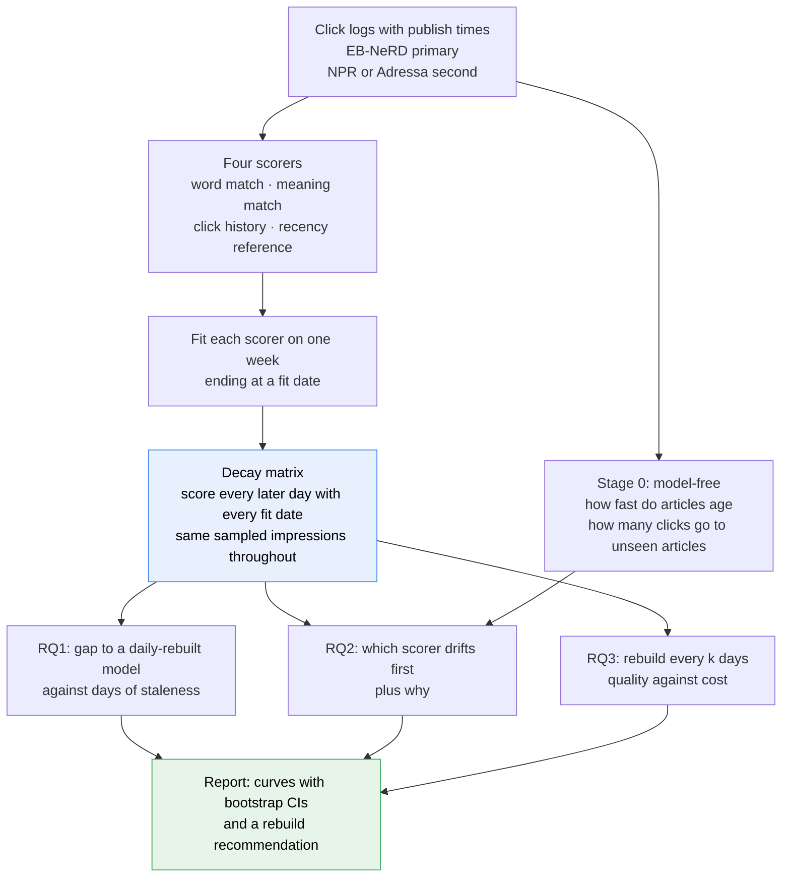

# Term project — what is asked, and why

Plain-language companion to [[project_proposal_temporal_degradation|the proposal]]. It explains the question,
the ideas behind it and the tasks — **no implementation here**. The design record (components, interfaces,
leakage boundary, alternatives rejected) is [[Subjects/IRE/Projects/IRE-Term-Project/docs/planning/architecture|architecture]]; the running record of decisions and findings is
[[log]]; the datasets are in [[datasets]]. **Due 2026-11-20** · 25 % of the grade · graded individually.

> [!important] The constraint that shapes everything
> The course asks for **depth and rigor, not breadth** — one narrow question answered well. Every number
> needs a **bootstrap CI and the count it came from**, and **no number may be recorded that was not run**.
> Coding assistants are allowed, but **vivas probe your own submitted code**, so anything an assistant wrote
> has to be read line by line and defensible. The proposal as submitted named Adressa; the plan below changes
> the primary dataset to EB-NeRD (see [[#Decisions you have to make]]).

> [!warning] Superseded in part by option D (2026-10-29)
> The main run now ranks each click's article in a 48-hour publish-time pool ([[current-plan]]); impression slates are the
> cross-check. Where this note says "slate" or "impression", [[stage-plan]] is the authority. The task table below is updated.

> [!info] Status of this doc
> Written 2026-10-26, **before any code exists and before any result**. Every expectation below is a
> *expectation to test*, not a finding.

## The one-sentence version

A news recommender is built once and then left running; we measure **how much worse it gets each day it is not
rebuilt, which of its parts gets worse first, and how often it would have to be rebuilt to stay close to a
fresh one** — and what that rebuilding costs.

## The whole thing on one page

**Read it as:** one table of results — every fit date scored on every later day — feeds all three research
questions. Build that table once, carefully, and the questions become reading it in different ways.

---

# Layer 1 · The plain picture

## What "going stale" means

Picture a recommender trained on last week's clicks. Today it is asked to rank ten articles for a reader. Two
things have moved since training:

1. **New articles exist that it never saw.** News is mostly new: in the NPR logs the median clicked article is
   only about **14 hours old** at click time, and 85 % of clicks land within about 26 hours (*measured*,
   the NPR section of [[datasets]]). A model that has to
   "know" an article to score it is blind to most of what readers now click.
2. **The reader moved.** Their interests today are not the interests in the profile the model holds.

The model does not crash. It keeps producing rankings, just worse ones — and nobody notices until quality has
already dropped. That silence is why it is worth measuring.

## The three ways a recommender can "know" an article

| Signal | Plain words | What it needs to have seen |
|---|---|---|
| **Word matching** | Does this article share words with what the reader read before? | The vocabulary and word weights from last week's articles. A brand-new word has no weight. |
| **Meaning matching** | Is this article about something similar, even with no shared words? | A fixed language model turns any article into numbers, so a new article is no problem — only the *reader's profile* can go stale. |
| **Click history** | Did people who read what this reader read also read this? | Past co-clicks. A new article has **no co-clicks at all** until the model is rebuilt. |

Two plain reference lines run beside them, because in news they are strong and a "decay" that only matches a
trivial baseline means little:

- **Recency** — rank the newest article first. A1 already showed this is startlingly strong: ignoring the user
  entirely scored recall@50 = 0.905 on EB-NeRD (A1 findings F16/F21).
- **Popularity in the training week** — rank what was clicked most.

## What we expect, and why a flat result is still a result

Written as expectations, not facts (not commitments; nothing is pre-registered):

- Click history should go stale **first**, because an unseen article scores nothing at all.
- Meaning matching should go stale **least**, because its language model never changes.
- Word matching should sit between them: new words are unweighted, but most words are old.
- Recency should barely change at all — it needs no training.

A curve that stays flat for 15 days is a **valid answer** ("at this horizon you need not rebuild"). It must be
reported with its CI, not hidden. The one thing that cannot be done is deciding afterwards which result
"counts".

---

# Layer 2 · How to measure it without fooling ourselves

## The staleness axis

Pick a **fit date** — say 10 May. Train on the seven days ending there, then freeze. Score impressions on 11 May
(*staleness 1 day*), 12 May (*2 days*), and so on. The x-axis is **days since the fit date**.

The trap: some days are simply harder than others (a weekend, a big story), so raw quality against day would
show a "decay" that is partly the calendar. The fix is a **control**: on every evaluation day, also score with a
model **rebuilt that very morning**, and measure the **gap** between rebuilt and frozen.

## Two regimes — what exactly is frozen

"Frozen" is ambiguous. If a reader's profile keeps updating from their latest clicks, word matching and meaning
matching have almost nothing frozen, and the answer to "which part rots first" is decided before any data is
looked at. So we run both:

| Regime | Frozen | Live |
|---|---|---|
| **A · fully frozen** | the learned parts **and** every reader's profile at the fit date | nothing |
| **B · live profiles** | only the learned parts (word weights, co-click table) | each reader's profile, from their clicks up to the moment of the impression |

**A − B isolates how much of the decay is stale readers rather than a stale model.** That difference is itself a
finding, and it is the part the original proposal had no way to see.

## The decay matrix — the one artefact everything comes from

Fit on every date in a range; score every later evaluation day with every fit date; keep the per-click
results for the **same sampled clicks in every cell**. Then:

- RQ1 is a row of the table (fix a fit date, move the day).
- RQ3 is a diagonal-ish read (pretend you rebuilt every *k* days, take the right cell each day).
- The control is the cell where the fit date is the day before.

Because every cell shares the same impressions, two cells can be compared with a **paired** bootstrap — much
tighter than comparing two separate intervals (A1 finding F46; `src/eval/bootstrap.py:115`).

## Formal version

Let $d$ be an evaluation day, $r$ a fit date with $r<d$, and $M(r,d)$ the metric of the model fitted at $r$ and
scored on day $d$. Staleness is $s=d-r$.

$$\Delta(r,d)\;=\;M(d-1,\,d)\;-\;M(r,\,d)$$

Read it as: *how much better a model rebuilt yesterday is than the one fitted at $r$, on the same day $d$.* The
symbols: $M(d-1,d)$ is the daily-rebuilt control; $M(r,d)$ the frozen model; $\Delta\ge0$ means staleness hurts.

For a rebuild interval $k$, the model used on day $d$ is the one fitted at the last rebuild date $r_k(d)\le d-1$:

$$\bar M(k)\;=\;\frac{1}{|D|}\sum_{d\in D} M\bigl(r_k(d),\,d\bigr),\qquad \text{cost}(k)\;=\;\#\text{rebuilds}\ \text{(and fit seconds)}$$

where $D$ is the set of evaluation days. Read it as: *the average quality you would have had if you rebuilt every
$k$ days, against what the rebuilding cost.*

## Why each signal goes stale (the diagnostics)

A curve says *that* a signal decays; a diagnostic says *why* — and that is what turns a plot into an
explanation. Each is computable from the data alone:

| Signal | Diagnostic | What a rising value means |
|---|---|---|
| Word matching | share of a day's clicked-article words that were not in the fit week's vocabulary | the model is ignoring more of each article |
| Meaning matching | cosine distance of the day's article embeddings from the fit week's centre | the topics have moved |
| Click history | share of a day's candidates, and of its clicks, on articles with **no co-click row** | the table is blind to more of the slate |
| All | share of a day's clicks on articles **published after the fit date** | an upper bound on what any click-based model can still know |

The last row needs **no model at all** — only clicks and publish times — and is the cheapest result in the
project.

---

# Layer 3 · The hard parts

1. **The pool is not the world, and (cross-check only) neither is the slate.** Under option D the candidates are the articles live at the click time (the 48-hour pool), which conditions on nothing the site chose; under the slate cross-check the candidates are what the site's own system chose to show, so we can only ask
   "did the clicked article rank above the others shown?" — not whether something better was never shown. The
   same bias applies to every scorer and every day, so *gaps* stay comparable; absolute scores do not transfer.
2. **EB-NeRD is only 15 labelled days.** That caps the longest staleness we can see directly. Using click
   histories back to 27 April lets fit dates start earlier, which stretches staleness to roughly four weeks, but
   at the cost of mixing staleness with the calendar. The daily-rebuilt control is what keeps that honest.
3. **The people we evaluate are survivors.** Click histories exist only for users who also appear in the
   evaluation window, so everyone scored is active after the fit date by construction. This understates
   cold-start users. State it; do not fix it silently.
4. **Policy mix can masquerade as decay (NPR).** 87 % of NPR impressions come from one non-personalised
   "top-state" list, and the mix of lists changes over the four months. Decay must be reported **per list type**,
   or a shift in what the site showed will look like a model going stale.
5. **Position bias.** 41 % of NPR clicks are on the first slot. A scorer that only knows position is strong;
   it belongs on the plot as a reference.
6. **Recency dominance.** A1 found newest-first beats most personalisation here. If the three scorers all decay
   to roughly recency's level, the honest reading is "they were mostly recency all along" — not a discovery
   about word matching.
7. **Small daily samples.** NPR has a median of about 10 000 impressions a day (EB-NeRD far more). Single-day
   intervals are wide; pool days into windows and say so (A1's own lesson, F34: an under-powered harness gave a
   score outside its own CI).
8. **Many curves, one claim.** Four scorers × two regimes × several fit dates is a lot of comparisons. Fix the
   **primary** comparison in advance (frozen vs daily-rebuilt, regime B, hybrid and each single scorer on
   MRR and recall@10) and label everything else exploratory.
9. **Compute and disk are finite.** One 32-core CPU box; about 44 GB of disk when this was written, with Adressa
   (16 GB compressed, unknown size extracted) still arriving. Do not extract Adressa before checking free space.

---

# The tasks

Each task: what it asks, why, the concept it rests on, and what "done" looks like. Order and dates are in the schedule section of
[[Subjects/IRE/Projects/IRE-Term-Project/docs/planning/architecture|architecture]].

| ID | Task | Why | Done when |
|---|---|---|---|
| **T0** | Decide the open points below; create the folders; build the monitor (time, RAM, disk, handshake between stages) | A clean start, and every later stage is measured | decisions logged in [[log]]; monitor tests pass |
| **T1** | Build a compact, leakage-checked store for EB-NeRD, NPR and Adressa (articles, clicks with times, publish times; slates only for the cross-check), plus the embeddings | Everything else reads this; schema mistakes here poison every result | both datasets load; row counts match the profiled numbers in [[datasets]] |
| **T2** | Fix the evaluation sample: a seeded set of **clicks** per day (20,000), with a stated size | Same clicks in every cell is what makes comparisons paired | sample ids saved; size reported next to every metric |
| **T3** | Model-free stage: article age curve and the unseen-click share | Cheapest result; explains the mechanism | the age curve and the hourly unseen-click curve with CIs, for all three datasets (first run: log P30, P32) |
| **T4** | The scorers (recency, popularity, word, meaning, click history) behind one interface, plus a fused hybrid, ranking each click's article in its 48-hour pool | RQ2 needs each signal separable and swappable | each scorer alone beats a shuffle on a smoke day; hybrid weights fitted only on data before the fit date |
| **T5** | Leakage tests, including ones that break on purpose | A leak here would manufacture a smooth, believable decay curve | mutation tests fail when the boundary is moved |
| **T6** | Build the decay matrix on EB-NeRD | Source of RQ1–RQ3 | matrix stored; the daily-rebuilt control reproduces on a rerun |
| **T7** | RQ1 and RQ2: gap curves, regime A vs B, diagnostics | The main finding | plots with paired-bootstrap CIs |
| **T8** | RQ3: rebuild-interval simulation and cost | The practical recommendation | quality-against-cost curve; fit seconds measured, not assumed |
| **T9** | Replicate on the second dataset (NPR, or Adressa) | Tests whether the finding is one publisher's | same plots under the same protocol, per `algo` for NPR, with the caveats above |
| **T6h** | *Core (D22).* Hourly fast axis on EB-NeRD: fit at chosen hours, evaluate 1–24 h later, both regimes, hourly-rebuilt control | On this site the median click is on an article 1.4 h old and 91 % of clicks are on post-fit articles by 6 h, so a daily grid sees only the saturated end | decay against hours since the fit with CIs; scale set by the measured fit time in T4 |
| **T11** | Cleanup and freeze: remove partial files, rerun one small grid and compare hashes, freeze `results/`, report disk and a deletable list for you to approve | Reproducible and tidy; nothing of yours is deleted | hashes match; frozen; list approved |
| **T10** | Report; curate `ai-log.md` with `/ai-log` | Both are graded artefacts | design note within the length limit; the log shows real verification, including failures |

**Cut order if time runs out** (first to go first; master in [[current-plan]]): the extras of T6h → Adressa → T9 (NPR) → the earliest fit date → the
A-vs-B comparison → per-signal fit seconds → the semantic scorer's second encoder. T0–T8 on one dataset is a complete project.

---

# Decisions you have to make

Background and costs first, as the vault style requires; recommended option marked.

## 1 · Who is on the team, and is it one pipeline or two?

The syllabus caps project teams at **3**. `IRE-Term-Project.md` still carries an unresolved note about four
people (a 2+2 split with a shared pipeline). Nothing in the vault records what was decided. **A single
pipeline with two adjacent questions** is cheap here: the decay matrix is shared, and one person owns RQ1/RQ3
while another owns RQ2 and the replication. Grading is individual either way, so each member must be able to
explain the whole matrix. *This plan assumes one shared spine; say if the team is different.*

## 2 · The submitted proposal named Adressa

The proposal you submitted used Adressa as primary and MIND as a check. This plan makes **EB-NeRD primary**
because Adressa's article text is on-request only, it has no impression lists, and the download was still
running. Your questions and method are unchanged; the dataset and the horizon are not. **If the instructor
expects the submitted dataset, a short note explaining the change** (what was found, and that the research
questions are the same) is cheap protection. The original text is kept in
[[project_proposal_temporal_degradation_v1_submitted]].

## 3 · Which second dataset

| | NPR | Adressa |
|---|---|---|
| Span | 118 local days | 90 days |
| Impressions | yes (one click each) | no — candidates must be built |
| Text | titles and topics | titles, keywords, entities |
| Per-day volume | thin (median ≈ 10 k) | dense (27 M events) |
| Confounds | list type, position | none of those, but pool definition |
| State | downloaded and profiled | 5 of 16 GB copied |

**Recommended: NPR first** (the protocol carries over unchanged), Adressa only if time remains. At most one.

## 4 · How elaborate should the click-history signal be?

Item-to-item co-click counts are simple, fast to refit, interpretable and zero for an unseen article — which is
exactly the mechanism under test. A matrix-factorisation model adds quality and a heavier refit. **Recommended:
co-click counts as the primary signal; factorisation as a clearly labelled extension** only after T8.

## 5 · Git for the code

Not required for this project and deferred by the team, with no deadline. If you want it later, `code/` can become its own
repository at any time; nothing in the plan depends on it.

---

# Glossary

- **Slate / impression** — the list of articles shown to one reader at one moment, and which one they clicked.
- **Fit date** — the last day of data a model was trained on; **staleness** — days since then.
- **Frozen / rebuilt** — a model left alone after its fit date / one refitted from the latest week.
- **Decay matrix** — the table of metric values for every (fit date, evaluation day) pair.
- **Paired bootstrap** — a confidence interval on the *difference* between two models scored on the same
  impressions; much tighter than comparing two separate intervals.
- **Coverage** — the share of candidates a model can score at all.

---
[[IRE-Term-Project|← tracking note]] · [[Subjects/IRE/Projects/IRE-Term-Project/docs/planning/architecture|architecture]] · [[log]] · [[datasets]] · [[project_proposal_temporal_degradation|proposal (revised)]] · [[Subjects/IRE/_syllabus|IRE course plan]]
