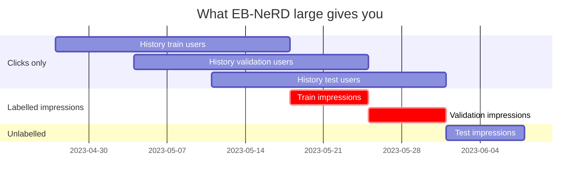

# Project proposal: temporal degradation of a news recommender

> [!info] The version as originally submitted is kept, unchanged, in [[project_proposal_temporal_degradation_v1_submitted]].

## 0. Viability check — 2026-10-26 (read this first)

> [!important] Verdict: viable, but only as a **15-day, EB-NeRD** study — not the 10-week Adressa study below
> The question is sound and cheap to run on the A1 pipeline. Three things in the original draft do not
> survive contact with the data and the sources, and sections 4, 6, 7, 9 and 10 have been corrected
> accordingly. Everything marked *measured* was read from the local files on 2026-10-26.

### 0.1 What the data actually allows (measured)

EB-NeRD *large*, extracted in `Assignments/Assignment-1-Lexical-Semantic-Retrieval/data/work/ebnerd/`:

| Fact | Value |
|---|---|
| Labelled impressions | **2023-05-18 → 2023-06-01 = 15 days** (train 18–25 May, validation 25 May–1 Jun) |
| Volume | 1.4–2.0 M impressions and 380–450 k users **per day** |
| Held-out test set | 1–8 Jun 2023, 13.5 M impressions, **no click labels** — unusable for nDCG/MRR/AUC |
| Per-click history (`history.parquet`) | train users 27 Apr–18 May, validation users 4–25 May, test users 11 May–1 Jun; median 80–92 clicks per user |
| Articles | 125 541, Danish title and body, `published_time` present (one outlier dated 1993 — filter it); about 6 k published in May 2023, roughly 200 per day |

**Read it as:** the evaluation window is two weeks, but click history reaches back to 27 Apr, so you can
train on a week that ends well before the evaluation starts. That is how the staleness axis gets longer
than 15 days (see 6.2).

### 0.2 Problems with the original draft

| # | Problem | Consequence | Fix |
|---|---|---|---|
| 1 | **Adressa is a poor primary dataset now.** Article text is *not* in the public download — it is "available on request" by email. The 10-week file is 16 GB, Norwegian, CC BY-NC-SA. The light version does carry `publishTime`, title, keywords, category and named entities (per the official field description, `cxdataset_v5.pdf`) but **no article body**, and it has **no impression lists** — click events only. | A blocking external dependency with 25 days left. | Use **EB-NeRD** (already on disk, publish times, text, history). Adressa becomes future work. |
| 2 | **"Frozen model" is undefined for two of the three signals.** If user profiles update daily, BM25 and a frozen pretrained encoder have almost nothing frozen. | RQ2's answer is predetermined — the click-history signal rots, the others barely move — and says nothing about word or meaning matching. | Run **two regimes** (6.2): *fully frozen* (model and user profiles) and *live profiles* (only learned parameters frozen). The gap between them is itself a finding. |
| 3 | **Raw metric vs. day conflates staleness with day-to-day difficulty.** The 15 days include two weekends. | A weekend dip would read as decay. | Report decay as `metric(frozen) − metric(rebuilt daily)` on the same day. The daily rebuild is the control. |
| 4 | **Rebuild intervals 21 and 30 days, a 10-week average, and "several training weeks" cannot be run.** | Section 7 and 6.5 were unexecutable. | New intervals 1, 2, 3, 5, 7, 14 days and 3 training cutoffs (6.2, 6.5, 7). |
| 5 | **No recency baseline.** In news, "newest first" is a very strong ranker. | Decay of the three signals could look dramatic against a baseline that ignores the one thing news ranks on. | Add a **recency-only scorer** (time since `published_time`) as a fourth reference line. |
| 6 | **Two related-work claims are wrong or unverified** (see section 10). | A wrong citation in a graded report. | Corrected in section 10. |

### 0.3 What to expect, so a null result is not a surprise

- With the candidate pool up to date and a frozen encoder, **meaning matching should decay least by construction**.
  That is not a flaw, but say it up front and report *how little*, with a CI.
- **Click history should decay most**, mainly through coverage: a new article has no co-clicks, so it is scored last
  (Kille & Albayrak found the same mechanism).
- Unlike Kille & Albayrak's anonymous sessions, EB-NeRD users have long histories (median 80+ clicks over 3 weeks),
  so collaborative filtering is **viable here**. That is a genuine difference worth one paragraph.
- A flat curve is a valid answer: it would say "at a 15-day horizon you need not rebuild".

### 0.4 Scope and cost

- **Evaluation scale:** 1.4–2.0 M impressions per day is too many to score three scorers across 15 days and 3 cutoffs.
  Sample a fixed number of impressions per day (for example 50 k, stratified by user), seed it, and report the count
  next to every metric.
- **Reuse, don't rebuild:** copy A1's bootstrap and metric code (`src/eval/bootstrap.py`, `metrics.py`) into the
  project; do not import across work items. Check that A1's embedding store covers the articles you need.
- **Data location:** extract or copy EB-NeRD into this project's own `data/` folder (vault rule), not point back at A1.
- **Time:** 25 days remain to 2026-11-20. This is feasible only if the scope in section 9 is held; the optional
  extensions there are the first things to cut.

---

## 1. Motivation

Recommenders are usually trained once and left running. Meanwhile two things keep moving: new articles arrive that the model never saw, and users' interests drift. The result is silent decay — the system keeps producing recommendations, they just get worse, and nobody notices until quality has already dropped a lot.

This is a specific instance of a problem IR already has a name for: **freshness**. A search engine has to decide how often to recrawl pages to keep its index current; we're asking the same question about a recommender's model instead of its index. That's the "paying a cost to get relevance" framing the course uses — freshness isn't free, and neither is staleness.

### 1.1 Scope: model freshness, not crawl freshness

Worth stating explicitly, since it's easy to conflate: this project is **not** about how often to crawl or fetch new articles into the candidate pool (the classical web-crawler freshness problem — whether the system knows an article exists yet). We assume new articles are added to the candidate pool as soon as they're published, which is standard app plumbing and out of scope.

What we're measuring instead is **model freshness** — how stale the recommender's *scoring machinery* gets even though the candidate pool is up to date:

- Word matching's vocabulary and term-weighting statistics (TF-IDF/IDF) are computed from week-1 articles and go stale as new terms appear.
- Meaning matching's embedding *function*, if pretrained, doesn't need retraining — but any reference statistic built from it (e.g. a user profile averaged from old embeddings) can still go stale. (If we train our own embedding model instead, the whole thing needs retraining — a design choice to flag.)
- Click history's interaction matrix has no shortcut: a new article has zero history until the model is rebuilt with fresh click data.

The web-crawl freshness problem is used only as a conceptual analogy (pay a cost to stay relevant), not as part of the system being built.

## 2. Research questions

- **RQ1 — How fast?** Trained once on one week of data and never updated, how much does recommendation quality decline per day, and does it decline linearly, or fall off a cliff, or level off?
- **RQ2 — Which part first?** A recommender typically combines three different signals — lexical (word) matching, semantic (meaning) matching, and collaborative (click history) signals. Which of these degrades fastest, and why?
- **RQ3 — How often to rebuild?** Given the decay rate, what's the relationship between how often you retrain and how good the recommendations stay, expressed as a cost/quality trade-off curve?

## 3. Definitions

| Signal | What it does | Analogy |
|---|---|---|
| Word matching | Scores articles by lexical overlap with the user's click history (TF-IDF / BM25) | Keyword search |
| Meaning matching | Scores articles by semantic similarity using text embeddings | "articles about a similar topic," even with no shared words |
| Click history | Scores articles using patterns of co-clicks between users (matrix factorization or item-item co-occurrence), ignoring text entirely | "people who read X also read Y" |

These three need to be **separable, swappable modules** in the system, not fused into a single opaque neural net — otherwise RQ2 can't be answered, because there'd be nothing to isolate.

## 4. Dataset

Two realistic public options:

- **MIND** (Microsoft News Dataset) is the standard English-language benchmark, but its public release only exposes a training week and a test week of impression logs, and it doesn't include article publish timestamps — both of which limit how well we can track decay over many weeks or identify genuinely "new" articles.
- **Adressa** (the 20M / 10-week version) covers ten continuous weeks of a real news portal's traffic and, unlike MIND, includes article publish timestamps (`publishTime`, confirmed in the light version's field list; 1 Jan–31 Mar 2017). That combination — long time span plus timestamps — is what actually lets us measure day-by-day decay and define "new article" cleanly. The trade-off is that the text is Norwegian, so meaning-matching needs a multilingual embedding model.

**Proposal (revised 2026-10-26):** use **EB-NeRD large** (Danish, already on disk) as the primary and only dataset: 15 labelled days, per-click history back to 27 Apr, publish timestamps and text for every article. Meaning matching needs a multilingual encoder (A1's embeddings or `multilingual-e5`). **Adressa is dropped to future work**: its article text is available only on request, the 10-week file is 16 GB and Norwegian, and it cannot be obtained and loaded in the time left. **MIND is dropped too**: its labelled range is 6.0 days and it has no publish times (A1 finding F27).

The cost of this choice is a short horizon (15 days, extended by training cutoffs, see 6.2). It cannot say anything about decay beyond about a month.

## 5. System design

A simple hybrid recommender: three independent scorers (BM25 for word matching, a sentence-embedding model for meaning matching, a matrix-factorization or item-item co-occurrence model for click history), combined by a weighted sum into a final ranking. Each scorer can also be run **alone**, which is what makes RQ2 answerable.

## 6. Measurement methodology — how do I actually measure "how much worse it gets"?

### 6.1 Metrics
Standard ranking metrics, computed per day: **nDCG@k** and **MRR** (how close clicked articles land to the top of the ranked list) and optionally **AUC** (how well the model separates clicked from non-clicked articles in an impression). These are the same family of metrics used throughout the course for ranking quality.

### 6.2 Time-sliced decay protocol
1. Pick a **cutoff** *c*. Train the full hybrid model on the 7 days of clicks ending at *c* (from the `history.parquet` click logs, 27 Apr onward) and freeze it.
2. For each evaluation day *d* in 18 May–1 Jun with *d* > *c*, score a fixed seeded sample of that day's impressions with the frozen model. Staleness is *s* = *d* − *c* days.
3. Run **two regimes**: **(A) fully frozen** — learned parameters and user profiles both fixed at *c*; **(B) live profiles** — learned parameters frozen, but each user's click history keeps updating. A − B isolates how much of the decay is stale user profiles rather than a stale model.
4. As the control, rebuild the same model **every day** and score the same impressions. **Decay = metric(frozen) − metric(rebuilt daily)** on the same day, so weekday effects cancel.
5. Plot decay vs. staleness *s*. That curve *is* the answer to RQ1 — its shape (linear decline, cliff, plateau) is itself a finding worth reporting.

**Cutoffs:** *c* = 3, 10 and 17 May 2023. Staleness then runs 1–15 days for the 17 May cutoff, 8–22 for 10 May and 15–29 for 3 May, so the curve covers about four weeks. The cost is that staleness is partly confounded with calendar day across cutoffs; the daily-rebuild control is what makes them comparable.

**Selection caveat:** click histories exist only for users who also appear in the impression window, so every user in the sample is active after the cutoff by construction. That biases toward retained users and understates cold-start users. State it.

### 6.3 Isolating which part rots first (RQ2)
Repeat the exact same day-by-day protocol, but separately for the word-matching-only scorer, the meaning-matching-only scorer, and the click-history-only scorer. Three separate decay curves come out. Whichever curve drops fastest (in absolute terms, or as %-of-freshly-rebuilt performance, which is the fairer comparison since the three scorers start at different quality). Add the **recency-only scorer** (time since `published_time`) as a fourth reference curve is the part that "rots first." Cross-check this against the combined model by ablation: remove one signal at a time from the hybrid and see how much the combined score's decay changes.

### 6.4 Diagnosing *why* each part decays (this is what turns a curve into an explanation)
- **Word matching:** track the percentage of terms in each day's clicked articles that never appeared in the week-1 training vocabulary. Rising % should correlate with dropping quality.
- **Meaning matching:** track how far each day's article embeddings drift from the week-1 embedding distribution (e.g. average cosine similarity to the week-1 centroid). This tests whether the embedding space itself is going stale, versus just needing a bigger reference set.
- **Click history:** track the percentage of each day's impressions that involve articles with literally zero clicks in the training window (the classic cold-start blind spot). This number should rise sharply and probably explains most of click history's decay.

### 6.5 Statistical care
The three cutoffs in 6.2 double as the robustness check: if the decay pattern holds across them, it is not an artifact of one training week. Report every number with a **paired bootstrap 95% CI over impressions** and the impression count (the course requires this; never a bare number). Three cutoffs is too few for a variance estimate across weeks, so show them as three separate curves rather than an error bar.

### 6.6 What "day d's test set" is, precisely

There's no separately constructed "optimal" ground truth — the dataset already records real **impressions**: for a given user, the exact candidate list they were actually shown, and which article they actually clicked. Day d's test set is simply every impression timestamped on that day.

Evaluation procedure per impression: take the real candidate list as-is (we don't generate candidates ourselves), score every candidate with the frozen model, and check where the article the user actually clicked lands in that ranking. nDCG@k / MRR / AUC formalize exactly this check, aggregated across a day's impressions.

Nuance: a user's click *history* (what they've read so far) is just data and updates naturally day by day in the log. What's actually frozen and going stale is the *learned* part of the click-history component — the co-occurrence statistics / latent factors computed once from week-1 interactions — which is where that signal's staleness really lives.

**Caveat to flag proactively:** because candidate lists were chosen by the site's real production system, we can only check whether our model would have surfaced the article the user did click, among options that system chose to show — not whether it would have found something better that was never shown at all (known in the literature as exposure/position bias in offline recommender evaluation). This doesn't invalidate the comparison, since the same bias applies uniformly across every day and every signal, but it's worth stating as a known limitation rather than leaving it for the guide to raise.

## 7. From decay curves to a rebuild schedule (RQ3)

Simulate periodic rebuilding at several intervals *k* = 1, 2, 3, 5, 7 and 14 days (21 and 30 do not fit in a 15-day window). For each *k*: at every rebuild point, retrain on the most recent 7 days of clicks; between rebuilds, evaluate day by day exactly as in Section 6.2. Compute, for each *k*, the **time-averaged metric** over the 15 evaluation days and the **number of retrains performed**. Measure **wall-clock training time per signal** as well, not just the count: rebuilding BM25 statistics takes seconds while a factorization takes minutes, so the cost axis differs per signal, and "rebuild the cheap signals daily and the expensive one weekly" is a candidate answer to RQ3. Keep that as the headline only if the per-signal decay curves actually differ. Plotting average quality against number of retrains gives the final trade-off curve: the project's headline result.

## 8. Deliverables

- Decay curves for the combined model and for each of the three isolated signals (RQ1, RQ2)
- Diagnostic evidence explaining *why* each signal decays (Section 6.4)
- The cost/quality trade-off curve for different rebuild frequencies (RQ3)
- A short written recommendation: "given a budget of N retrains over 15 days, rebuild every k days to stay within X% of freshly-rebuilt quality"

## 9. Timeline (revised 2026-10-26, to the 2026-11-20 deadline)

| Dates | Work | Cut first if late |
|---|---|---|
| 26–29 Oct | Copy EB-NeRD into this project's `data/`; confirm the sampled impression set loads; freeze the question, the regimes (6.2) and the leakage boundary | — |
| 30 Oct–4 Nov | Four scorers (lexical, semantic, click history, recency) plus the daily-rebuild control; first decay curve, one cutoff (RQ1) | the 3 May cutoff |
| 5–10 Nov | Per-signal curves, regime A vs. B, diagnostics 6.4 (RQ2) | the A vs. B comparison |
| 11–15 Nov | Rebuild-interval simulation and trade-off curve (RQ3) | per-signal wall-clock costs |
| 16–20 Nov | Report; curate `ai-log.md` | — |

End-sem is 2026-11-23, so report week overlaps revision. Treat 15 Nov as the real experiment cut-off.

## 10. Related work and the gap this project fills

**Established findings this project builds on:**

- Kille & Albayrak (2017), *On the Decaying Utility of News Recommendation Models*, is the closest existing study in the same domain. *(Checked against the PDF, 2026-10-26.)* They tracked four types of news-recommendation model (including random, popularity and sequence models; read Section 3 of the paper for the exact list before naming them) across four publishers, using 1–9 February 2016 data with the time axis in hours, and found utility decays roughly exponentially over time — but tie most of that decay to catalog **coverage** (whether the model knows an article exists at all) rather than to which matching mechanism is used to score it. They also note that classic collaborative filtering was barely usable in their setting, since anonymous news readers leave too few interactions per session to build real profiles — a domain constraint worth being aware of. Retraining daily helped most on the very first day after retraining, with fast diminishing returns after — a useful prior for our own retrain-frequency curve.
- *(Not checked — find and read it before citing.)* A 2023 study on budget-constrained retraining scheduling frames essentially the same trade-off this project is after — models degrade due to concept drift, retraining has a real cost, and the practical question is finding an acceptable schedule under a limited budget (studied in news and retail domains) — but treats the recommender as a single model rather than decomposing it by signal type.
- ~~A 2026 study on modeling stage-wise user-interest evolution on MIND argues that evaluating across the full week-5 test period reveals more drift.~~ **Not supported.** The paper (Cheng et al., arXiv 2603.10471, WWW '26) exists, but its abstract names no dataset and makes no claim about week-5 evaluation. Do not cite it for that; cite it only after reading the full text.
- *(Not checked.)* A recent industry patent on temporally relevant news recommendation experiments with sliding training-window sizes from 5 to 30 days, always testing on the following day — real-world prior art on how much training data and how often to retrain, though again as a single-model comparison.
- A 2026 study of 20 years of Ukrainian court-citation retrieval directly compares the decay rate of a lexical signal (BM25) against a structural/link-based signal (co-citation) and — counter to the common assumption that keyword matching ages best — reports that BM25 "decays even faster". **The numbers originally given here (31% vs. 21%) do not match the abstract**, which gives co-citation MRR falling about a third on a fixed article set and nearly half under a temporal split, and BM25 falling 31%; those figures are not obviously consistent with "faster". Read the paper's results table and quote its own comparison before using either number. Different domain, and only two signal types, but the framing — race the decay rates of distinct retrieval mechanisms against each other — is exactly the shape of our RQ2.

**The gap:** no study found decomposes news-recommendation staleness into the three specific mechanisms this project targets — lexical, semantic, and collaborative — each isolated as its own scorer, each with a day-by-day decay curve and a mechanistic diagnosis for *why* it decays (vocabulary coverage, embedding drift, cold-start rate), feeding into a retrain-frequency cost curve. Existing work either treats the whole model as one unit (Kille & Albayrak; the budget-scheduling study) or runs a two-way version of this comparison in an unrelated domain (the citation-retrieval study).

**Contribution statement:** this project extends known recommender-staleness findings by attributing decay to a specific retrieval mechanism, in a domain and configuration — lexical, semantic, and collaborative signals in news recommendation — that hasn't been decomposed this way before, and tests rather than assumes which mechanism is most temporally robust. The citation-retrieval study's finding that lexical matching can decay *faster* than an alternative signal is reason to treat RQ2 as a genuinely open empirical question rather than a foregone conclusion.

**For further reading:**
- Kille, B. & Albayrak, S. (2017). *On the Decaying Utility of News Recommendation Models.* TempRec'17. https://ceur-ws.org/Vol-1922/paper2.pdf
- *Scheduling on a budget: Avoiding stale recommendations with timely updates* (2023), ScienceDirect.
- *Modeling Stage-wise Evolution of User Interests for News Recommendation* (2026). https://arxiv.org/html/2603.10471
- *Temporal Decay of Co-Citation Predictability: A 20-Year Statute Retrieval Benchmark from 396M Ukrainian Court Citations* (2026). https://arxiv.org/pdf/2605.17639
- US Patent, *Systems and methods for recommending temporally relevant news content using implicit feedback data.*