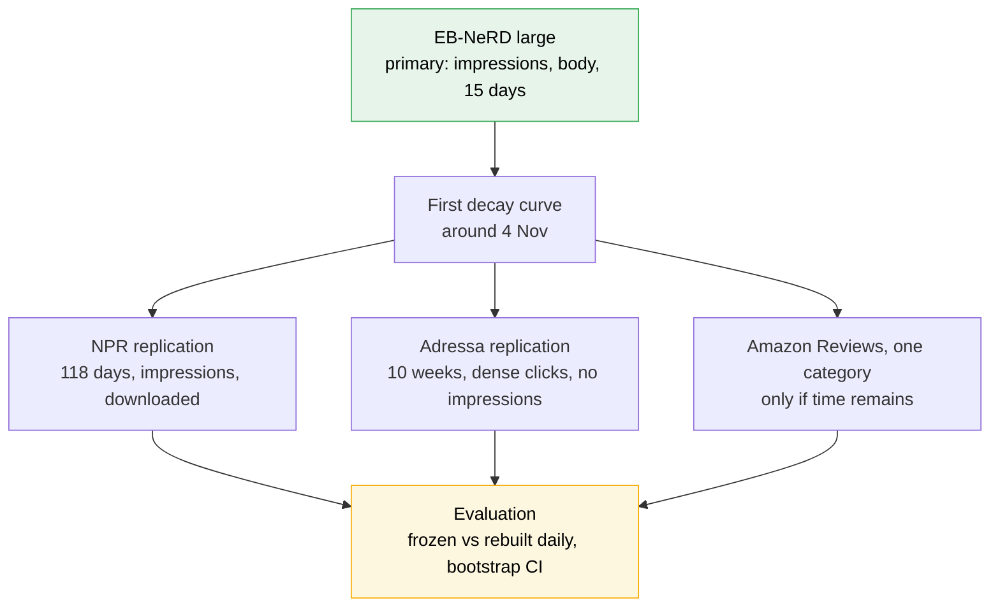

# Datasets for the temporal-decay study

Full per-dataset and per-day statistics are in [[dataset-stats]].

Which datasets can carry [[project_proposal_temporal_degradation|the news-staleness proposal]], what each
one actually contains, and what was rejected. Checked 2026-10-26. Items marked **measured** were read
from local files; items marked **documented** come from the dataset's own documentation; **unverified**
means taken from a secondary source or memory — confirm before citing.

## What a dataset must provide

1. Timestamped user interactions.
2. A publish or introduction time per item, to define "new article".
3. Item text, so the lexical and meaning signals exist (otherwise RQ2 shrinks).
4. A time span that matches how fast the domain moves.
5. For ranking metrics on logged candidates: impression lists. Without them the candidate pool has to be
   built (see *Evaluating without impressions*).

## The two datasets in play

### EB-NeRD large — primary *(measured)*

Location: **`data/ebnerd/large/`** in this project (copied 2026-10-27 from `Assignments/Assignment-1-Lexical-Semantic-Retrieval/data/work/ebnerd/large/`; the five parquet files, 3.4 GB, checksums identical). The unlabelled test set (1.8 GB) was not copied.

| Fact | Value |
|---|---|
| Labelled impressions | **2023-05-18 → 2023-06-01, 15 days** (train 18–25 May, validation 25 May–1 Jun) |
| Volume | 1.4–2.0 M impressions and 380–450 k users per day |
| Held-out test set | 1–8 Jun 2023, 13.5 M impressions, **no click labels** — not usable for ranking metrics |
| Click history (`history.parquet`) | per-click timestamps: train users 27 Apr–18 May, validation users 4–25 May, test users 11 May–1 Jun; median 80–92 clicks per user |
| Articles | 125 541; Danish title and body; `published_time` present; one outlier dated 1993 (filter); about 6 000 published in May 2023 |
| Strengths | impression lists, full text, persistent users, already loaded by the A1 pipeline |
| Limits | only 15 labelled days; Danish; one publisher |

### Adressa — optional replication *(documented: `cxdataset_v5.pdf`)*

Source: <https://reclab.idi.ntnu.no/dataset/> · licence CC BY-NC-SA 4.0 (non-commercial) · Norwegian ·
cite Gulla et al. (2017), *The Adressa dataset for news recommendation*, WI '17.

| Fact | Value |
|---|---|
| Span | **1 Jan → 31 Mar 2017, 10 weeks** (`three_month.tar.gz`, 16 GB compressed; `one_week.tar.gz`, 1.4 GB) |
| Scale | **measured on the full archive: 113.6 M events, 4 805 071 users, 81 019 distinct article ids** (documented figures were 27.2 M events, 3.08 M users, 48 486 articles; the difference is unexplained); about 22 % subscriber users (documented, one-week figure) |
| Format | JSON, saved one file per day |
| Event fields | `eventId`, `time` (Unix), `userId`, `sessionStart`, `sessionStop`, `activeTime` (seconds, if known), `os`, `deviceType`, `city`, `country`, `region`, `referrerUrl` |
| Article fields | `canonicalUrl`, `documentId`, `title`, `category`, `keywords`, `namedEntities`, `author`, **`publishTime`**, `profile` |
| **Not in the light version** | **article body** (on request, `reclab@idi.ntnu.no`; the full version keeps it in a separate `contentdata` folder) |
| **Absent altogether** | **impression lists** — click events only |
| Caveats | not every event has every field (a homepage visit has no article attributes); `activeTime` is missing when too short; `userId` is a cross-site identifier |

Consequences for the design:

- **Text signals run on title, keywords and named entities**, not body. Weaker than EB-NeRD. Ask for the
  body now; a reply can take days.
- **Candidates must be built**, not read from a log (next section).
- It gives the 10-week horizon the original proposal assumed, so rebuild intervals of 21 and 30 days become
  runnable again.

**Status (checked 2026-10-27, *measured*):** the archive is `data/three_month.tar.gz` (17.18 GB, not yet in `data/adressa/`), unextracted.
Reading it through `tar` ended with no error, so it is complete. **Converted 2026-10-27 to `data/adressa/parquet/`: 90 per-day parquet sets (339 files, all fields, 113 579 695 events, 3.11 GB), verified; see [[Subjects/IRE/Projects/IRE-Term-Project/log|log]] P23.** Uncompressed it is **154 GB** (90 files, 1.1–2.9 GB each), more than the free disk, so **do not extract it whole**; stream one day at a time.
Members are flat names `20170101` … `20170331`, 90 days with no gaps.

| Check | Result (days 2017-01-02, 02-13, 03-27 only) |
|---|---|
| Publish time | Present, but the field is named lowercase **`publishtime`**, on 87–99 % of article events (28–38 % of all events; the rest are front pages and similar with no article) |
| Text fields | `title`, `keywords`, `author`, `category1`, `profile` (weighted concepts, entities, sentiment, language), `canonicalUrl`, `id`. **No body** |
| 10 contiguous weeks | Yes, 2017-01-01 to 2017-03-31, no missing day |
| `userId` persistence | Yes: of the 310 255 users on 2 Jan, 106 478 (34 %) appear on 13 Feb and 80 202 (26 %) on 27 Mar |
| Events per day | 1.25–1.61 M, 237–310 k users; no unparsable lines |

Corrections to the field list above: the event carries `url`, `referrerHostClass` and `referrerSearchEngine` too, `category` is `category1`, named entities live inside `profile`, and not every article event has a keyword or category list. The publish-time *format* and the share of days with a plausible lag between publish and click are **not yet checked**.

### NPR (News Portal Recommendations, Globo) — second dataset candidate *(Kaggle metadata + **measured**)*

Source: Kaggle `joelpl/news-portal-recommendations-npr-by-globo` · paper: Pinho, Guedes & Freire, CEUR
Vol-3639 paper 6 · Portuguese, from the G1 portal · built "following the same structure as MIND" · **licence
CC BY-NC-SA 4.0** (Kaggle; non-commercial, share-alike — fine for coursework, same as Adressa).
Downloaded 2026-10-26 to `data/npr/` (`npr.zip`, 687 MB compressed; extracted to `data/npr/raw/`, 855 MB).

| Fact | Value (measured) |
|---|---|
| Span | **2023-01-03 → 2023-05-01 (UTC timestamps), 118 full days in local time** — the first and last timestamps are both about 03:00 UTC, i.e. midnight in Brasília (inferred, not documented); **116 of the 118 local days have data** — 2023-01-20 and 2023-04-27 have none (UTC dates showed no gap because of the 3-hour offset) |
| Impressions | **1 402 576**, **every one with exactly one click** (no un-clicked impressions in the file) |
| Candidate list | about **10 items** per impression (mean 9.99, max 40); the click's feed position is logged |
| Users per day (local day, *measured* 2026-10-27) | median **9 858**, mean 11 496, max 39 638; 112 days with 3 000+ impressions have a median of 9 962 and a minimum of 2 946; falls from a median of 11 917 a day in January to 7 282 in April |
| Users | 1 162 802; **71 % of impressions from non-logged users**; **82 % of users appear in exactly one impression** |
| History | `history` plus per-item `timestampHistory` (ms), clicks, time on page, scroll, visit count; median 6 items, mean 11.7; spans 3 Jan–1 May (nothing earlier than the window) |
| Articles | 148 099, `newsId`, `publishDate` (none missing), `title`, `titleCharCount`, `textCharCount`, `topics`; 100 % of clicked items are present |
| Publish dates | 2014–2023, but about 17–22 k articles per month in Jan–Apr 2023 (about 700 a day) |
| **Body text** | **Not released.** The listing holds only `articles_wobody_wourl.parquet` (no body, no URL); the description mentions a with-body file but it is not among the files, which sum exactly to the 896 MB total. Text signals are limited to **title and editorial topics**. |

Folder layout (`data/npr/raw/`): `articles/articles/articles_wobody_wourl.parquet` · `behaviors/behaviors_00…04.parquet` ·
`recommendations/recommendations/{algorithm impressions, articles, behaviors}/` (reduced files for the 92 700
sampled impressions with ALS, Recents and Top lists).

Behaviour columns: `impressionId`, `impressionTimestamp` (ms), `userId`, `userType` (Logged / Non-Logged), `algo`,
`clickedItem`, `clickedFeedPosition`, `positions`, `impressions`, `impressionsWithClick`, `historySize`, `history`,
`timestampHistory`, `numberOfClicksHistory`, `timeOnPageHistory`, `scrollPercentageHistory`, `pageVisitsCountHistory`.

What this means for the study:

- **The horizon problem is solved**: 118 days, impression lists, publish dates and timestamped history in one
  dataset. Neither EB-NeRD (15 days) nor Adressa (no impressions) has all of that.
- **News here is very short-lived**: the median clicked article is **0.58 days** (13.8 h) old at click, the 85th
  percentile 1.10 days, the 95th 2.64 days (*measured* 2026-10-27, publish date to click; an earlier run gave 0.54, 1.08 and 2.6). That is a strong staleness
  signal, and a ready model-free age curve. (The paper's "85 % within about 8–9.5 days" is a different
  measure — publish date to an article's *last* click.)
- **Per-day volume is modest and uneven**: median 10 254 impressions a day, max 45 160, falling from about
  180 k a week in January to about 50 k in April. Wide bootstrap CIs on a single day; pool days into windows.
- **Drop outage days** (under 3 000 impressions; dates here are UTC calendar dates, so the day boundary is offset 3 hours from the local day): 20 Jan, 12 Feb (11 impressions), 4–5 Mar, 5 Apr, 12 Apr, 15 Apr,
  27 Apr, plus the partial 1 May.

Cautions that change the design:

- **One production policy dominates.** 87 % of impressions are from `top-state` (a non-personalised, popularity-by-state
  list); `als` is 6.6 % (92 700), `recents` 5.5 %, `top` 0.7 % (and **absent in January**, appearing later). The
  mix shifts over time, which can masquerade as decay. Report decay **per `algo`** and keep the mix fixed in
  any headline curve; the ALS slice is only about 780 impressions a day.
- **Strong position bias.** 41 % of clicks are on feed position 1 and 28 % on position 2, so a position-only
  baseline is strong. Include it as a reference line, as with the recency scorer.
- **No negatives that were not clicked.** Every row holds one click among about 10 shown items, so the metric
  is "where does the clicked item rank among its list"; there is no impression without a click.
- **Mostly one-time users.** With 82 % of users in a single impression, personalisation relies on the timestamped
  `history`, not on repeat visits. Check how many users have non-empty history before building the
  click-history signal (zero-history rows were 0 in the file, median history is 6).
- **Text is thin**: Portuguese titles (about 15 words) and topics only; a multilingual encoder is needed for
  the meaning signal.

Verdict: **viable, and a stronger second dataset than Adressa for evaluation fidelity** (impressions, 118
days, timestamped history); weaker on text and on per-day volume, and confounded by the policy mix.

## Volume per day *(measured 2026-10-27 unless marked)*

| | EB-NeRD large | NPR | Adressa |
|---|---|---|---|
| Days with data | 14 full (+ 1 June partial: 450 k clicks, 168 k users) | 116 of 118 local days (none on 2023-01-20, 2023-04-27) | 90 (listing), 3 sampled |
| **Users per day** | **380–449 k** (full days) | median **9 858**, mean 11 496, max 39 638; Jan 11 917 → Apr 7 282 | **237–310 k** (3 days only) |
| **Clicks per day** | **1.43–2.01 M**, median about 1.8 M | median about **10 000**; Jan 12 380 → Apr 7 548 (one click per impression) | **340–502 k** article clicks of 1.25–1.61 M events (3 days only) |
| Clicks per user per day | about 4.2 | about 1 | about 1.6 (3 days only) |
| **Articles published per day** | median **162** (18–31 May), range 115–266 | median **750**, range 276–900; Jan 749, Feb 821, Mar 807, Apr 605 | about 540 a day on average (48 486 articles over 90 days, *documented*; counts articles seen in clicks, not a per-day publish count) |
| Time resolution | impression timestamps to the second | impression timestamps in ms | event `time` in Unix seconds |

Notes: the EB-NeRD publish times show a spike at 03:00 (2 194 articles against about 1 000 in other hours),
so some of them are probably batch or default timestamps; check before using hour-level publish time. NPR
outage days (under 3 000 impressions) are listed in the NPR section. Adressa per-day figures need one full
streaming pass before they are quoted for all 90 days.

## Evaluating without impressions

Impressions only supply the candidate list. Decay is the gap between a frozen model and one rebuilt daily,
and both can be scored on clicks alone:

1. At time *t*, the pool is every article with `publishTime ≤ t` that is plausibly live (for example
   published in the last 48 hours). Define "live" from **publish time only** — defining it from later clicks
   leaks the future.
2. Rank the full pool for each click from the user's earlier clicks. Use the full pool, not sampled
   negatives; sampled metrics can reorder systems.
3. Report a sensitivity check on the pool window, since it is now a design choice.

Costs: recency and popularity become strong baselines (keep the recency-only scorer as a reference line),
and a click may be on something never shown. Both the frozen and rebuilt models share that bias, so the
decay gap stays comparable; absolute scores do not compare to EB-NeRD's.

### Model-free stage

Clicks plus publish time also support measurements that need no model at all:

- **Article age curve** — clicks per hour against hours since `publishTime`. The decay Kille & Albayrak
  describe, and the mechanism behind staleness.
- **Unseen-click share** — the fraction of each day's clicks on articles published after the training
  cutoff. A click-history model cannot score these, so it bounds how much click-history quality survives.

Total clicks per day is **not** a substitute: traffic and weekday effects swamp any model signal.

## Other news datasets considered

| Dataset | Span and size | Interactions | Text | Verdict |
|---|---|---|---|---|
| **MIND** | labelled range 6.0 days (A1 finding F27) | clicks + impressions | title, abstract | Too short; no publish times. |
| **Globo.com** | 1–16 Oct 2017; about 3 M clicks, 46 k articles, 314 k users | clicks only | **embeddings only**, no text (licensing) | Weak. One 2025 source says it is no longer provided to researchers *(unverified)*. |
| **plista** | 70 353 articles, 13 German portals; 1.1 M click logs | clicks | articles | Short; current availability not confirmed. |
| **NPR** | 3 Jan → 1 May 2023, 118 local days (*measured*) | impressions (one click each) + timestamped history | title and topics; **no body** | **Downloaded and checked — see the NPR section.** |
| **xMIND** | derived from MIND, 14 languages (machine-translated) | as MIND | translated | Inherits MIND's 6-day limit. |

No larger **public** news dataset with user clicks turned up. Yahoo- and Bing-scale logs are not open.
News archives without users (Common Crawl news, GDELT, the NYT corpus) exist but were not checked for
terms or size.

## Other forms of temporal decay

| Form of decay | Datasets | Fit |
|---|---|---|
| **Recommender staleness** (the plan) | EB-NeRD, Adressa | Best fit. |
| **Retrieval persistence** — a frozen retriever on a changing document and query set | **LongEval** (CLEF, built on Qwant logs). 2023: 1.59 M documents, 882 queries. 2025 edition reportedly about 18 M documents in monthly snapshots *(secondary source, unverified)*. French with English translations; soft labels from a click model; non-commercial licence. | Built for this question, but queries not users, so no click-history signal; it would also replace the submitted proposal and has published prior work. Cite it as related work. |
| **Slow-churn recommendation** — same design, months-to-years scale | **Amazon Reviews 2023**: 570 M+ reviews, 33 categories, to Sep 2023; review text, item descriptions, timestamps (13 digits, likely ms — check). Paper: arXiv 2403.03952. | Supports all three signals and gives a fast-vs-slow contrast with news (`project-ideas` Candidate 7). Reviews are explicit, not clicks. Use **one category** for compute. |
| **Music listening drift** | **Yambda** (Yandex): 4.79 B events, about 1 M users, 10 months; listens, likes, `is_organic`; 50 M, 500 M and 5 B versions; Parquet on Hugging Face. | Strong for click history. No track text found, so no lexical signal. Use the 50 M version. |
| **Movies** | Netflix Prize; MovieLens | Netflix: **rejected** — see below. MovieLens is the better movie choice *(from memory, not checked this session)*. |
| **Text drift on a long archive** | **TREC Washington Post collection**: about 728 626 articles, Jan 2012–Dec 2020 (NIST page; the TAC page lists a larger 840 000-article range to 2022, so ask which release you would get). Full body text and publish dates; relevance judgements from the News Track. | Text signals only — no click logs, so RQ2's click-history arm cannot run. Access needs signed organisational and individual agreements sent to NIST, with up to 7 business days for approval, and redistribution is restricted. Not worth the delay for a 25-day window. |
| **Information cascades** | **PGNSC** (ACL 2024) | **Not verified.** Only the paper title turned up; no dataset page or field list was found, so the details in the pasted summary are unconfirmed. By its own description it is a link-prediction benchmark, so it would not fit a recommender pipeline. Not used. |
| **Vocabulary and embedding drift** | any timestamped text, for example **FNSPID** (15.7 M financial news records and 29.7 M price records, 1999–2023, CC BY 4.0, Hugging Face) | Measures how the text changes (new-term rate, embedding drift), not ranking decay. No users, no relevance labels. |

### Netflix Prize — rejected

- Records are only `CustomerID, Rating, Date` plus a separate `MovieID, Year, Title` file. No plot, genre or
  text, so the lexical and meaning signals reduce to titles and RQ2 loses its point.
- Dates run 1998–2005 at day resolution; users backfilled ratings in bursts, so the date is a poor proxy
  for when something was consumed. Movie catalogues also churn far more slowly than news.
- The Kaggle copy is third-party; the Prize data was withdrawn after de-anonymisation research and a
  lawsuit *(from memory; current licence not verified)*. Not worth the risk in a graded report.

### Financial news

FNSPID is the only large open financial news set found. It has no clicks and no relevance labels. Using
price moves as labels would be inventing a task, so it is not recommended beyond text-drift measurement.
(The "29 M" figure belongs to the price records, not the news.)

## Kaggle search for other news datasets — nothing new with clicks, text and dates

Searched 2026-10-26 through the Kaggle API (six queries: news recommendation, clicks, impressions, user
interactions, clickstream, sessions, reading behaviour; 44 unique results). Only metadata and file lists were
read; nothing was downloaded.

| Dataset | What it is | Verdict |
|---|---|---|
| `joelpl/news-portal-recommendations-npr-by-globo` | NPR | Already in use — see above. |
| `gspmoreira/news-portal-user-interactions-by-globocom` | The older Globo set: 16 days, 377 MB, CC BY-NC-SA | Superseded by NPR; embeddings only, no text. |
| `arashnic/mind-news-dataset`, `vimalkumarnarasiman/news-recommendation-dataset` | **Mirrors of MIND** (small), 65–160 MB. The second labels itself Apache 2.0, which is not MIND's licence. | No gain: MIND's 6-day labelled range and no publish times. |
| `somumourya/news-recommendation-dataset` | One `News.csv`, 31 MB, **no description, unknown licence** | Unverified; do not use without opening it. |
| `xiaojiu1414/digix-global-ai-challenge` | Huawei DIGIX 2022: ads CTR task with a **news-feed source domain** (1.6 GB feeds file) | Anonymised categorical IDs only (category, source, entity IDs) — **no article text**. `i_upTimes` is a like count, not an upload time. Licence unknown, competition data. Not suitable. |
| `shrikrishnaparab/articles` | IBM Watson articles and user interactions, 4.5 MB of interactions | Small, no timestamps; not a decay study. |
| `georgesaavedra/news-popularity-in-social-media-platforms` | UCI: about 93 k news items, Nov 2015–Jul 2016, title, publish date, final Facebook/Google+/LinkedIn popularity | Item popularity only — **no users**, and this copy has the final value, not a time series. |
| `colabsss/news-communication-effects-dataset` | 100 000 records, 47 columns incl. user, clicks, dwell time, China regions | **No provenance given**, uploaded 2026; looks generated rather than logged. Avoid. |
| `colabsss/digital-publishing-marketing-dataset`, `visionlangai/sports-engagement-dataset` | Small tabular sets | No provenance; skip. |

**Text-only archives** — usable for vocabulary and embedding drift (proposal section 6.4), never for ranking decay,
because they have no users:

| Dataset | Span | Notes |
|---|---|---|
| `aryansingh0909/nyt-articles-21m-2000-present` | 2000–present, 2.1 M articles, 4.6 GB CSV, listed CC0 | NYT article **metadata**; check the NYT API terms despite the CC0 label. |
| `rmisra/news-category-dataset` | HuffPost headlines 2012–2022, CC BY 4.0 | Headline, category, date. |
| `amirhoseindabbaghi/zoomit-articles-dataset-2010-2024` | Persian tech news 2010–2024, 730 MB, CC BY-SA | Text only. |
| `laveshjadon/news-nlp-features-dataset` | Indian stock-market news 2016–2026, 0.7 MB | Small. |

**Read it as:** Kaggle holds no news dataset that has clicks, article text and publish dates at a usable span
beyond NPR (titles only) and EB-NeRD. The rest are mirrors of MIND, text archives or datasets with no
provenance. The earlier plan stands.

## The `irgroup/datasets` catalogue — checked, nothing to add

<https://github.com/irgroup/datasets> is an **index of what the TH Köln IR group keeps on its own server**.
The binaries are git-ignored, so the repo holds only READMEs; there is no data to download from it. Entries
were read one by one against this project's needs (timestamped interactions, item text, publish time):

| Entry | What it is | Why it does not help here |
|---|---|---|
| **TripClick** (2021) | Click log of the Trip health search engine, 2013–2020, about 5.2 M clicks, 32.7 GB | Search, not recommendation; README does not say records carry timestamps or whether text is included; access needs a **signed request form**, and trained models cannot be shared publicly without the owners' permission. |
| **Yandex Personalized Web Search** (2014) | 27 training days + 3 test days, 34.6 M sessions, 5.7 M users | Only **relative** time units and **anonymised numeric IDs** — no query or document text, so the lexical and meaning signals cannot exist. |
| **Yahoo-L18** | One month of search logs with relevance judgements | Query text and URLs but **no timestamps** mentioned and no document content; needs a signed Yahoo! Webscope agreement. |
| **TREC-OpenSearch** (2016/17) | Living-labs click logs on two academic search sites | Small, a few rounds, timestamps and sizes not stated. |
| **AOL** (2006) | Query log, about 20 M queries from about 650 k users over three months (Mar–May 2006). The Kaggle copy `dineshydv/aol-user-session-collection-500k` is a **third-party re-upload of one file of ten** (`user-ct-test-collection-02.txt`, 226 MB), licence "Other". Fields: `AnonID`, `Query`, `QueryTime`, `ItemRank`, `ClickURL` (domain only). | Rejected. No document text, no publish dates and no item catalogue — only a query string and a clicked **domain**, so the three signals cannot be built. It is a search log, not a news or item recommender. The original release was withdrawn over privacy after users were re-identified, and the data is unfiltered and sexually explicit. Not suitable for a graded report. |
| **Washington Post v1/v4, NYT, AQUAINT, TREC disks, Tipster** | News and document collections | Text only, no user clicks; licensed (NIST/LDC), and the copies sit on the group's server. Same limits as the Washington Post row above. |

**Read it as:** this is a list of search and document-test collections, not news recommendation logs. It
adds no dataset with clicks, item text and publish dates at a news timescale that beats NPR, EB-NeRD or
Adressa. Its only use is as a pointer to originals (TripClick, Webscope), each behind an agreement that
would not clear in 25 days.

## Decision

**Read it as:** EB-NeRD carries the study; a second dataset is added only after the first curve exists, and
at most one. The choice is **NPR** (keeps the impression-based protocol, long span, but thin per day and
mostly anonymous) versus **Adressa** (dense clicks and 90 days, but candidates must be built and the text is
title-and-keywords). Decide after inspecting both files. LongEval, Yambda, FNSPID, Washington Post, PGNSC
and Netflix are not used.

## Open items

- [x] NPR: file sizes, schema, licence, history timestamps — checked and downloaded 2026-10-26.
- [ ] Email the Adressa maintainers for article text.
- [ ] Run the four Adressa checks when the copy lands.
- [ ] Check A1's embedding store covers the EB-NeRD articles needed.
- [ ] Decide whether to add Amazon Reviews after the first decay curve.

## Sources

- Adressa: [dataset page](https://reclab.idi.ntnu.no/dataset/), [field description](https://reclab.idi.ntnu.no/dataset/cxdataset_v5.pdf)
- [Amazon Reviews 2023](https://huggingface.co/datasets/McAuley-Lab/Amazon-Reviews-2023)
- [LongEval-Retrieval, arXiv 2303.03229](https://arxiv.org/abs/2303.03229) · [2025 edition summary](https://www.emergentmind.com/topics/longeval)
- [Yambda, arXiv 2505.22238](https://arxiv.org/pdf/2505.22238)
- [Globo.com](https://ml.paperswithcode.com/dataset/news-interactions-on-globo-com)
- NPR: [paper, CEUR Vol-3639](https://ceur-ws.org/Vol-3639/paper6.pdf) · [Kaggle](https://www.kaggle.com/datasets/joelpl/news-portal-recommendations-npr-by-globo)
- [TREC Washington Post corpus](https://trec.nist.gov/data/wapost/)
- [FNSPID, arXiv 2402.06698](https://arxiv.org/pdf/2402.06698)
- [News recommendation dataset survey, arXiv 2509.12361](https://arxiv.org/pdf/2509.12361)
- [Netflix Prize](https://en.wikipedia.org/wiki/Netflix_Prize)

---
[[IRE-Term-Project|← tracking note]] · [[project_proposal_temporal_degradation|proposal (revised)]] · [[project_proposal_temporal_degradation_v1_submitted|proposal (as submitted)]] · [[project-ideas|full analysis]] · [[Subjects/IRE/_syllabus|IRE course plan]]
